<div class="flex items-center gap-4 w-full">
  
  <span class="ud-pill">Desarrollo Web en Entorno Servidor · 2DAW · 2026-2027</span>
</div>

# Introducción al desarrollo<br>de software en servidor

### Parte 1: desarrollo web en entorno servidor

<div class="mt-10 flex items-end justify-between w-full">
  <div class="text-left">
    <b class="text-lg">José Luis González Sánchez</b><br/>
    <span class="opacity-70">IES Luis Vives · Leganés</span>
  </div>
  <PacMan :size="54" label="Preparando la aplicación..." />
</div>

---

## 📦 Materiales de la unidad

Todo el material de la UD01 está publicado en el repositorio de GitHub, organizado por carpetas:

<div class="grid grid-cols-2 gap-6 items-start">
<div>

- 📚 **10 puntos** — fundamentos y ejemplos
- 📝 **Prácticas** — actividades en `practicas/`
- 💻 **Soluciones** — proyectos en `soluciones/`
- 🖼️ **Imágenes y recursos** — en `images/`
- 🎬 **Vídeos** — lista en YouTube

</div>
<div class="flex flex-col items-center justify-center gap-4 pt-4">
<div class="flex flex-col items-center gap-1 text-sm">
  <span class="text-xs opacity-70">Repositorio con materiales de la unidad</span>
  <RepoBadge />
</div>

<div class="text-sm opacity-75 text-center max-w-55">

Clónalo, forquéalo o descárgalo en zip: el material siempre está a un clic.

</div>
</div>
</div>

---

## 🎯 Resultado de aprendizaje: RA 1

<RaaCcee
  code="RA 1"
  title="Selecciona las arquitecturas y tecnologías de programación web en entorno servidor, analizando sus capacidades y características propias."
  :letters="['a', 'b', 'c', 'd', 'e', 'f', 'g']"
  :ccee="[
    'Se han caracterizado y diferenciado los modelos de ejecución de código en el servidor y en el cliente web.',
    'Se han reconocido las ventajas que proporciona la generación dinámica de páginas.',
    'Se han identificado los mecanismos de ejecución de código en los servidores web.',
    'Se han reconocido las funcionalidades que aportan los servidores de aplicaciones y su integración con los servidores web.',
    'Se han identificado y caracterizado los principales lenguajes y tecnologías relacionados con la programación web en entorno servidor.',
    'Se han verificado los mecanismos de integración de los lenguajes de marcas con los lenguajes de programación en entorno servidor.',
    'Se han reconocido y evaluado las herramientas y frameworks de programación en entorno servidor.',
  ]"
/>

---

## 📚 Parte 1: fundamentos (1/2)

<div class="grid grid-cols-2 gap-3">

<TopicCard :num="1" title="Introducción al desarrollo web" desc="Cliente y servidor" />
<TopicCard :num="2" title="Componentes de una web" desc="Front-end y back-end" />
<TopicCard :num="3" title="Arquitecturas web" desc="Capas, MVC y SOLID" />
<TopicCard :num="4" title="HTTP y HTTPS" desc="Peticiones y respuestas" />
<TopicCard :num="5" title="Servicios web y APIs" desc="REST, GraphQL y WebSocket" />

</div>

---

## 📚 Parte 1: fundamentos (2/2)

<div class="grid grid-cols-2 gap-3">

<TopicCard :num="6" title="Web dinámica" desc="Generación de contenido" />
<TopicCard :num="7" title="Lenguajes y frameworks" desc="Tecnologías de servidor" />
<TopicCard :num="8" title="Servidores web" desc="Apache, Nginx y Kestrel" />
<TopicCard :num="9" title="Despliegue" desc="Contenedores, nube y CI/CD" />
<TopicCard :num="10" title="Seguridad y monitorización" desc="Acceso, protección y registros" />

</div>

---
layout: section
---

<div class="ud-section-number">01</div>

# Introducción al desarrollo web

<div class="opacity-70">Lo que ocurre detrás de la aplicación</div>

---

## 1 · Punto de partida

<div class="grid grid-cols-2 gap-5 items-start">
<div>

<TipBox type="consejo" title="Punto de partida">

Cuando envías un formulario o abres tu perfil en Instagram, ¿qué ocurre después de pulsar el botón?

</TipBox>

<TipBox type="analogia">

Como en un restaurante, el cliente hace un pedido y la cocina prepara la respuesta.

</TipBox>

</div>
<div>

<Objetivos :items="[
  'Comprender el desarrollo web en servidor',
  'Distinguir front-end y back-end',
  'Reconocer dónde se ejecuta cada parte',
  'Entender el despliegue a producción',
]" />

</div>
</div>

---

## 🌐 ¿Qué hay detrás de una aplicación web?

La aplicación combina interfaz, lógica, datos e infraestructura. Cada parte tiene una responsabilidad.

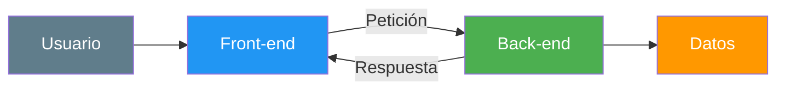

En Netflix, el servidor consulta el catálogo y las preferencias para devolver una respuesta al cliente.

---

## 🧩 El desarrollo web es más que una interfaz

<div class="grid grid-cols-2 gap-5 items-center">
<div>

- El front-end presenta la información.
- El back-end aplica reglas y gestiona datos.
- El despliegue hace accesible el resultado.

Todos deben funcionar juntos para ofrecer el servicio.

</div>
<div>


</div>
</div>

---

## 🖥️ Front-end y back-end

| | Front-end | Back-end |
|---|---|---|
| **Dónde** | Navegador del usuario | Servidor |
| **Tecnologías** | HTML, CSS y JavaScript | C#, Java, Python y PHP |
| **Responsabilidad** | Interfaz e interacción | Reglas de negocio y datos |
| **Ejemplo** | Comprobar un campo vacío | Guardar un usuario |

<TipBox type="advertencia">

La validación del navegador mejora la experiencia, pero el servidor también debe validar los datos.

</TipBox>

---

## 🍽️ Cliente y servidor: la analogía

<div class="grid grid-cols-2 gap-5 items-start">
<div>

<ConceptCard icon="👤" title="Cliente" accent="blue">

El usuario consulta el menú y hace un pedido. El navegador recoge la petición y la envía.

</ConceptCard>

</div>
<div>

<ConceptCard icon="👨‍🍳" title="Servidor" accent="green">

La cocina comprueba los ingredientes, prepara el plato y devuelve el resultado.

</ConceptCard>

</div>
</div>

La base de datos hace el papel de despensa: contiene la información que el servidor necesita.

---

## 🔁 El recorrido de una petición

<div class="w-full mx-auto max-w-140">

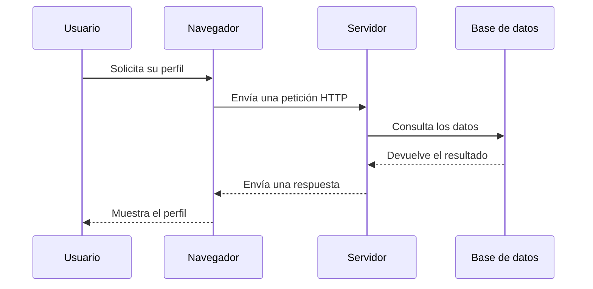

</div>

La petición viaja desde el cliente; el servidor procesa los datos y devuelve una respuesta.

---

## 📷 Instagram: ¿qué hace cada parte?

<div class="grid grid-cols-2 gap-5 items-center">
<div>

1. El navegador recibe HTML, CSS y JavaScript.
2. JavaScript solicita datos al servidor.
3. El servidor consulta fotos y seguidores.
4. El navegador presenta los datos recibidos.

</div>
<div>

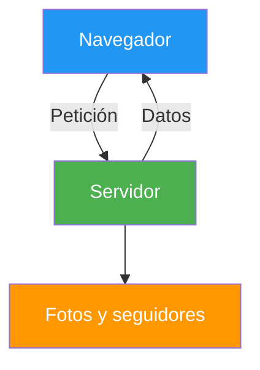

</div>
</div>

El servidor puede responder con JSON; el navegador decide cómo presentar esa información.

---

## ⚙️ ¿Dónde se ejecuta el código?

<div class="grid grid-cols-2 gap-5 items-start">
<div>

<ConceptCard icon="🖥️" title="En el navegador" accent="blue">

- HTML: estructura.
- CSS: presentación.
- JavaScript: interacción y validaciones.

</ConceptCard>

</div>
<div>

<ConceptCard icon="⚙️" title="En el servidor" accent="green">

- Aplica reglas de negocio.
- Consulta y modifica datos.
- Genera contenido personalizado.

</ConceptCard>

</div>
</div>

En Gmail, el servidor obtiene los mensajes; el navegador puede comprobar un campo obligatorio antes de enviarlo.

---

## 📡 Una petición a un servicio C#

El endpoint se ejecuta en el servidor y devuelve un saludo construido con el nombre recibido:

```csharp
var builder = WebApplication.CreateBuilder(args);
var app = builder.Build();

app.MapGet("/saludo/{nombre}", (string nombre) =>
{
    return $"¡Hola {nombre}! Bienvenido al Desarrollo Web en Entorno Servidor.";
});

app.Run();
```

Al solicitar `/saludo/Ana`, el cliente recibe el saludo; el código C# no se ejecuta en el navegador.

---

## 👥 Un servidor también puede devolver datos

Esta ruta devuelve una lista de usuarios:

```csharp
app.MapGet("/usuarios", () =>
{
    var usuarios = new[]
    {
        new { Id = 1, Nombre = "Ana", Email = "ana@email.com" },
        new { Id = 2, Nombre = "Carlos", Email = "carlos@email.com" }
    };
    return usuarios;
});
```

La ruta recibe la petición y devuelve los datos. En este ejemplo la colección está en memoria: no se está consultando una base de datos real.

---

## 🚀 Del desarrollo a producción

Desplegar es llevar la aplicación a un entorno donde sus usuarios puedan utilizarla.

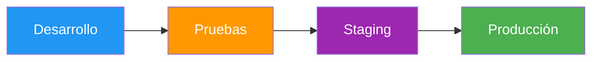

El despliegue también comprende configuración, pruebas y monitorización. Un entorno de preproducción permite comprobar la versión antes de publicarla.

---

## 🧪 ¿Qué se hace en cada entorno?

| Entorno | Función | Ejemplos del tema |
|---|---|---|
| **Desarrollo** | Crear y modificar la aplicación | Rider, VS Code y Git |
| **Pruebas** | Comprobar el comportamiento | NUnit, Moq y Selenium |
| **Staging** | Probar en condiciones próximas a producción | Docker y Compose |
| **Producción** | Ofrecer el servicio a sus usuarios | Azure, AWS y Docker |

El despliegue continuo automatiza pruebas y publicación según el proceso configurado.

<TipBox type="nota" title="¿Por qué separar entornos?">

Un error detectado en pruebas o *staging* puede corregirse antes de que afecte a los usuarios de producción.

</TipBox>

---

## 🐤 Publicación progresiva

Una versión no tiene por qué llegar a todos los usuarios de golpe.

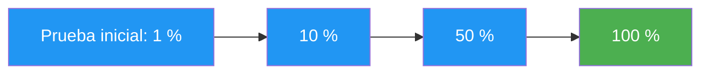

En un despliegue *canary*, se observa el resultado antes de ampliar la publicación.

---

## 🎯 ¿Qué buscamos con el despliegue?

| Objetivo | Pregunta |
|---|---|
| **Accesibilidad** | ¿Pueden utilizar la aplicación sus usuarios? |
| **Estabilidad** | ¿Funciona sin interrupciones graves? |
| **Escalabilidad** | ¿Puede crecer cuando aumenta la demanda? |
| **Seguridad** | ¿Están protegidos los datos y servicios? |

<TipBox type="advertencia">

No despliegues directamente a producción sin haber probado antes la versión.

</TipBox>

---

## Resumen del punto 1

<div class="grid grid-cols-2 gap-5 items-start">
<div>

| Concepto | Descripción |
|---|---|
| Front-end | Interfaz en el navegador |
| Back-end | Lógica y datos en el servidor |
| HTTP | Comunicación entre cliente y servidor |
| Despliegue | Paso de desarrollo a producción |
| Escalabilidad | Capacidad de crecer con la demanda |

</div>
<div>

<ConceptCard icon="✅" title="Buenas prácticas" accent="green">

- Separa interfaz y lógica.
- Valida también en el servidor.
- Prueba antes de publicar.
- Protege los datos y servicios.

</ConceptCard>

**⏭️ ¿Qué viene después?** Los componentes de una aplicación web.

</div>
</div>

---
layout: section
---

<div class="ud-section-number">02</div>

# Componentes de una aplicación web

<div class="opacity-70">Un servidor, distintos clientes</div>

---

## 2 · Punto de partida

<div class="grid grid-cols-2 gap-5 items-start">
<div>

<TipBox type="consejo" title="Punto de partida">

Puedes usar Netflix desde el navegador, el móvil o una televisión. ¿Necesita cada dispositivo un back-end distinto?

</TipBox>

<TipBox type="analogia">

Un restaurante puede atender en el local, preparar comida para llevar o entregarla a domicilio.

</TipBox>

</div>
<div>

<Objetivos :items="[
  'Identificar los componentes de cada entorno',
  'Explicar por qué un back-end sirve a varios clientes',
  'Distinguir una página de una aplicación web',
  'Reconocer tecnologías de cliente y servidor',
]" />

</div>
</div>

---

## 🧩 Componentes y responsabilidades

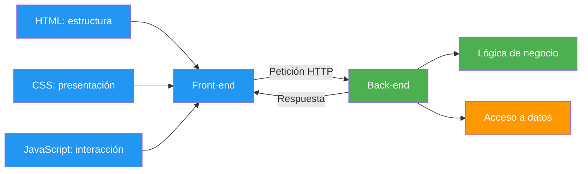

Una API ofrece operaciones al cliente; los datos pueden viajar en formatos como JSON o XML.

---

## 📱 Un back-end para varios clientes

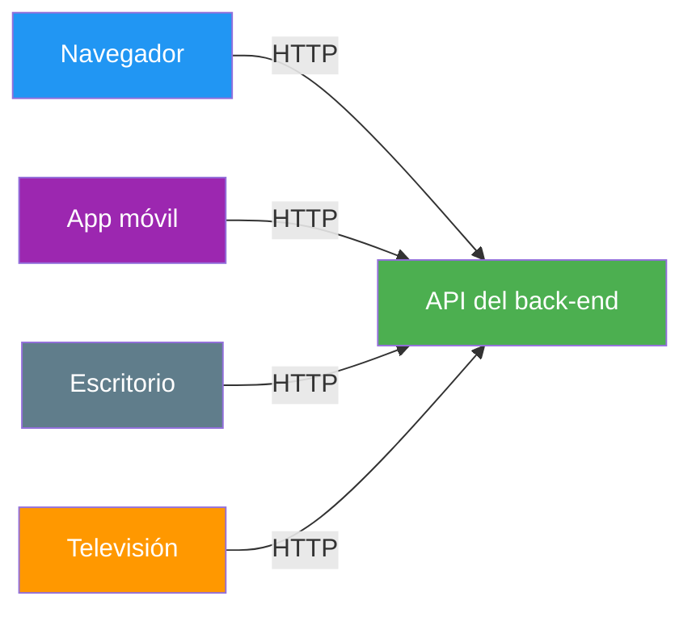

Un mismo servicio puede atender a clientes diferentes si estos saben comunicarse con su API.

---

## 🎬 Netflix en distintos dispositivos

<div class="grid grid-cols-2 gap-5 items-start">
<div>

<ConceptCard icon="📱" title="Distintos clientes" accent="blue">

- Navegador web.
- Aplicación para móvil.
- Televisión inteligente.
- Consola de videojuegos.

</ConceptCard>

</div>
<div>

<ConceptCard icon="⚙️" title="Servicios de back-end" accent="green">

Procesan las peticiones y proporcionan los datos que cada cliente necesita presentar.

</ConceptCard>

</div>
</div>

Ser independiente de un cliente concreto no significa que todos deban mostrar la misma interfaz.

---

## 📄 Página web y aplicación web

| | Página web | Aplicación web |
|---|---|---|
| **Enfoque** | Presentar un documento | Ofrecer una herramienta interactiva |
| **Interacción** | Consulta de contenido | Búsqueda, escritura o compra |
| **Datos** | Pueden ser estáticos | Frecuentemente personalizados |
| **Ejemplos** | Porfolio o página informativa | Gmail, Instagram o Amazon |

Una aplicación web puede incluir páginas; un sitio web puede reunir páginas y funcionalidades interactivas.

<TipBox type="nota" title="Ejemplo">

Una página informativa muestra una oferta; una aplicación permite buscar, iniciar sesión e inscribirse en ella.

</TipBox>

---

## 🔎 InfoJobs: de la página a la aplicación

Al buscar ofertas, el cliente envía los filtros y el servidor procesa la consulta.

<div class="w-full mx-auto max-w-140">

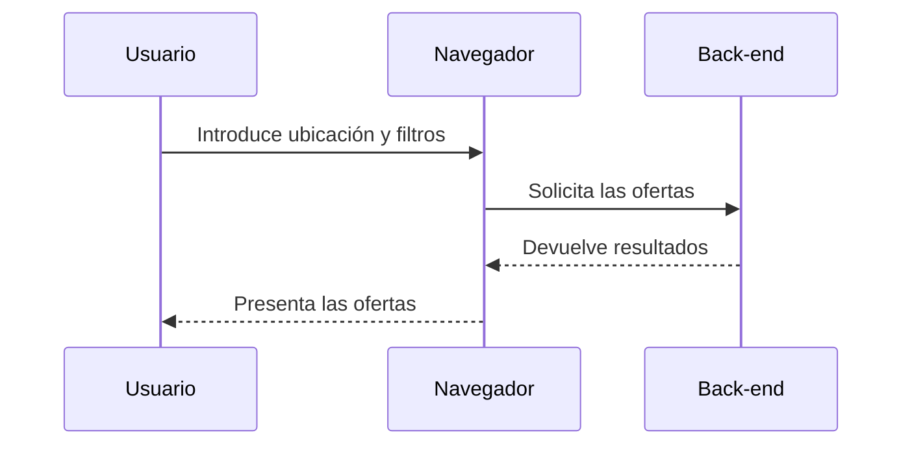

</div>

El registro, el envío de un CV y la inscripción en ofertas añaden interacción y procesamiento de datos.

---

## Resumen del punto 2

<div class="grid grid-cols-2 gap-5 items-start">
<div>

| Concepto | Descripción |
|---|---|
| Front-end | Presentación e interacción |
| Back-end | Lógica y acceso a datos |
| API | Interfaz para solicitar servicios |
| Página web | Documento mostrado por un navegador |
| Aplicación web | Herramienta que procesa interacciones |

</div>
<div>

<ConceptCard icon="✅" title="Buenas prácticas" accent="green">

- Separa presentación y lógica.
- Diseña servicios para distintos clientes.
- Documenta la API.

</ConceptCard>

**⏭️ ¿Qué viene después?** Arquitecturas de aplicaciones web.

</div>
</div>

---
layout: section
---

<div class="ud-section-number">03</div>

# Arquitecturas web

<div class="opacity-70">Organizar las piezas y sus responsabilidades</div>

---

## 3 · Punto de partida

<div class="grid grid-cols-2 gap-5 items-start">
<div>

<TipBox type="consejo" title="Punto de partida">

Una casa necesita un plano antes de levantar paredes. Una aplicación también necesita decidir cómo se organizan y comunican sus piezas.

</TipBox>

<TipBox type="analogia">

En una biblioteca, el lector solicita un libro y el bibliotecario lo busca y registra.

</TipBox>

</div>
<div>

<Objetivos :items="[
  'Explicar el modelo cliente-servidor',
  'Comparar monolitos, capas, microservicios y serverless',
  'Identificar modelo, vista y controlador',
  'Aplicar los principios SOLID al diseño',
]" />

</div>
</div>

---

## 🏛️ Arquitectura cliente-servidor

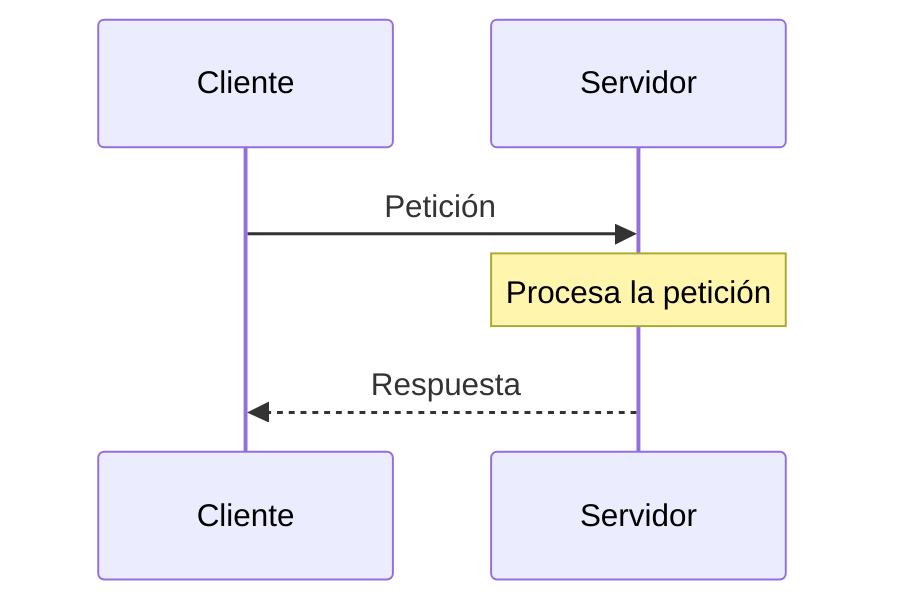

El cliente solicita un servicio. El servidor escucha, realiza el trabajo necesario y responde; distintos clientes pueden compartir ese servicio.

---

## ⚖️ ¿Qué aporta esta separación?

| Ventaja | Qué significa |
|---|---|
| **Centralización** | La lógica y los datos pueden gestionarse desde el servidor |
| **Mantenimiento** | Actualizar el servidor no exige reinstalar todos los clientes |
| **Seguridad** | El acceso a los datos se controla en el servidor |
| **Escalabilidad** | Pueden incorporarse servidores para atender más demanda |

<TipBox type="nota">

Centralizar también exige cuidar la disponibilidad y proteger el servidor: la arquitectura por sí sola no garantiza seguridad.

</TipBox>

---

## 📦 Arquitectura monolítica

Un monolito agrupa las funcionalidades de la aplicación en una unidad de despliegue. Puede estar bien organizado internamente en capas.

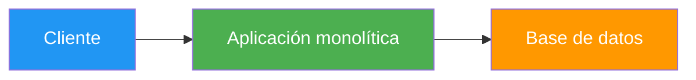

Es sencillo empezar y desplegar una sola aplicación. Al crecer, una modificación puede exigir volver a desplegar el conjunto.

---

## 🧱 Arquitectura por capas

Cada capa concentra una responsabilidad y utiliza la que necesita para realizar su trabajo.

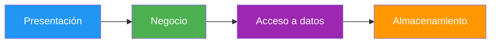

Un monolito puede usar capas: **distribución en despliegues** y **separación de responsabilidades** no son la misma decisión.

---

## 🗂️ ¿Qué hace cada capa?

| Capa | Responsabilidad | Ejemplos |
|---|---|---|
| **Presentación** | Recibe y presenta información | HTML, CSS, Razor |
| **Negocio** | Aplica reglas y coordina operaciones | Servicios C# |
| **Acceso a datos** | Consulta o modifica la información | EF Core, Dapper |
| **Datos** | Almacena la información | PostgreSQL, MongoDB |

Separar capas facilita localizar dónde debe cambiar una regla sin mezclarla con la vista.

<TipBox type="nota" title="Ejemplo">

Al crear un pedido, presentación recibe los datos, negocio comprueba las reglas y acceso a datos guarda el resultado.

</TipBox>

---

## 🧩 Arquitectura de microservicios

<div class="w-full mx-auto max-w-140">

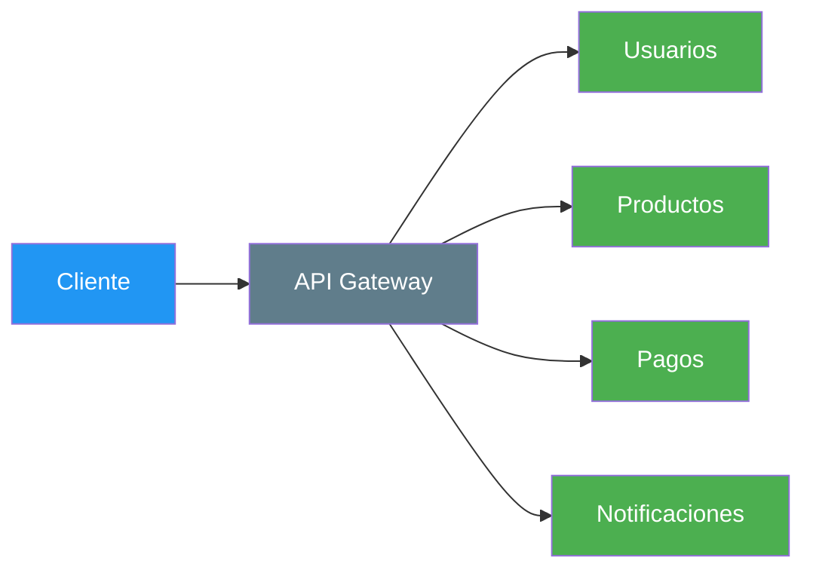

</div>

Los servicios se despliegan de forma independiente y se comunican a través de la red. Esta distribución añade coordinación, observabilidad y posibles fallos de comunicación.

---

## 🎬 Microservicios: autonomía y costes

<div class="grid grid-cols-2 gap-5 items-start">
<div>

<ConceptCard icon="✅" title="Ventajas" accent="green">

- Despliegue independiente por servicio.
- Escalado de las partes más demandadas.
- Equipos con responsabilidades diferenciadas.

</ConceptCard>

</div>
<div>

<ConceptCard icon="⚠️" title="Complejidad" accent="yellow">

- Comunicación y fallos de red.
- Coordinación entre servicios.
- Más despliegues y monitorización.

</ConceptCard>

</div>
</div>

En el ejemplo de Netflix se separan funcionalidades como búsqueda y recomendaciones. La independencia reduce el alcance de algunos fallos, pero no elimina todas las dependencias.

---

## ☁️ Serverless: el servidor sigue existiendo

En serverless el proveedor gestiona la infraestructura; el equipo se centra en el código y la configuración.

| Pregunta | Respuesta |
|---|---|
| ¿Hay servidores? | Sí, pero no los administras directamente |
| ¿Cuándo se ejecuta? | Ante una petición o evento configurado |
| ¿Ejemplos? | Azure Functions y AWS Lambda |
| ¿Cuándo puede ayudar? | Trabajos basados en eventos o demanda variable |

La facturación depende del servicio contratado: revisa sus límites, tiempos y costes.

---

## 🧭 Comparar arquitecturas

| Opción | Unidad de despliegue | Cuándo considerarla |
|---|---|---|
| **Monolito** | Una aplicación | Empezar con menor complejidad operativa |
| **Capas** | Organización interna | Separar presentación, negocio y datos |
| **Microservicios** | Servicios independientes | Necesidades de autonomía y escalado diferenciado |
| **Serverless** | Funciones gestionadas | Procesamiento dirigido por eventos |

No son etiquetas excluyentes: una aplicación monolítica puede estar organizada en capas.

<TipBox type="nota" title="Una decisión práctica">

Un proyecto pequeño puede empezar como monolito por capas y separar servicios cuando exista una necesidad real de autonomía.

</TipBox>

---

## 🧩 MVC: modelo, vista y controlador

| Pieza | Responsabilidad | Ejemplo en ASP&#46;NET Core |
|---|---|---|
| **Modelo** | Representa datos y reglas | `Persona.cs`, `Producto.cs` |
| **Vista** | Presenta información | `Index.cshtml`, `Create.cshtml` |
| **Controlador** | Recibe peticiones y coordina | `PersonasController.cs` |

MVC organiza la interacción con el usuario. No sustituye a una base de datos ni decide por sí solo cuántos servicios se despliegan.

<TipBox type="nota" title="Ejemplo">

El controlador solicita un producto al modelo y entrega sus datos a una vista que genera la página.

</TipBox>

---

## 🔁 El recorrido de una petición en MVC

<div class="w-full mx-auto max-w-140">

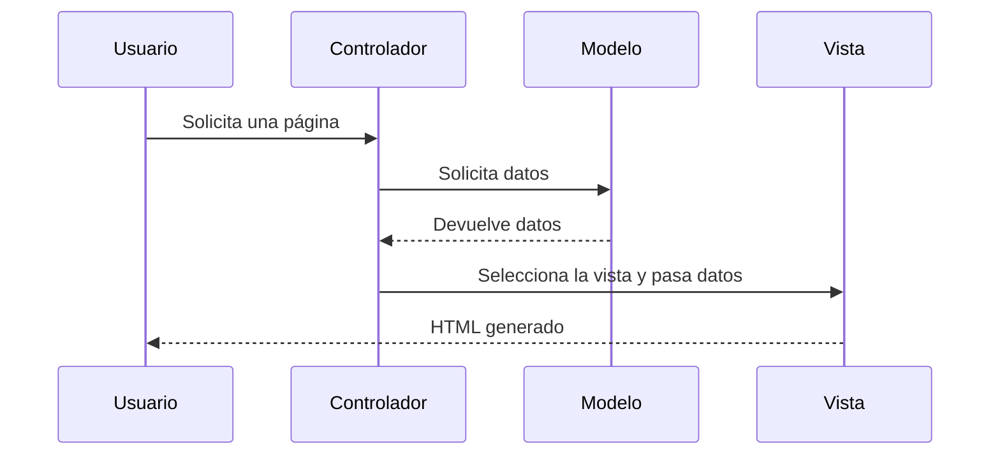

</div>

En el ejemplo de acceso, el controlador coordina la comprobación y elige qué vista devolver.

---

## 🧭 SOLID: cinco principios de diseño

| Inicial | Principio | Idea |
|---|---|---|
| **S** | Responsabilidad única | Una razón principal para cambiar |
| **O** | Abierto/cerrado | Extender sin modificar continuamente lo existente |
| **L** | Sustitución de Liskov | Respetar el contrato del tipo base |
| **I** | Segregación de interfaces | Depender solo de las operaciones necesarias |
| **D** | Inversión de dependencias | Depender de abstracciones |

Cada principio orienta el diseño; no es una receta para añadir clases sin necesidad.

<TipBox type="nota" title="Idea común">

SOLID busca que los cambios sean más localizados y que las piezas colaboren mediante contratos claros.

</TipBox>

---

## 🎯 S: una responsabilidad

`PedidoService` no debería asumir también el envío de correo y la generación de PDF.

```csharp
public class PedidoService(IPedidoRepository repository)
{
    public void CrearPedido(Pedido pedido) => repository.Guardar(pedido);
}

public class EmailService(IEmailProvider provider)
{
    public void Enviar(string email, string asunto, string cuerpo)
        => provider.Enviar(email, asunto, cuerpo);
}
```

Si cambia el proveedor de correo, la responsabilidad del envío está separada de la gestión del pedido.

---

## 🔌 O: abierto a extensión

Una calculadora puede recibir una estrategia de descuento a través de una interfaz:

```csharp
public interface IDescuento
{
    decimal Aplicar(decimal precio);
}

public class CalculadoraDescuento(IDescuento descuento)
{
    public decimal Calcular(decimal precio) => descuento.Aplicar(precio);
}
```

Se pueden añadir implementaciones de `IDescuento` sin añadir otro `if` a la calculadora.

---

## 🐧 L: respetar el contrato

Si una clase base promete que todas las aves vuelan, un pingüino no puede cumplir esa promesa.

```csharp
public interface IVolador { void Volar(); }
public interface INadador { void Nadar(); }

public class Pato : IVolador, INadador
{
    public void Volar() { /* vuela */ }
    public void Nadar() { /* nada */ }
}

public class Pinguino : INadador
{
    public void Nadar() { /* nada */ }
}
```

Separamos capacidades en vez de obligar a un subtipo a romper el comportamiento esperado.

---

## ✂️ I: interfaces específicas

Un servicio que solo consulta productos no necesita recibir operaciones de escritura:

```csharp
public interface IReadOnlyRepository<T>
{
    T? GetById(int id);
    List<T> GetAll();
}

public class ProductoQueryService(IReadOnlyRepository<Producto> repository)
{
    public Producto? Obtener(int id) => repository.GetById(id);
}
```

Una interfaz de escritura separada puede ofrecer `Create`, `Update` y `Delete` a quien los necesite.

---

## 🔄 D: depender de abstracciones

```csharp
public class PedidoService(IPedidoRepository repository, IEmailService email)
{
    public void Crear(Pedido pedido)
    {
        repository.Guardar(pedido);
        email.Enviar(pedido.Cliente.Email, "Pedido creado");
    }
}
```

El servicio recibe contratos en vez de crear directamente `PedidoRepositorySql` y `EmailServiceGmail`. La configuración decide qué implementaciones proporcionar.

---

## Resumen del punto 3

<div class="grid grid-cols-2 gap-5 items-start">
<div>

| Concepto | Idea principal |
|---|---|
| Cliente-servidor | Peticiones y respuestas |
| Monolito | Una unidad de despliegue |
| Capas | Responsabilidades separadas |
| Microservicios | Servicios desplegables de forma independiente |
| Serverless | Infraestructura gestionada |
| MVC | Modelo, vista y controlador |
| SOLID | Principios para facilitar cambios |

</div>
<div>

<ConceptCard icon="✅" title="Buenas prácticas" accent="green">

- Elige la arquitectura según la necesidad.
- Separa responsabilidades.
- Evita complejidad distribuida prematura.
- Depende de abstracciones.

</ConceptCard>

**⏭️ ¿Qué viene después?** El protocolo HTTP y la comunicación segura con HTTPS.

</div>
</div>

---
layout: section
---

<div class="ud-section-number">04</div>

# HTTP y HTTPS

<div class="opacity-70">El lenguaje de las peticiones y respuestas</div>

---

## 4 · Punto de partida

<div class="grid grid-cols-2 gap-5 items-start">
<div>

<TipBox type="consejo" title="Punto de partida">

Al escribir una URL o enviar un formulario, ¿qué viaja entre tu navegador y el servidor? ¿Qué te dice un `404`?

</TipBox>

<TipBox type="analogia">

Cada petición se parece a una carta: contiene un destinatario, información y, cuando hace falta, un contenido.

</TipBox>

</div>
<div>

<Objetivos :items="[
  'Explicar la comunicación HTTP sin estado',
  'Leer una petición y una respuesta',
  'Relacionar métodos HTTP con operaciones',
  'Interpretar códigos de estado y cabeceras',
  'Distinguir HTTP de HTTPS',
]" />

</div>
</div>

---

## 📡 HTTP: petición y respuesta

HTTP define cómo se intercambian mensajes entre un cliente y un servidor. Es extensible mediante cabeceras y cada petición tiene su propia respuesta.

<div class="w-full mx-auto max-w-100">

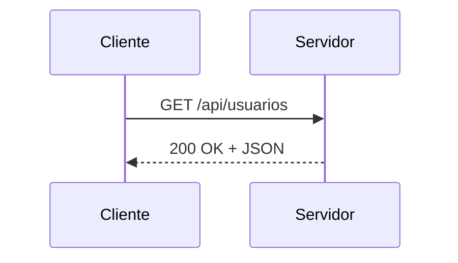

</div>

HTTP es **sin estado**: el significado de una petición no depende por sí solo de una conversación previa.

---

## 🧠 Si HTTP no recuerda, ¿cómo mantiene una sesión?

<div class="grid grid-cols-2 gap-5 items-start">
<div>

<ConceptCard icon="🍪" title="Cookie" accent="blue">

El navegador puede guardar una cookie y enviarla en peticiones posteriores según las condiciones configuradas.

</ConceptCard>

</div>
<div>

<ConceptCard icon="🔑" title="Token" accent="green">

El cliente puede enviar un token en la cabecera `Authorization` para identificar la petición.

</ConceptCard>

</div>
</div>

El servidor valida la información recibida; mantener una sesión requiere un mecanismo adicional a HTTP.

---

## ✉️ Anatomía de una petición HTTP

Ejemplo de una petición HTTP/1.1 que envía datos para crear un usuario:

```http
POST /api/usuarios HTTP/1.1
Host: api.ejemplo.com
Content-Type: application/json
Accept: application/json

{ "nombre": "Ana" }
```

La primera línea contiene método, ruta y versión. Después van las cabeceras, una línea en blanco y el cuerpo opcional.

---

## 🧩 Leer cada parte de la petición

| Elemento | En el ejemplo | Función |
|---|---|---|
| **Método** | `POST` | Indica la operación solicitada |
| **Ruta** | `/api/usuarios` | Identifica el recurso |
| **Versión** | `HTTP/1.1` | Versión del protocolo |
| **Cabeceras** | `Host`, `Content-Type`, `Accept` | Describen la petición y su contenido |
| **Cuerpo** | `{ "nombre": "Ana" }` | Datos enviados al servidor |

Para filtros en una lectura suele utilizarse la consulta de la URL: `/api/usuarios?rol=admin`.

<TipBox type="nota" title="Recuerda">

Las cabeceras describen el mensaje; el cuerpo transporta los datos que la operación necesita enviar.

</TipBox>

---

## 📬 Anatomía de una respuesta HTTP

El servidor informa del resultado y del tipo de contenido que devuelve:

```http
HTTP/1.1 200 OK
Content-Type: application/json
Cache-Control: no-cache

{ "id": 1, "nombre": "Ana" }
```

La línea de estado expresa el resultado; las cabeceras añaden metadatos y el cuerpo contiene los datos cuando corresponde.

---

## 🔍 Petición y respuesta juntas

<div class="w-full mx-auto max-w-140">

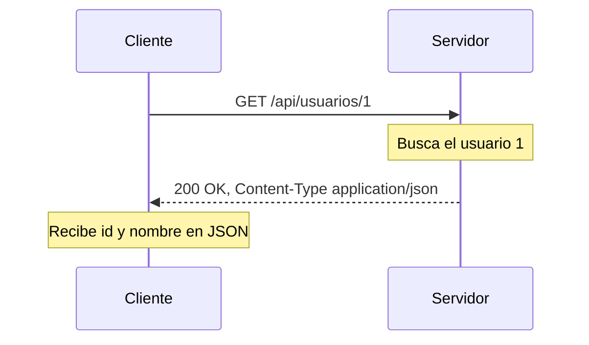

</div>

Si no existe el recurso, el servidor puede responder `404 Not Found` en lugar de `200 OK`.

---

## 🛠️ Métodos HTTP y operaciones

| Método | Uso habitual | Ejemplo |
|---|---|---|
| **GET** | Obtener información | `GET /api/productos` |
| **POST** | Crear o enviar datos | `POST /api/pedidos` |
| **PUT** | Sustituir una representación | `PUT /api/usuarios/5` |
| **PATCH** | Aplicar una modificación parcial | `PATCH /api/usuarios/5` |
| **DELETE** | Solicitar la eliminación | `DELETE /api/carrito/3` |

CRUD agrupa crear, leer, actualizar y eliminar. Los métodos expresan la semántica HTTP de la petición.

<TipBox type="nota" title="Ejemplo">

Para modificar el nombre de un usuario se puede enviar `PATCH /api/usuarios/5` con el nuevo valor en el cuerpo.

</TipBox>

---

## 🔄 GET, PUT y DELETE: repetir no siempre es crear

<div class="grid grid-cols-2 gap-5 items-start">
<div>

<ConceptCard icon="🔍" title="GET" accent="blue">

Solicita una representación. Es un método seguro: el cliente no solicita una modificación del recurso.

</ConceptCard>

</div>
<div>

<ConceptCard icon="🔁" title="Idempotencia" accent="green">

Repetir una petición idempotente tiene el mismo efecto previsto que ejecutarla una vez. GET, PUT y DELETE son idempotentes; POST no tiene esa garantía.

</ConceptCard>

</div>
</div>

Las respuestas pueden diferir: un segundo `DELETE` puede responder `404` aunque el efecto buscado siga siendo que el recurso no exista.

---

## 📋 Una API mínima con rutas HTTP

Estos ejemplos de ASP&#46;NET Core relacionan la ruta y el método con la respuesta:

```csharp
app.MapGet("/api/usuarios", () => Results.Ok(usuarios));

app.MapPost("/api/usuarios", (Usuario usuario) =>
{
    // Guardar en base de datos
    return Results.Created($"/api/usuarios/{usuario.Id}", usuario);
});

app.MapDelete("/api/usuarios/{id}", (int id) =>
{
    // Eliminar de la base de datos
    return Results.NoContent();
});
```

Los comentarios representan operaciones pendientes: este fragmento ilustra las rutas, no implementa persistencia.

---

## 🚦 Familias de códigos de estado

| Familia | Significado | Ejemplos |
|---|---|---|
| **1xx** | Información | `100 Continue` |
| **2xx** | Éxito | `200`, `201`, `204` |
| **3xx** | Redirección o respuesta condicional | `301`, `304` |
| **4xx** | La petición no puede atenderse tal como llega | `400`, `401`, `404` |
| **5xx** | Error al atender la petición en el servidor | `500`, `502`, `503` |

El código acompaña a la respuesta HTTP; no debe confundirse con un mensaje de error del lenguaje C#.

<TipBox type="nota" title="Al diagnosticar">

Un `404` indica que no se ha encontrado el recurso; un `500` indica un fallo al procesar la petición.

</TipBox>

---

## ✅ Éxito y redirección

| Código | Significado | Ejemplo |
|---|---|---|
| **200 OK** | Petición atendida | Lectura correcta de un usuario |
| **201 Created** | Recurso creado | Alta mediante POST |
| **204 No Content** | Éxito sin cuerpo | Eliminación sin contenido de respuesta |
| **301 Moved Permanently** | Recurso movido permanentemente | Cambio estable de URL |
| **304 Not Modified** | Representación sin cambios | Respuesta condicional de caché |

Una respuesta `204` no lleva cuerpo; el código comunica el resultado.

<TipBox type="nota" title="Ejemplo">

Tras crear un usuario, `201 Created` puede incluir la dirección del nuevo recurso; `304` permite reutilizar una versión en caché.

</TipBox>

---

## 🚫 Errores de la petición

| Código | Significado |
|---|---|
| **400** | Petición inválida |
| **401** | Falta autenticación válida |
| **403** | El servidor rechaza el acceso |
| **404** | Recurso no encontrado |
| **409** | Conflicto con el estado del recurso |
| **422** | Contenido entendido pero no procesable |
| **429** | Demasiadas peticiones |

Por ejemplo, `409` puede indicar duplicados o conflictos de concurrencia; `422`, el rechazo de una regla de negocio.

---

## 💥 Errores del servidor

| Código | Significado | Ejemplo |
|---|---|---|
| **500** | Error interno | Una excepción no controlada al procesar |
| **502** | Respuesta inválida de un servidor intermedio | Un proxy no recibe una respuesta válida |
| **503** | Servicio no disponible | Sobrecarga o mantenimiento |

<TipBox type="advertencia">

No muestres detalles internos ni secretos al cliente. Registra el detalle en el servidor y devuelve una respuesta apropiada.

</TipBox>

---

## 🏷️ Cabeceras de petición y respuesta

| Cabecera | Para qué sirve |
|---|---|
| `Host` | Identifica el servidor solicitado en HTTP/1.1 |
| `Content-Type` | Indica el tipo del cuerpo enviado |
| `Accept` | Expresa los formatos que acepta el cliente |
| `Authorization` | Transporta credenciales de la petición |
| `Cache-Control` | Indica directivas para la caché |
| `Set-Cookie` | Solicita al navegador guardar una cookie |

`Content-Type` describe lo que se envía; `Accept` expresa lo que se quiere recibir.

<TipBox type="nota" title="Ejemplo">

Un cliente puede enviar JSON con `Content-Type: application/json` y pedir también JSON mediante `Accept`.

</TipBox>

---

## 🔒 HTTPS: HTTP protegido por TLS

<div class="w-full mx-auto max-w-110">

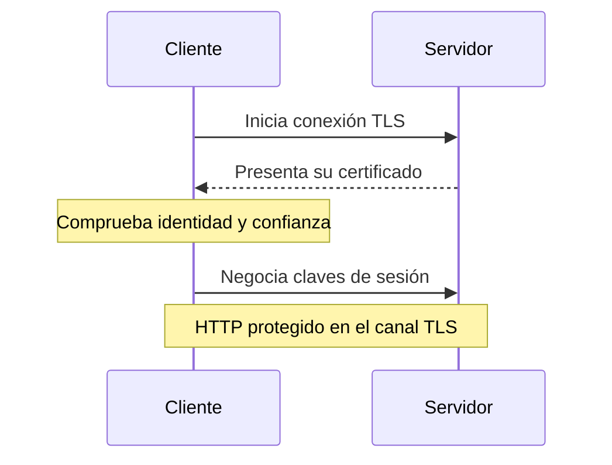

</div>

TLS protege la comunicación y verifica el servidor, pero no garantiza la seguridad de la aplicación.

---

## ⚖️ HTTP frente a HTTPS

| | HTTP | HTTPS |
|---|---|---|
| **Puerto habitual** | 80 | 443 |
| **Transporte** | Sin protección TLS | HTTP protegido con TLS |
| **Datos en tránsito** | Pueden ser observados o modificados | Cifrados y protegidos frente a alteración |
| **Identidad del servidor** | No verificada mediante TLS | Certificado validado por el cliente |

Usa HTTPS en producción y trata las credenciales como información sensible.

<TipBox type="advertencia">

El cifrado protege el tránsito, pero la aplicación debe seguir validando entradas y comprobando permisos.

</TipBox>

---

## Resumen del punto 4

<div class="grid grid-cols-2 gap-5 items-start">
<div>

| Concepto | Idea principal |
|---|---|
| HTTP | Petición-respuesta sin estado |
| Petición | Método, ruta, cabeceras y cuerpo opcional |
| Respuesta | Estado, cabeceras y cuerpo opcional |
| Métodos | GET, POST, PUT, PATCH y DELETE |
| Estado | Categorías 1xx a 5xx |
| HTTPS | HTTP protegido con TLS |

</div>
<div>

<ConceptCard icon="✅" title="Buenas prácticas" accent="green">

- Usa HTTPS.
- Elige bien método y código.
- Protege credenciales y detalles internos.
- Limita peticiones abusivas.

</ConceptCard>

**⏭️ ¿Qué viene después?** Servicios web, APIs y comunicación en tiempo real.

</div>
</div>

---
layout: section
---

<div class="ud-section-number">05</div>

# Servicios web y APIs

<div class="opacity-70">Distintas formas de comunicar aplicaciones</div>

---

## 5 · Punto de partida

<div class="grid grid-cols-2 gap-5 items-start">
<div>

<TipBox type="consejo" title="Punto de partida">

Una aplicación necesita consultar productos y también recibir mensajes de un chat. ¿Usaría la misma forma de comunicación para todo?

</TipBox>

<TipBox type="nota">

REST organiza recursos; GraphQL permite consultas flexibles; WebSocket mantiene comunicación bidireccional.

</TipBox>

</div>
<div>

<Objetivos :items="[
  'Distinguir servicio web, API, endpoint y recurso',
  'Explicar los principios de REST',
  'Comparar REST y GraphQL',
  'Entender WebSocket y otras opciones',
  'Elegir una tecnología según la necesidad',
]" />

</div>
</div>

---

## 🔌 Servicios web: aplicaciones que colaboran

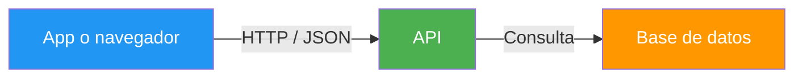

Un servicio web permite que aplicaciones intercambien información. La API define cómo solicitar sus operaciones; el servidor puede consultar datos para responder.

---

## 🧩 Servicio, API, recurso y endpoint

| Término | Significado | Ejemplo |
|---|---|---|
| **Servicio web** | Aplicación accesible a través de la red | Servicio de catálogo |
| **API** | Interfaz que expone operaciones | Consultar o crear productos |
| **Recurso** | Elemento representado por la API | Un producto |
| **Endpoint** | Punto de acceso a una operación | `GET /api/productos/1` |

Una API web no tiene por qué seguir REST: hay diferentes estilos y protocolos.

<TipBox type="nota" title="Ejemplo">

En un catálogo, un producto es un recurso; `GET /api/productos/1` permite solicitar su representación.

</TipBox>

---

## 🧭 REST es un estilo arquitectónico

REST no es un protocolo ni equivale simplemente a enviar JSON. Define restricciones para organizar sistemas cliente-servidor.

| Principio | Qué aporta |
|---|---|
| Cliente-servidor | Separa responsabilidades |
| Sin estado | Cada petición contiene el contexto necesario |
| Cacheable | Las respuestas indican si pueden reutilizarse |
| Interfaz uniforme | Operaciones y representaciones coherentes |
| Capas | Permite intermediarios |
| Código bajo demanda | Restricción opcional |

HTTP puede ser el protocolo utilizado para implementar una API que siga estos principios.

---

## 🗺️ Recursos, rutas y métodos

| Petición | Intención |
|---|---|
| `GET /api/productos` | Listar productos |
| `GET /api/productos/1` | Obtener un producto |
| `POST /api/productos` | Crear un producto |
| `PUT /api/productos/1` | Actualizar su representación |
| `DELETE /api/productos/1` | Solicitar su eliminación |
| `GET /api/productos?categoria=libros` | Filtrar la colección |

La ruta identifica el recurso; el método expresa la operación. Evita usar verbos como `/api/getProduct` cuando puedes usar sustantivos y métodos HTTP.

---

## 🛒 Leer productos en una minimal API

Una lista en memoria representa el catálogo:

```csharp
app.MapGet("/api/productos", () => Results.Ok(productos));

app.MapGet("/api/productos/{id}", (int id) =>
{
    var producto = productos.FirstOrDefault(p => p.Id == id);
    return producto is not null ? Results.Ok(producto) : Results.NotFound();
});
```

La primera ruta devuelve la colección; la segunda devuelve `200` si existe el producto o `404` si no se encuentra.

---

## ➕ Crear un producto

```csharp
app.MapPost("/api/productos", (Producto producto) =>
{
    var nuevo = producto with { Id = productos.Max(p => p.Id) + 1 };
    productos.Add(nuevo);
    return Results.Created($"/api/productos/{nuevo.Id}", nuevo);
});
```

El ejemplo devuelve `201 Created` y la ubicación del recurso. Es una simulación: `Max` falla si la lista está vacía y no resuelve persistencia ni concurrencia.

---

## ✏️ Actualizar un producto

```csharp
app.MapPut("/api/productos/{id}", (int id, Producto producto) =>
{
    var existente = productos.FirstOrDefault(p => p.Id == id);
    if (existente is null) return Results.NotFound();

    var index = productos.IndexOf(existente);
    productos[index] = producto with { Id = id };
    return Results.Ok(productos[index]);
});
```

El fragmento sustituye los datos de la lista en memoria; devuelve `404` si el producto no existe.

---

## 🗑️ Eliminar un producto

```csharp
app.MapDelete("/api/productos/{id}", (int id) =>
{
    var producto = productos.FirstOrDefault(p => p.Id == id);
    if (producto is null) return Results.NotFound();

    productos.Remove(producto);
    return Results.NoContent();
});
```

La respuesta `204` confirma el resultado sin cuerpo. Como en el resto del ejemplo, se necesita persistencia y control de concurrencia en una aplicación real.

---

## 🔎 GraphQL: pedir los campos necesarios

Una consulta GraphQL describe los campos que necesita el cliente:

```graphql
query {
  usuario(id: 1) {
    nombre
    email
    posts(limit: 5) {
      titulo
      fecha
    }
  }
}
```

El esquema define qué se puede consultar. El servidor resuelve la consulta y devuelve los campos solicitados.

---

## 🔎 Más y menos datos de los necesarios

- **Over-fetching:** la respuesta incluye campos que la pantalla no utiliza.
- **Under-fetching:** hacen falta más peticiones para reunir los datos necesarios.
- GraphQL permite seleccionar campos y relaciones del esquema en una consulta.
- Esa flexibilidad exige controlar profundidad, coste y autorización de los campos.

Una API REST también puede ofrecer filtros, proyecciones y recursos adaptados a sus clientes.

---

## ⚖️ REST frente a GraphQL

| Pregunta | REST | GraphQL |
|---|---|---|
| **Organización** | Recursos y operaciones | Esquema y consultas |
| **Campos** | Los define la representación disponible | El cliente selecciona campos del esquema |
| **Peticiones** | Varias rutas según recursos | Habitualmente un endpoint GraphQL |
| **Caché** | Puede aprovechar semántica HTTP | Exige considerar la forma de consulta |
| **Riesgo** | Recibir más o menos datos de los necesarios | Consultas costosas si no se limitan |

GraphQL no elimina automáticamente el problema de consultas costosas ni sustituye siempre a REST.

<TipBox type="nota" title="Ejemplo">

Una pantalla puede solicitar nombre y publicaciones en GraphQL; con REST, el diseño de los recursos determina qué peticiones necesita.

</TipBox>

---

## 💬 WebSocket: conversación abierta

<div class="w-full mx-auto max-w-110">

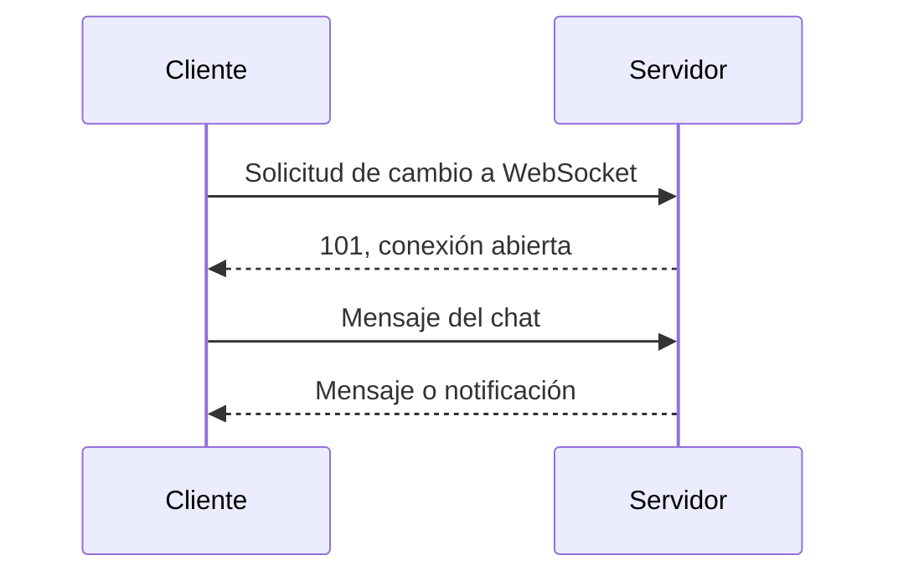

</div>

Tras la conexión inicial, cualquiera de los extremos puede enviar mensajes sin esperar una nueva petición por cada uno.

---

## ⚖️ HTTP y WebSocket se complementan

| Aspecto | HTTP petición-respuesta | WebSocket |
|---|---|---|
| **Comunicación** | El cliente inicia cada petición | Ambos extremos pueden enviar mensajes |
| **Caso típico** | Consultar o modificar recursos | Chat y notificaciones en tiempo real |
| **Gestión** | Mensajes independientes | Conexión persistente |

Una aplicación puede cargar el catálogo por HTTP y usar WebSocket para actualizaciones en directo.

<TipBox type="nota" title="Ejemplo">

En un chat, HTTP puede recuperar los mensajes anteriores y WebSocket transportar los nuevos mientras la conexión permanezca abierta.

</TipBox>

---

## 🛰️ Otras alternativas

| Tecnología | Idea | Uso habitual |
|---|---|---|
| **gRPC** | Llamadas remotas con contratos y Protocol Buffers | Comunicación entre servicios |
| **SOAP** | Mensajes estructurados en XML | Integraciones empresariales |
| **SSE** | Eventos del servidor hacia el cliente | Notificaciones unidireccionales |
| **Webhook** | Petición a una URL al ocurrir un evento | Aviso de pagos o eventos de GitHub |

REST es un estilo, GraphQL un lenguaje de consulta, y WebSocket un protocolo: no son categorías idénticas.

<TipBox type="nota" title="Cómo elegir">

Además del formato, importa si la comunicación es una petición puntual, un flujo de eventos o una conversación bidireccional.

</TipBox>

---

## 🛰️ gRPC y SOAP

| | gRPC | SOAP |
|---|---|---|
| **Modelo** | Llamadas a operaciones remotas | Intercambio de mensajes estructurados |
| **Contrato** | Servicio y mensajes definidos en `.proto` | Contrato y esquema XML |
| **Datos** | Habitualmente Protocol Buffers | XML |
| **Uso** | Servicios internos, incluidos flujos | Integraciones empresariales |

gRPC admite streaming bidireccional; SOAP puede combinarse con estándares de seguridad. Las capacidades y el rendimiento dependen de la implementación.

<TipBox type="nota" title="Contrato">

El contrato describe las operaciones y los mensajes: ayuda a que los sistemas acuerden cómo comunicarse.

</TipBox>

---

## 📣 SSE y webhooks: dos formas de avisar

| | SSE | Webhook |
|---|---|---|
| **Dirección** | Servidor → navegador o cliente | Sistema emisor → URL receptora |
| **Mecanismo** | Conexión HTTP abierta para eventos | Petición HTTP cuando ocurre un evento |
| **Ejemplo** | Actualización de un panel | Aviso de pago a una aplicación |

Un webhook necesita validar su origen y gestionar reintentos; SSE no permite enviar mensajes del cliente al servidor por ese mismo flujo.

<TipBox type="nota" title="Ejemplo">

Un panel recibe actualizaciones por SSE; una pasarela notifica un pago a la aplicación mediante un webhook.

</TipBox>

---

## 🎯 ¿Cuál elegir?

| Necesidad | Opción que considerar | Motivo |
|---|---|---|
| API de recursos | REST sobre HTTP | Rutas y métodos conocidos |
| Campos flexibles | GraphQL | El cliente selecciona la información |
| Chat interactivo | WebSocket | Mensajes bidireccionales |
| Eventos solo del servidor | SSE | Flujo unidireccional |
| Aviso entre sistemas | Webhook | Se notifica cuando sucede el evento |
| Contrato entre servicios | gRPC | Contrato tipado y streaming |

Evalúa también seguridad, coste operativo, clientes y herramientas disponibles.

<TipBox type="consejo">

Una misma aplicación puede combinar tecnologías: REST para consultar recursos y WebSocket para mensajes en tiempo real.

</TipBox>

---

## Resumen del punto 5

<div class="grid grid-cols-2 gap-5 items-start">
<div>

| Concepto | Idea principal |
|---|---|
| API | Interfaz para comunicarse |
| REST | Estilo basado en restricciones |
| GraphQL | Consultas según un esquema |
| WebSocket | Comunicación bidireccional persistente |
| gRPC | Llamadas remotas tipadas |
| SOAP | Mensajes estructurados en XML |
| SSE y webhook | Comunicación basada en eventos |

</div>
<div>

<ConceptCard icon="✅" title="Buenas prácticas" accent="green">

- Elige según el tipo de comunicación.
- Documenta las operaciones.
- Controla consultas y mensajes.
- Protege los servicios.

</ConceptCard>

**⏭️ ¿Qué viene después?** Cómo se genera una página web dinámica.

</div>
</div>

---
layout: section
---

<div class="ud-section-number">06</div>

# Páginas web dinámicas

<div class="opacity-70">Generar contenido para cada petición</div>

---

## 6 · Punto de partida

<div class="grid grid-cols-2 gap-5 items-start">
<div>

<TipBox type="consejo" title="Punto de partida">

Cuando abres Instagram ves tus fotos y no las de otra persona. ¿Cómo puede una misma dirección mostrar contenido distinto?

</TipBox>

<TipBox type="analogia">

Un periódico impreso conserva el contenido de su edición; una aplicación puede construir una vista con los datos actuales.

</TipBox>

</div>
<div>

<Objetivos :items="[
  'Distinguir contenido estático y dinámico',
  'Describir el recorrido del renderizado en servidor',
  'Comparar SSR y CSR',
  'Interpretar ejemplos de ASP.NET Core y Razor',
]" />

</div>
</div>

---

## 📄 Estática frente a dinámica

| Aspecto | Contenido estático | Contenido dinámico |
|---|---|---|
| **Origen** | Archivo preparado | Resultado generado según datos |
| **Ejemplo** | Página informativa | Perfil o búsqueda personalizada |
| **Servidor** | Puede servir el archivo tal cual | Ejecuta lógica si la generación es en servidor |
| **Actualización** | Se cambia o regenera el archivo | Puede variar entre peticiones |

Una página estática puede incluir JavaScript y ser interactiva: estático describe cómo se sirve el contenido, no todas las capacidades del navegador.

---

## 📂 Una página estática

<div class="w-full mx-auto max-w-140">

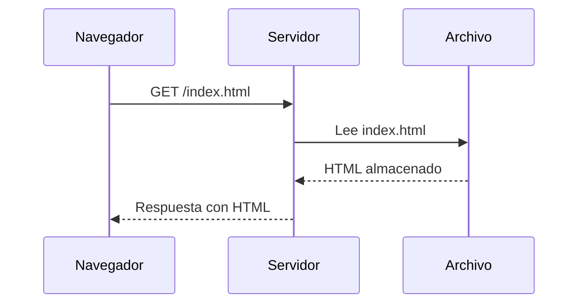

</div>

El servidor devuelve el archivo disponible. Las peticiones pueden aprovechar cachés cuando la configuración lo permita.

---

## 🍳 SSR: el servidor prepara el HTML

<div class="w-full mx-auto max-w-140">

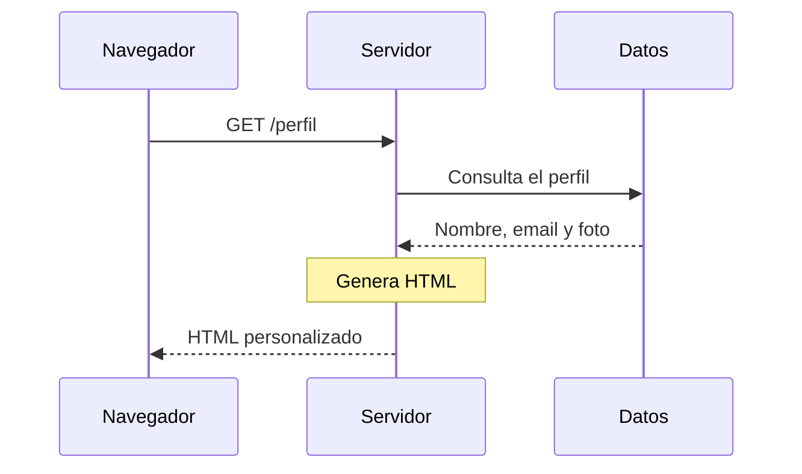

</div>

En SSR (*Server-Side Rendering*), el navegador recibe HTML generado en el servidor para esa petición.

---

## 🖥️ SSR y CSR: ¿dónde se construye la vista?

| | SSR | CSR |
|---|---|---|
| **HTML inicial** | Generado en el servidor | La aplicación del navegador genera la vista |
| **Datos** | Se usan para producir HTML en servidor | Suelen llegar al navegador mediante una API |
| **Tecnologías** | Razor, PHP, Django | JavaScript con React, Angular o Vue |
| **Consideraciones** | Procesamiento en el servidor | Descarga y ejecución de JavaScript |

No son enfoques excluyentes: una aplicación puede combinar HTML inicial en servidor e interactividad posterior en el cliente.

<TipBox type="nota" title="Consecuencia">

En SSR el servidor prepara la vista inicial; en CSR el navegador necesita ejecutar JavaScript para construirla.

</TipBox>

---

## 🧰 Tecnologías para generar contenido

| Tecnología | Lenguaje o entorno | Ejemplo de framework |
|---|---|---|
| **ASP&#46;NET Core** | C# | Razor, MVC |
| **PHP** | PHP | Laravel |
| **Java** | Java | Spring |
| **Python** | Python | Django, Flask |
| **Node.js** | JavaScript en servidor | Aplicaciones y APIs |

El servidor ejecuta la tecnología elegida y devuelve HTML, JSON u otra representación al cliente.

<TipBox type="nota" title="Ejemplo">

Una plantilla Razor puede producir HTML para un navegador; una API del mismo servidor puede devolver datos JSON a una aplicación móvil.

</TipBox>

---

## 🕒 Un saludo que depende de la hora

En esta minimal API, el servidor calcula el saludo para cada petición:

```csharp
app.MapGet("/", () =>
{
    var hora = DateTime.Now.Hour;
    var saludo = hora switch
    {
        < 12 => "Buenos días",
        < 20 => "Buenas tardes",
        _ => "Buenas noches"
    };

    return Results.Content($"<h1>{saludo} desde ASP.NET Core</h1>",
        "text/html");
});
```

`Results.Content` especifica que la respuesta es HTML; la hora utilizada es la del servidor.

---

## 👥 Datos dinámicos no son necesariamente HTML

```csharp
app.MapGet("/api/usuarios/{id}", (int id) =>
{
    var usuario = usuarios.FirstOrDefault(u => u.Id == id);
    return usuario is not null
        ? Results.Ok(usuario)
        : Results.NotFound(new { Error = $"Usuario {id} no encontrado" });
});
```

El servidor busca el usuario y devuelve sus datos o `404`. La lista en memoria del ejemplo se pierde al reiniciar: no sustituye a una base de datos.

---

## 🪄 Razor: plantilla más datos

```mermaid
graph LR
    A["Plantilla .cshtml"] --> R["Motor Razor"]
    M["Modelo y datos"] --> R
    R --> H["HTML generado"]
    H --> N["Navegador"]
    style A fill:#2196F3,color:#fff
    style M fill:#FF9800,color:#fff
    style R fill:#9C27B0,color:#fff
    style H fill:#4CAF50,color:#fff
    style N fill:#607D8B,color:#fff
```

La plantilla mezcla marcado con expresiones C#. El servidor ejecuta Razor y el navegador recibe el HTML resultante.

---

## 🧾 La plantilla Razor

Esta plantilla calcula el precio y el mensaje en el servidor:

```html
@model Producto

@{
    var precioFinal = Model.Precio * 0.9m;
    var mensaje = Model.Stock > 0 ? "En stock" : "Agotado";
}

<h1>@Model.Nombre</h1>
<p>Precio: @precioFinal.ToString("0.00") €</p>
<p>@mensaje</p>
```

`@model` indica el modelo; `@{ ... }` contiene código; `@Model.Nombre` inserta el valor.

---

## 📬 El HTML que recibe el navegador

Una vez resuelta la plantilla, el navegador recibe el resultado, no las expresiones Razor:

```html
<h1>Teclado mecánico</h1>
<p>Precio: 71.91 €</p>
<p>En stock</p>
```

En «ver código fuente» no encontrarás `@Model.Nombre`: esa expresión se procesó antes de enviar la respuesta.

---

## 🌍 Plantillas en otras tecnologías

En PHP el código se procesa en el servidor antes de devolver HTML:

```php
<h1>Hola desde PHP</h1>
<?php
    $nombre = "Alumno";
    echo "<p>Bienvenido, " . $nombre . "!</p>";
?>
```

En Django una plantilla puede usar variables y condiciones como ``. En todos los casos, es importante separar la lógica de negocio y codificar adecuadamente los datos mostrados.

---

## 🧩 Tres herramientas de Razor

| Sintaxis | Ejemplo | Función |
|---|---|---|
| **Bloque** | `@{ var precio = 79.90; }` | Ejecuta código C# |
| **Expresión** | `@Model.Nombre` | Inserta un valor en el HTML |
| **Control** | `@if`, `@foreach` | Condiciones e iteración en la plantilla |

Mantén la lógica de negocio fuera de la vista: la plantilla debe centrarse en la presentación.

<TipBox type="nota" title="Al procesar una vista">

El servidor evalúa bloques y condiciones con el modelo; el navegador recibe el HTML resultante.

</TipBox>

---

## Resumen del punto 6

<div class="grid grid-cols-2 gap-5 items-start">
<div>

| Concepto | Idea principal |
|---|---|
| Estático | Archivo preparado |
| Dinámico | Resultado que depende de datos o contexto |
| SSR | El servidor genera HTML |
| CSR | El navegador construye la vista |
| Razor | Plantilla C# y HTML |
| API | Puede devolver datos en JSON |

</div>
<div>

<ConceptCard icon="✅" title="Buenas prácticas" accent="green">

- Separa presentación y negocio.
- Elige SSR o CSR según la necesidad.
- No confundas memoria con persistencia.
- Mantén frameworks con soporte.

</ConceptCard>

**⏭️ ¿Qué viene después?** Lenguajes, plataformas y frameworks de servidor.

</div>
</div>

---
layout: section
---

<div class="ud-section-number">07</div>

# Lenguajes y frameworks

<div class="opacity-70">Del código fuente al servicio web</div>

---

## 7 · Punto de partida

<div class="grid grid-cols-2 gap-5 items-start">
<div>

<TipBox type="consejo" title="Punto de partida">

ASP&#46;NET Core, Spring y Laravel permiten crear aplicaciones web. ¿Qué cambia en la ejecución y en las herramientas que los acompañan?

</TipBox>

<TipBox type="analogia">

Una receta puede leerse mientras cocinas o prepararse de antemano: son maneras distintas de llegar a la ejecución.

</TipBox>

</div>
<div>

<Objetivos :items="[
  'Distinguir ejecución interpretada, nativa e intermedia',
  'Identificar los stacks LAMP, MEAN y WISA',
  'Reconocer frameworks para servicios web',
  'Relacionar HTML y código de servidor',
]" />

</div>
</div>

---

## ⚙️ ¿Cómo se ejecuta el código?

| Enfoque | Recorrido habitual | Ejemplos |
|---|---|---|
| **Interpretación** | Un entorno ejecuta el programa | PHP, Python, JavaScript |
| **Compilación nativa** | Fuente → código máquina | C++, Go, Rust |
| **Código intermedio** | Fuente → formato intermedio → entorno de ejecución | C#, Java |

Son modelos generales, no etiquetas rígidas: un entorno puede combinar compilación, interpretación y optimizaciones JIT.

<TipBox type="nota" title="Consecuencia">

La forma de ejecución influye en el despliegue: puede ser necesario instalar un runtime o preparar un binario para el sistema de destino.

</TipBox>

---

## 🔄 C# y Java: un paso intermedio

```mermaid
graph LR
    CS["C#"] --> IL["Código intermedio IL"]
    IL --> CLR["CLR / .NET"]
    J["Java"] --> BC["Bytecode"]
    BC --> JVM["JVM"]
    style CS fill:#2196F3,color:#fff
    style IL fill:#9C27B0,color:#fff
    style CLR fill:#4CAF50,color:#fff
    style J fill:#2196F3,color:#fff
    style BC fill:#9C27B0,color:#fff
    style JVM fill:#4CAF50,color:#fff
```

El entorno de ejecución debe estar disponible en la plataforma de destino. Las opciones de compilación y publicación pueden variar.

---

## 🧰 ¿Qué es un stack?

Un stack combina tecnologías que cooperan para ejecutar y desplegar una aplicación.

| Stack | Componentes |
|---|---|
| **LAMP** | Linux, Apache, MySQL y PHP |
| **MEAN** | MongoDB, Express, Angular y Node.js |
| **MERN** | MongoDB, Express, React y Node.js |
| **WISA** | Windows, IIS, SQL Server y ASP&#46;NET |

Los componentes pueden sustituirse según el proyecto; no hay una única combinación obligatoria.

---

## 🐧 LAMP y 🪟 WISA

<div class="grid grid-cols-2 gap-5 items-start">
<div>

<ConceptCard icon="🐧" title="LAMP" accent="blue">

- Linux: sistema operativo.
- Apache: servidor web.
- MySQL: datos.
- PHP: lógica de aplicación.

</ConceptCard>

</div>
<div>

<ConceptCard icon="🪟" title="WISA" accent="purple">

- Windows: sistema operativo.
- IIS: servidor web.
- SQL Server: datos.
- ASP&#46;NET: desarrollo web.

</ConceptCard>

</div>
</div>

ASP&#46;NET Core es multiplataforma: no está limitado a Windows o IIS.

---

## 📦 MEAN y MERN

Ambos incluyen MongoDB, Express y Node.js. Cambia la tecnología principal del cliente:

| Stack | Cliente | Servidor | Datos |
|---|---|---|---|
| **MEAN** | Angular | Express + Node.js | MongoDB |
| **MERN** | React | Express + Node.js | MongoDB |

XAMPP y WAMP facilitan entornos locales; un entorno de producción necesita su propia configuración y medidas de seguridad.

---

## 🌍 Frameworks para servicios web

| Entorno | Ejemplos de frameworks | Aplicaciones habituales |
|---|---|---|
| **C# / .NET** | ASP&#46;NET Core | APIs, MVC y Razor |
| **Java** | Spring Boot | Servicios y aplicaciones empresariales |
| **PHP** | Laravel, Symfony | Web y servicios |
| **JavaScript** | Express, NestJS | APIs con Node.js |
| **Python** | Django, FastAPI | Web y servicios |
| **Go** | Gin, Echo | Servicios compilados |

Evalúa soporte, comunidad, integración y necesidades del equipo, no solo el nombre del lenguaje.

<TipBox type="nota" title="Ejemplo">

ASP&#46;NET Core permite crear tanto servicios que devuelven JSON como aplicaciones que generan páginas con Razor.

</TipBox>

---

## 🧮 Servicio de notas en ASP&#46;NET Core

El ejemplo recibe notas separadas por comas, calcula la media y devuelve datos:

```csharp
app.MapGet("/api/notas/{notas}", (string notas) =>
{
    var listaNotas = notas.Split(',')
                          .Select(n => double.Parse(n))
                          .ToList();
    var media = listaNotas.Average();
    var estado = media >= 5 ? "Aprobado" : "Suspenso";
    return new { Notas = listaNotas, Media = Math.Round(media, 2), Estado = estado };
});
```

Para `/api/notas/7,8,9,6`, la media es `7.5`. El ejemplo ilustra el recorrido: una API real debe validar formato y rango antes de calcular.

---

## 🪄 Código de servidor integrado en HTML

En un archivo `.cshtml`, Razor resuelve las expresiones C# antes de enviar el HTML:

```html
@{
    var titulo = "Mi Lista de Tareas";
    var tareas = new[] { "Estudiar C#", "Hacer ejercicios", "Descansar" };
}
<h1>@titulo</h1>
<ul>
    @foreach (var tarea in tareas)
    {
        <li>@tarea</li>
    }
</ul>
```

La respuesta contiene los elementos HTML generados, no el bucle C# original.

---

## 🧭 Elegir tecnología

| Consideración | Pregunta |
|---|---|
| **Problema** | ¿Necesitas páginas, API, tiempo real o procesamiento de datos? |
| **Equipo** | ¿Qué experiencia y herramientas tiene? |
| **Operación** | ¿Dónde se desplegará y quién lo mantendrá? |
| **Ecosistema** | ¿Tiene bibliotecas, soporte y comunidad adecuados? |
| **Medición** | ¿Qué rendimiento necesitas realmente? |

No hay un lenguaje universalmente mejor: mide con la carga y los requisitos de tu aplicación.

<TipBox type="consejo">

Un CMS, una API empresarial y una aplicación de análisis de datos pueden necesitar herramientas y equipos diferentes.

</TipBox>

---

## Resumen del punto 7

<div class="grid grid-cols-2 gap-5 items-start">
<div>

| Concepto | Idea principal |
|---|---|
| Interpretación | Ejecución gestionada por un entorno |
| Nativo | Código máquina para una plataforma |
| Intermedio | IL o bytecode con entorno de ejecución |
| Stack | Conjunto de tecnologías |
| Framework | Infraestructura reutilizable |
| Razor | C# integrado en HTML |

</div>
<div>

<ConceptCard icon="✅" title="Buenas prácticas" accent="green">

- Elige según requisitos.
- Evalúa soporte y mantenimiento.
- Valida los datos recibidos.
- Separa responsabilidades.

</ConceptCard>

**⏭️ ¿Qué viene después?** Servidores web, aplicaciones y bases de datos.

</div>
</div>

---
layout: section
---

<div class="ud-section-number">08</div>

# Servidores web y de aplicaciones

<div class="opacity-70">Del navegador a los datos</div>

---

## 8 · Punto de partida

<div class="grid grid-cols-2 gap-5 items-start">
<div>

<TipBox type="consejo" title="Punto de partida">

Una URL puede devolver una imagen o ejecutar una operación de negocio. ¿Quién recibe la petición y quién hace cada trabajo?

</TipBox>

<TipBox type="analogia">

El servidor web recibe el pedido; la aplicación prepara la respuesta dinámica y consulta los datos necesarios.

</TipBox>

</div>
<div>

<Objetivos :items="[
  'Distinguir servidor web y servidor de aplicaciones',
  'Conocer Apache, Nginx, Tomcat y Kestrel',
  'Identificar gestores SQL y NoSQL',
  'Describir una arquitectura de producción',
]" />

</div>
</div>

---

## 🚪 ¿Qué hace un servidor web?

Escucha conexiones y responde a peticiones HTTP. Según su configuración puede:

- Servir **archivos estáticos**, como CSS, imágenes o HTML.
- Gestionar conexiones **HTTPS** y certificados.
- Actuar como **proxy inverso**, pasando peticiones a la aplicación.
- Distribuir tráfico entre instancias mediante **balanceo de carga**.

HTTP suele usar el puerto 80 y HTTPS el 443; los puertos concretos se configuran.

---

## 🧩 De la petición a la respuesta

```mermaid
graph LR
    C["Cliente"] -->|"HTTP / HTTPS"| W["Servidor web"]
    W -->|"Estáticos"| F["Archivos"]
    W -->|"Dinámicos"| A["Aplicación"]
    A -->|"Consulta"| D["Base de datos"]
    D -->|"Datos"| A
    A -->|"Respuesta"| W
    W --> C
    style W fill:#2196F3,color:#fff
    style A fill:#4CAF50,color:#fff
    style D fill:#FF9800,color:#fff
```

La aplicación ejecuta la lógica; la base de datos persiste información. No todas las instalaciones necesitan todos estos componentes.

---

## 🪶 Apache HTTP Server

- Servidor de código abierto, **modular** y configurable.
- Procesa conexiones mediante distintos modelos de procesos o hilos.
- Los **VirtualHosts** permiten servir varios sitios desde una misma máquina.
- `.htaccess` permite configuración por directorio cuando está habilitada.

En Debian/Ubuntu, una instalación de ejemplo es `sudo apt install apache2`; la ubicación y los comandos dependen del sistema.

---

## 🏘️ Apache: un VirtualHost

```apache
<VirtualHost *:80>
    ServerName www.miweb.com
    DocumentRoot /var/www/miweb
    ErrorLog ${APACHE_LOG_DIR}/error.log
    CustomLog ${APACHE_LOG_DIR}/access.log combined
</VirtualHost>
```

En Debian/Ubuntu se habilita con `sudo a2ensite miweb.conf` y se recarga Apache. La resolución DNS y el acceso al directorio también deben estar configurados.

---

## 🔷 Nginx: eventos y proxy inverso

- Arquitectura orientada a eventos, adecuada para numerosas conexiones.
- Configuración centralizada; sirve estáticos y puede actuar como proxy.
- También permite balanceo, caché y compresión.

```nginx
server {
    listen 80;
    server_name www.miweb.com;
    location / {
        proxy_pass http://localhost:5000;
    }
}
```

Es un fragmento HTTP para explicar el proxy; en producción hay que configurar TLS, cabeceras y acceso de acuerdo con el despliegue.

---

## ⚖️ Apache y Nginx

| Aspecto | Apache | Nginx |
|---|---|---|
| Organización | Módulos; varios modelos de proceso | Orientado a eventos |
| Configuración | Central y, si se habilita, `.htaccess` | Centralizada |
| Estáticos y proxy | Ambos disponibles | Ambos disponibles |
| Contexto | Hosting compartido y aplicaciones web | Proxy inverso y tráfico concurrente |

La elección depende de la configuración y las pruebas de carga; ambos pueden servir contenido y hacer de proxy.

<TipBox type="nota" title="Ejemplo">

Un proxy recibe la petición pública y la dirige a una aplicación que escucha en otro puerto o máquina.

</TipBox>

---

## 🧠 Entornos de ejecución de aplicaciones

La lógica dinámica necesita un proceso capaz de ejecutar la aplicación:

| Tecnología | Componente | Función |
|---|---|---|
| Java | **Tomcat / Jetty** | Contenedores web para aplicaciones Java |
| ASP&#46;NET Core | **Kestrel** | Servidor HTTP integrado |
| Python | **Gunicorn / uWSGI** | Servir aplicaciones WSGI |
| PHP | **PHP-FPM** | Ejecutar PHP mediante FastCGI |

Sus capacidades son distintas: Tomcat no equivale a un servidor Jakarta EE completo y Kestrel es un servidor web.

---

## ☕ Tomcat y 🟣 Kestrel

<div class="grid grid-cols-2 gap-5 items-start">
<div>

<ConceptCard icon="☕" title="Tomcat" accent="blue">

Contenedor de Servlets y JSP. Una aplicación Java puede desplegarse como archivo `.war`. El puerto depende de la instalación; 8080 es habitual.

</ConceptCard>

</div>
<div>

<ConceptCard icon="🟣" title="Kestrel" accent="purple">

Servidor HTTP de ASP&#46;NET Core. Admite HTTPS y puede situarse detrás de Nginx o IIS. Los puertos se configuran por entorno.

</ConceptCard>

</div>
</div>

---

## 🟣 Configurar Kestrel

```csharp
var builder = WebApplication.CreateBuilder(args);
builder.WebHost.ConfigureKestrel(options =>
{
    options.ListenAnyIP(5000);
    options.ListenAnyIP(5001, listen => listen.UseHttps());
});
var app = builder.Build();
app.MapGet("/", () => "Hola desde Kestrel");
app.Run();
```

HTTPS requiere un certificado apropiado. Exponer todas las interfaces implica configurar también red y cortafuegos.

---

## 🗃️ Gestores de bases de datos

| Familia | Modelo | Ejemplos |
|---|---|---|
| **Relacional** | Tablas relacionadas y consultas SQL | MySQL, MariaDB, PostgreSQL, SQL Server, Oracle |
| **Documentos** | Documentos con estructura flexible | MongoDB |
| **Clave-valor** | Acceso mediante clave | Redis: caché y sesiones |
| **Columnas** | Datos organizados por familias de columnas | Cassandra |
| **Grafos** | Nodos y relaciones | Neo4j |

La elección depende de los datos y las consultas. Una aplicación puede combinar persistencia relacional y caché.

<TipBox type="nota" title="Ejemplo">

PostgreSQL puede guardar pedidos relacionados con clientes; Redis puede mantener datos consultados con frecuencia.

</TipBox>

---

## 🏗️ Arquitectura de producción

```mermaid
graph LR
    U["Cliente"] -->|"HTTPS"| P["Proxy / balanceador"]
    P --> A1["Aplicación 1"]
    P --> A2["Aplicación 2"]
    A1 --> DB["Base de datos"]
    A2 --> DB
    A1 --> C["Caché"]
    A2 --> C
    style P fill:#2196F3,color:#fff
    style A1 fill:#4CAF50,color:#fff
    style A2 fill:#4CAF50,color:#fff
    style DB fill:#FF9800,color:#fff
    style C fill:#9C27B0,color:#fff
```

Una CDN puede acercar archivos estáticos al usuario; una réplica puede ayudar con lecturas. El acceso a la base de datos debe restringirse a la red necesaria.

---

## Resumen del punto 8

<div class="grid grid-cols-2 gap-5 items-start">
<div>

| Pieza | Responsabilidad |
|---|---|
| Servidor web | HTTP, estáticos y proxy |
| Aplicación | Lógica dinámica |
| Apache / Nginx | Servidor web y proxy |
| Kestrel / Tomcat | ASP&#46;NET Core / Java |
| Base de datos | Persistencia |
| Caché | Acceso rápido a datos frecuentes |

</div>
<div>

<ConceptCard icon="✅" title="Buenas prácticas" accent="green">

- Restringe el acceso a la base de datos.
- Usa versiones con soporte.
- Monitoriza cada componente.
- Configura TLS y el proxy según el entorno.

</ConceptCard>

**⏭️ ¿Qué viene después?** Despliegue, escalabilidad y automatización.

</div>
</div>

---
layout: section
---

<div class="ud-section-number">09</div>

# Despliegue de aplicaciones web

<div class="opacity-70">Del ordenador del equipo a producción</div>

---

## 9 · Punto de partida

<div class="grid grid-cols-2 gap-5 items-start">
<div>

<TipBox type="consejo" title="Punto de partida">

La aplicación funciona en tu equipo. ¿Cómo la publicas, la actualizas con seguridad y atiendes a más usuarios?

</TipBox>

</div>
<div>

<Objetivos :items="[
  'Relacionar desarrollo, pruebas y producción',
  'Comparar escalabilidad vertical y horizontal',
  'Distinguir imagen, contenedor y orquestación',
  'Conocer nube y automatización CI/CD',
]" />

</div>
</div>

---

## 🚀 ¿Qué es desplegar?

Desplegar es preparar y poner una versión de la aplicación en un entorno donde pueda ejecutarse y ser utilizada.

```mermaid
graph LR
    D["Desarrollo"] --> T["Pruebas"]
    T --> S["Staging"]
    S --> P["Producción"]
    style D fill:#2196F3,color:#fff
    style T fill:#FF9800,color:#fff
    style S fill:#9C27B0,color:#fff
    style P fill:#4CAF50,color:#fff
```

La aplicación necesita código publicado, dependencias, infraestructura, configuración y secretos. **Staging** aproxima producción para validar antes de publicar.

---

## 📈 Escalabilidad vertical

**Scale up:** aumentar los recursos de una máquina: CPU, memoria o almacenamiento.

```mermaid
graph LR
    A["Servidor pequeño"] -->|"+ CPU / RAM"| B["Servidor mayor"]
    style A fill:#2196F3,color:#fff
    style B fill:#4CAF50,color:#fff
```

Es relativamente sencilla, pero tiene límites físicos y de coste. Una única máquina sigue siendo un punto de fallo.

---

## 📈 Escalabilidad horizontal

**Scale out:** añadir instancias y distribuir el trabajo.

<div class="w-full mx-auto max-w-140">

```mermaid
graph LR
    U["Clientes"] --> B["Balanceador"]
    B --> A["Instancia 1"]
    B --> C["Instancia 2"]
    B --> D["Instancia 3"]
    style B fill:#2196F3,color:#fff
    style A fill:#4CAF50,color:#fff
    style C fill:#4CAF50,color:#fff
    style D fill:#4CAF50,color:#fff
```

</div>

Ofrece más capacidad y tolerancia a fallos, pero requiere coordinar datos, sesiones y despliegues.

---

## 🧠 ¿Dónde vive la sesión?

Si la sesión solo está en la memoria de la instancia 1, una petición posterior dirigida a la instancia 2 podría no encontrarla.

- Diseña instancias **sin estado local necesario** entre peticiones.
- Comparte el estado que sea necesario mediante una solución apropiada, como Redis o una base de datos.
- El balanceador distribuye las peticiones; no sincroniza automáticamente los datos.

La escalabilidad horizontal tiene sus propios límites: también hay que observar las dependencias compartidas.

---

## 📦 Imagen, contenedor y Dockerfile

| Concepto | Qué representa |
|---|---|
| **Dockerfile** | Instrucciones para construir una imagen |
| **Imagen** | Plantilla versionable con aplicación y dependencias |
| **Contenedor** | Instancia en ejecución de una imagen |
| **Motor** | Herramienta que construye y ejecuta contenedores |

Una imagen ayuda a reproducir el entorno, pero no elimina diferencias de configuración, arquitectura, red o datos.

<TipBox type="analogia">

El Dockerfile es la receta, la imagen es el resultado preparado y cada contenedor es una instancia que se ejecuta.

</TipBox>

---

## 🖥️ Máquina virtual frente a contenedor

| Máquina virtual | Contenedor |
|---|---|
| Cada VM incluye su sistema operativo invitado | Los contenedores comparten el núcleo del sistema anfitrión |
| Se ejecuta sobre un hipervisor | Incluye aplicación, runtime y dependencias |
| Aislamiento a nivel de máquina | Aislamiento de procesos mediante el sistema operativo |

En Windows o macOS, los contenedores Linux suelen ejecutarse dentro de una VM Linux gestionada por la herramienta.

<TipBox type="nota" title="Consecuencia">

La aplicación y sus dependencias viajan en la imagen, pero el contenedor sigue dependiendo de un núcleo compatible para ejecutarse.

</TipBox>

---

## 🐳 Dockerfile para ASP&#46;NET Core

```dockerfile
FROM mcr.microsoft.com/dotnet/sdk:10.0 AS build
WORKDIR /src
COPY *.csproj .
RUN dotnet restore
COPY . .
RUN dotnet publish -c Release -o /app

FROM mcr.microsoft.com/dotnet/aspnet:10.0
WORKDIR /app
COPY --from=build /app .
EXPOSE 8080
ENTRYPOINT ["dotnet", "MiAplicacion.dll"]
```

Ejemplo para un proyecto sencillo: la etapa final contiene lo publicado, no el SDK. El nombre del ensamblado debe coincidir con el proyecto.

---

## 🔨 Construir y ejecutar una imagen

```bash
docker build -t miapp:v1 .
docker run -d --name miapp -p 5000:8080 miapp:v1
docker ps
docker logs miapp
docker stop miapp
```

- `-t`: etiqueta de la imagen; `-p`: puerto anfitrión → puerto del contenedor.
- `EXPOSE` documenta el puerto: **no lo publica por sí solo**.
- La aplicación debe escuchar en el puerto y las interfaces adecuados.

---

## 🧩 Compose: varios servicios

```yaml
services:
  app:
    build: .
    ports:
      - "5000:8080"
    depends_on:
      - db
  db:
    image: postgres:17-alpine
    environment:
      POSTGRES_DB: miapp
      POSTGRES_USER: admin
      POSTGRES_PASSWORD: ${POSTGRES_PASSWORD}
```

Ejemplo local: configura la contraseña fuera del fichero y no la subas al repositorio. `depends_on` ordena el arranque, pero no garantiza que la base de datos esté lista.

---

## 🧩 Trabajar con Compose

```bash
docker compose up -d
docker compose ps
docker compose logs -f app
docker compose down
```

Compose describe servicios, redes y, si se necesitan, volúmenes para persistencia. Parar contenedores no sustituye una estrategia de copias de seguridad.

---

## 🦭 Podman y Docker

| Aspecto | Docker | Podman |
|---|---|---|
| Proceso de gestión | Habitualmente daemon | Sin daemon central |
| Usuario | Puede configurarse rootless | Admite ejecución rootless |
| Imágenes y Dockerfile | Compatibles | Compatibles |
| Varios servicios | Docker Compose | `podman compose` con proveedor compatible |

```bash
podman build -t miapp:v1 .
podman run -d --name miapp -p 5000:8080 miapp:v1
podman ps
podman stop miapp
```

---

## ☸️ Kubernetes: orquestación

Un orquestador gestiona las instancias de una aplicación distribuida:

- Programa **pods** en nodos disponibles.
- Puede recuperar instancias fallidas y distribuir tráfico.
- Permite actualizaciones graduales y escalado configurado.
- Necesita configuración, observabilidad y recursos adecuados.

Docker o Podman permiten construir y ejecutar contenedores; Kubernetes coordina cargas de contenedores. No toda aplicación necesita Kubernetes.

---

## ☁️ Modelos de nube

| Modelo | Tú gestionas principalmente | Ejemplo |
|---|---|---|
| **IaaS** | Sistema operativo, aplicación y datos | Máquina virtual |
| **PaaS** | Aplicación, configuración y datos | Azure App Service |
| **SaaS** | Uso y configuración del servicio | Correo web |

AWS, Azure y Google Cloud ofrecen servicios de infraestructura y plataforma. La responsabilidad concreta depende del servicio contratado.

<TipBox type="nota" title="Ejemplo">

En una máquina virtual administras el sistema; en una plataforma gestionada te centras en publicar y configurar la aplicación.

</TipBox>

---

## 🔁 CI/CD: del cambio al despliegue

```mermaid
graph LR
    G["Cambio en Git"] --> B["Compilar"]
    B --> T["Ejecutar pruebas"]
    T --> A["Crear artefacto"]
    A --> S["Staging"]
    S --> P["Producción"]
    style G fill:#2196F3,color:#fff
    style T fill:#FF9800,color:#fff
    style P fill:#4CAF50,color:#fff
```

Si falla una comprobación, el pipeline debe informar y detener la promoción. GitHub Actions, GitLab CI, Jenkins o Azure DevOps pueden automatizarlo.

---

## 🔁 Integración, entrega y despliegue

| Término | Qué se automatiza |
|---|---|
| **Integración continua** | Compilación y pruebas frecuentes de los cambios |
| **Entrega continua** | Preparación de una versión lista para desplegar |
| **Despliegue continuo** | Publicación automática tras superar las comprobaciones |

Una entrega continua puede requerir una aprobación humana; un despliegue continuo no añade ese paso manual para cada versión.

<TipBox type="nota" title="Ejemplo">

Un cambio puede superar compilación y pruebas automáticamente, quedar listo para publicar y esperar la aprobación del equipo.

</TipBox>

---

## 🐤 Publicar gradualmente

Un despliegue **canary** expone la nueva versión primero a una fracción del tráfico.

1. Publica una instancia nueva y dirige una pequeña parte del tráfico.
2. Observa errores, latencia y comportamiento.
3. Amplía progresivamente si los indicadores son correctos.
4. Si hay problemas, detén la promoción y vuelve a la versión anterior.

La estrategia requiere métricas y un plan de reversión; no sustituye las pruebas.

---

## Resumen del punto 9

<div class="grid grid-cols-2 gap-5 items-start">
<div>

| Concepto | Idea principal |
|---|---|
| Vertical / horizontal | Más recursos / más instancias |
| Imagen / contenedor | Plantilla / instancia |
| Compose | Servicios coordinados |
| Kubernetes | Orquestación |
| IaaS / PaaS / SaaS | Diferentes responsabilidades |
| CI/CD | Automatización y entrega |

</div>
<div>

<ConceptCard icon="✅" title="Buenas prácticas" accent="green">

- Prueba antes de publicar.
- Mantén secretos fuera de las imágenes.
- Diseña la persistencia y el estado.
- Automatiza y prepara la reversión.

</ConceptCard>

**⏭️ ¿Qué viene después?** Seguridad y monitorización.

</div>
</div>

---
layout: section
---

<div class="ud-section-number">10</div>

# Seguridad y monitorización

<div class="opacity-70">Proteger, observar y responder</div>

---

## 10 · Punto de partida

<div class="grid grid-cols-2 gap-5 items-start">
<div>

<TipBox type="consejo" title="Punto de partida">

La aplicación responde correctamente, pero ¿cómo protege los datos y cómo sabemos qué ha fallado?

</TipBox>

</div>
<div>

<Objetivos :items="[
  'Diferenciar autenticación y autorización',
  'Explicar JWT y HTTPS',
  'Reconocer amenazas y medidas de protección',
  'Interpretar registros y planificar su rotación',
]" />

</div>
</div>

---

## 🔐 La tríada de seguridad

| Pilar | Pregunta | Ejemplo de medida |
|---|---|---|
| **Confidencialidad** | ¿Quién puede leer los datos? | Cifrado y control de acceso |
| **Integridad** | ¿Han sido alterados? | Firmas y comprobaciones |
| **Disponibilidad** | ¿Se puede utilizar el servicio? | Redundancia y copias |

Una solución completa contempla los tres pilares. Ninguna medida, por sí sola, garantiza toda la seguridad.

<TipBox type="nota" title="Ejemplo">

En una aplicación bancaria se protegen los datos, se evita la alteración de operaciones y se mantiene disponible el servicio.

</TipBox>

---

## 🪪 Autenticación frente a autorización

<div class="grid grid-cols-2 gap-5 items-start">
<div>

<ConceptCard icon="🪪" title="Autenticación" accent="blue">

¿Quién eres? El sistema comprueba la identidad mediante credenciales u otro mecanismo.

</ConceptCard>

</div>
<div>

<ConceptCard icon="🔑" title="Autorización" accent="green">

¿Qué puedes hacer? El sistema comprueba los permisos para una operación o recurso.

</ConceptCard>

</div>
</div>

Por ejemplo, un usuario identificado puede ver su perfil, pero no necesariamente la administración.

---

## 🛂 Métodos de autenticación

| Método | Idea | Precaución |
|---|---|---|
| **HTTP Basic** | Credenciales codificadas en Base64 | Base64 no cifra; requiere HTTPS |
| **HTTP Digest** | Reto y respuesta basada en hash | Principalmente en sistemas heredados |
| **Cookie y sesión** | La cookie identifica una sesión | Proteger la cookie y prevenir CSRF |
| **Token** | Credencial enviada con la petición | Protegerla y validar su contenido |
| **OAuth 2.0 / OpenID Connect** | Acceso delegado / capa de identidad | Integrar y validar correctamente |

OAuth 2.0 trata principalmente de autorización delegada; OpenID Connect añade identidad.

<TipBox type="advertencia">

Base64 es una codificación reversible: nunca protege las credenciales por sí sola.

</TipBox>

---

## 🔑 Autorización: roles y atributos

| Modelo | En qué se basa | Ejemplo |
|---|---|---|
| **RBAC** | Roles | Administrador o usuario |
| **ABAC** | Atributos y contexto | Departamento o propiedad del recurso |
| **ACL** | Lista de permisos por recurso | Permisos sobre un fichero |

La autorización debe comprobarse **en el servidor**, también sobre cada recurso solicitado, no solo en los botones de la interfaz.

<TipBox type="nota" title="Ejemplo">

Un usuario autenticado puede consultar su propio perfil, pero no por ello está autorizado a consultar el de otra persona.

</TipBox>

---

## 🟣 Políticas en ASP&#46;NET Core

```csharp
// Fragmentos: se presupone autenticación configurada.
builder.Services.AddAuthorization(options =>
    options.AddPolicy("AdminPolicy",
        policy => policy.RequireRole("Admin")));

// Después de builder.Build():
app.UseAuthentication();
app.UseAuthorization();
app.MapGet("/api/admin/usuarios", () => "Administración")
   .RequireAuthorization("AdminPolicy");
app.MapGet("/api/perfil", () => "Perfil")
   .RequireAuthorization();
```

La política exige el rol; el segundo endpoint exige una identidad autenticada. Configurar la autenticación y la identidad es necesario para que funcionen.

---

## 🎟️ JWT: tres partes

Un JWT firmado suele representarse como **cabecera.carga.firma**:

| Parte | Contenido |
|---|---|
| **Header** | Tipo y algoritmo |
| **Payload** | Afirmaciones o *claims*: sujeto, caducidad, roles… |
| **Signature** | Permite comprobar la firma y la integridad |

La carga está codificada, **no cifrada** por el hecho de estar firmada. No incluyas contraseñas ni datos sensibles.

<TipBox type="nota" title="¿Qué aporta la firma?">

Permite detectar cambios en el token; el servidor también debe comprobar emisor, audiencia, caducidad y permisos.

</TipBox>

---

## 🔄 Uso de un token

<div class="w-full mx-auto max-w-110">

```mermaid
sequenceDiagram
    participant C as Cliente
    participant S as Servidor
    C->>S: Credenciales por HTTPS
    S-->>C: Token firmado
    C->>S: Authorization: Bearer token
    S-->>C: Respuesta autorizada
```

</div>

Valida firma, algoritmo, emisor, audiencia y caducidad; comprueba después los permisos.

---

## 🟣 Validación JWT en ASP&#46;NET Core

```csharp
// Fragmento: configuración y paquete JWT Bearer necesarios.
builder.Services.AddAuthentication("Bearer")
    .AddJwtBearer(options =>
    {
        options.TokenValidationParameters = new()
        {
            ValidateIssuer = true,
            ValidateAudience = true,
            ValidateLifetime = true,
            ValidateIssuerSigningKey = true,
            // Emisor, audiencia y clave: configuración del entorno
        };
    });
```

La aplicación debe completar los valores de validación y proteger la clave; activar las opciones sin configurarlos no constituye una autenticación funcional.

---

## 🔒 HTTPS y certificados

HTTPS transporta HTTP sobre **TLS**:

1. El cliente comprueba que el certificado es válido para el servidor.
2. Se negocian los parámetros y claves de la conexión TLS.
3. Las peticiones y respuestas viajan protegidas en tránsito.

Los certificados deben instalarse y renovarse; pueden obtenerse gratuitamente mediante Let's Encrypt. HTTPS no corrige errores de autorización ni hace segura toda la aplicación por sí solo.

---

## 🛡️ Amenazas habituales

| Amenaza | Qué ocurre | Medidas |
|---|---|---|
| **SQL injection** | Entrada interpretada como SQL | Consultas parametrizadas |
| **XSS** | Código malicioso ejecutado en el navegador | Codificar salida según contexto; CSP |
| **CSRF** | Se induce una acción con credenciales del usuario | Tokens CSRF y cookies SameSite |
| **Fuerza bruta** | Muchos intentos de acceso | Limitación de tasa y protección del acceso |
| **Intercepción** | Un tercero observa o altera el tráfico | TLS y verificación del certificado |

<TipBox type="advertencia">

No confíes en la validación del navegador: el servidor debe comprobar los datos y los permisos de cada petición.

</TipBox>

---

## 🗃️ SQL: datos, no instrucciones

```csharp
// Incorrecto: la entrada modifica la consulta
var sqlInseguro =
    $"SELECT * FROM Usuarios WHERE Email = '{email}'";

// Fragmento con consulta parametrizada
var sql = "SELECT * FROM Usuarios WHERE Email = @Email";
using var command = new SqlCommand(sql, conexion);
command.Parameters.AddWithValue("@Email", email);
```

El valor se envía como parámetro, no concatenado al SQL. La conexión y el proveedor deben estar configurados.

---

## ✅ Defensa en profundidad

- **Contraseñas:** hash específico con salt, como Argon2, scrypt o bcrypt; no MD5 ni SHA-1.
- **Entrada:** valida tipo, formato y límites en el servidor.
- **Salida:** codifica según contexto y limita el contenido activo.
- **CORS:** configura los orígenes permitidos; no sustituye autenticación.
- **Cabeceras:** usa políticas apropiadas como Content-Security-Policy.
- **Dependencias y secretos:** actualiza y conserva las claves fuera del código.

---

## 📋 Monitorización: ¿qué ha ocurrido?

| Registro | Información habitual | Para qué sirve |
|---|---|---|
| **Access log** | Petición, estado y tamaño | Analizar tráfico |
| **Error log** | Fallos del servidor | Diagnosticar incidencias |
| **Application log** | Eventos y operaciones | Seguir el comportamiento de la aplicación |
| **Security log** | Accesos y eventos de seguridad | Detectar actividad sospechosa |

Registra información útil sin contraseñas, tokens ni datos personales innecesarios.

<TipBox type="nota" title="Ejemplo">

Un `500` en el registro de acceso indica dónde buscar; el registro de errores puede aportar el detalle para diagnosticarlo.

</TipBox>

---

## 🔍 Leer un access log

```text
192.168.1.100 - - [06/Sep/2026:10:30:00 +0100]
"GET /api/usuarios HTTP/1.1" 200 1234
```

- `192.168.1.100`: dirección registrada del cliente.
- La fecha incluye zona horaria; `GET /api/usuarios` es la petición.
- `200` indica el estado; `1234`, el tamaño de respuesta en bytes.
- Tras un proxy, la dirección registrada depende de la configuración y de las cabeceras confiables.

---

## 🟣 Logging estructurado en .NET

```csharp
app.MapGet("/api/usuarios", (ILogger<Program> logger) =>
{
    var usuarios = new[] { "Ana", "Carlos", "María" };
    logger.LogInformation(
        "Se consultaron {Count} usuarios", usuarios.Length);
    return Results.Ok(usuarios);
});
```

`{Count}` es una propiedad estructurada que facilita filtrar y analizar eventos. El nivel y el destino del registro se configuran para cada entorno.

---

## 📦 Rotación y retención de logs

La rotación limita el crecimiento: archivar, comprimir y eliminar registros según la política de retención.

```text
/var/log/miapp/*.log {
    daily
    missingok
    rotate 14
    compress
    delaycompress
    notifempty
}
```

Fragmento de `logrotate`: conserva hasta 14 archivos rotados. Comprueba permisos y cómo reabre los ficheros la aplicación tras rotar.

---

## 🧰 Herramientas de observación

| Herramienta | Función |
|---|---|
| **logrotate** | Rotación de archivos en Linux |
| **Serilog** | Logging estructurado para .NET |
| **ELK** | Recopilación, búsqueda y análisis de registros |
| **Splunk** | Plataforma de análisis y monitorización |

Además de logs, las métricas y alertas ayudan a detectar latencia, errores o falta de espacio antes de que afecten a los usuarios.

<TipBox type="consejo">

Combina registros de acceso y aplicación con alertas: saber que falla una petición y por qué falla son preguntas distintas.

</TipBox>

---

## Resumen del punto 10

<div class="grid grid-cols-2 gap-5 items-start">
<div>

| Concepto | Idea principal |
|---|---|
| CIA | Confidencialidad, integridad, disponibilidad |
| Autenticación | Identidad |
| Autorización | Permisos |
| JWT | Token firmado con claims |
| HTTPS | HTTP protegido con TLS |
| Logs | Evidencia para diagnóstico |

</div>
<div>

<ConceptCard icon="✅" title="Buenas prácticas" accent="green">

- Valida y autoriza en servidor.
- Usa parámetros en SQL.
- Protege credenciales y secretos.
- Monitoriza y rota registros.

</ConceptCard>

**⏭️ ¿Qué viene después?** Resumen de los fundamentos.

</div>
</div>

---
layout: section
---

# Resumen de la parte 1

<div class="opacity-70">De la petición del usuario a una aplicación segura en producción</div>

---

## 🧭 Mapa conceptual de los fundamentos

```mermaid
graph LR
    C["Cliente y servidor"] --> H["HTTP y HTTPS"]
    H --> A["API y web dinámica"]
    A --> S["Servidores y datos"]
    S --> D["Despliegue"]
    D --> P["Seguridad y monitorización"]
    style C fill:#2196F3,color:#fff
    style H fill:#4CAF50,color:#fff
    style A fill:#9C27B0,color:#fff
    style S fill:#FF9800,color:#fff
    style D fill:#607D8B,color:#fff
    style P fill:#f44336,color:#fff
```

<TipBox type="nota">

La arquitectura organiza las piezas; los protocolos las comunican y el despliegue las pone en funcionamiento. La seguridad y la monitorización acompañan a todo el proceso.

</TipBox>

---

## 🧩 Conceptos clave: de la petición a la respuesta

<div class="grid grid-cols-2 gap-5 items-start">
<div>

<ConceptCard icon="🖥️" title="Cliente y servidor" accent="blue">

- El cliente presenta la interfaz y envía peticiones.
- El servidor aplica la lógica y accede a los datos.
- Las capas, MVC y SOLID separan responsabilidades.

</ConceptCard>

</div>
<div>

<ConceptCard icon="📡" title="Comunicación" accent="green">

- HTTP define métodos, cabeceras y estados.
- HTTPS protege la comunicación mediante TLS.
- REST, GraphQL y WebSocket responden a necesidades distintas.

</ConceptCard>

</div>
</div>

---

## 🧩 Conceptos clave: de la aplicación a producción

<div class="grid grid-cols-2 gap-5 items-start">
<div>

<ConceptCard icon="🧰" title="Tecnologías" accent="purple">

- SSR genera HTML en servidor; CSR construye la vista en cliente.
- Los lenguajes y frameworks implementan la aplicación.
- Nginx, Apache y Kestrel reciben o gestionan peticiones.

</ConceptCard>

</div>
<div>

<ConceptCard icon="🚀" title="Operación" accent="green">

- Contenedores y CI/CD facilitan el despliegue.
- Autenticación y autorización protegen el acceso.
- Logs y monitorización ayudan a detectar incidencias.

</ConceptCard>

</div>
</div>

---

## ⚠️ Errores comunes a evitar

<div class="grid grid-cols-2 gap-5 items-start">
<div>

| Error | Cómo evitarlo |
|---|---|
| Confiar solo en el cliente | Valida también en servidor |
| Confundir `401` y `403` | Distingue identidad y permisos |
| Concatenar SQL | Usa consultas parametrizadas |
| Guardar secretos en código | Utiliza configuración protegida |

</div>
<div>

| Error | Cómo evitarlo |
|---|---|
| Pensar que HTTP recuerda | Identifica cómo se gestiona la sesión |
| Confundir imagen y contenedor | Distingue plantilla e instancia |
| Publicar sin pruebas | Valida antes de desplegar |
| Ignorar los logs | Monitoriza y configura su rotación |

</div>
</div>

---

## ✅ Checklist de supervivencia

<div class="grid grid-cols-2 gap-5 items-start">
<div>

<ConceptCard icon="🧠" title="¿Lo tienes claro?" accent="blue">

- [ ] ¿Distingo cliente, servidor y capas?
- [ ] ¿Explico MVC, SOLID y microservicios?
- [ ] ¿Interpreto métodos y estados HTTP?
- [ ] ¿Distingo REST, GraphQL y WebSocket?
- [ ] ¿Sé dónde se genera el HTML en SSR y CSR?

</ConceptCard>

</div>
<div>

<ConceptCard icon="🧰" title="¿Lo sabes aplicar?" accent="green">

- [ ] ¿Identifico la función de Nginx y Kestrel?
- [ ] ¿Diferencio imagen y contenedor?
- [ ] ¿Relaciono CI/CD y despliegue?
- [ ] ¿Distingo autenticación y autorización?
- [ ] ¿Protejo datos y consulto los logs?

</ConceptCard>

</div>
</div>

---

## 🚀 ¿Qué viene después?

<div class="grid grid-cols-2 gap-5 items-start">
<div>

```mermaid
graph LR
    F["Parte 1<br>Fundamentos web"] --> C["Parte 2<br>C# avanzado"]
    C --> A["Aplicaciones<br>de servidor"]
    style F fill:#4CAF50,color:#fff
    style C fill:#2196F3,color:#fff
    style A fill:#9C27B0,color:#fff
```

Los fundamentos explican cómo se comunican y despliegan las aplicaciones.

</div>
<div>

<ConceptCard icon="🟣" title="Parte 2: C# avanzado" accent="purple">

Profundizaremos en dependencias, patrones, datos, asincronía, pruebas y seguridad para construir aplicaciones de servidor.

</ConceptCard>

</div>
</div>

---
layout: center
---

<div class="flex flex-col items-center gap-3 w-full text-center">

<PacMan :size="64" />

# ¡Hasta el próximo deploy! <span class="ud-emoji">👋</span>

<b class="text-lg">UD01 · Introducción al desarrollo de software en servidor · Parte 1</b>

<span class="ud-pill">Desarrollo Web en Entorno Servidor · 2DAW · Curso 2026-2027</span>

<div class="flex flex-col items-center gap-1">
  <span class="text-xs opacity-70">📚 Materiales, prácticas y recursos</span>
  <RepoBadge />
</div>

<div class="flex flex-wrap items-center justify-center gap-x-6 gap-y-3 text-sm">

<a class="ud-pill ud-pill-link" href="https://joseluisgs.dev" target="_blank">🌐 joseluisgs.dev</a>
<a class="ud-pill ud-pill-link" href="https://github.com/joseluisgs" target="_blank">🐙 GitHub</a>
<a class="ud-pill ud-pill-link" href="https://www.linkedin.com/in/JoseLuisGSDev" target="_blank">💼 LinkedIn</a>
<a class="ud-pill ud-pill-link" href="https://www.youtube.com/@joseluisgs/" target="_blank">🎬 YouTube</a>
<a class="ud-pill ud-pill-link" href="https://x.com/JoseLuisGSDev" target="_blank">🐦 X</a>
<a class="ud-pill ud-pill-link" href="https://www.instagram.com/joseluisgs.dev/" target="_blank">📸 Instagram</a>

</div>
</div>
