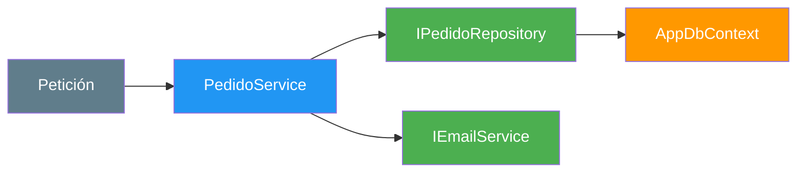
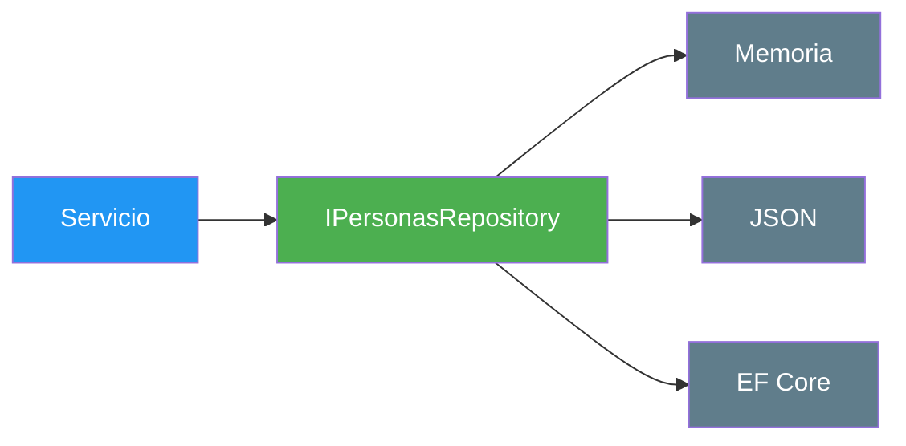
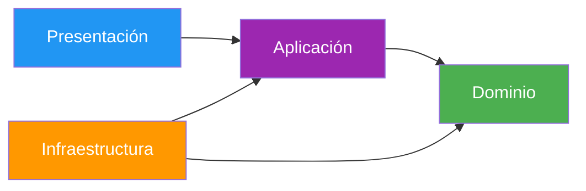
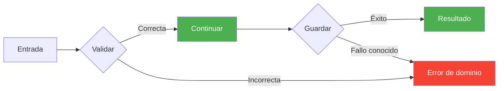
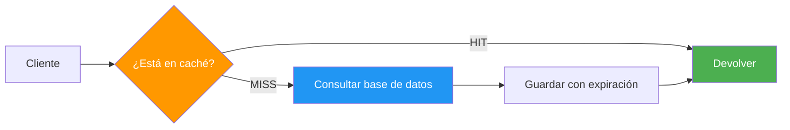
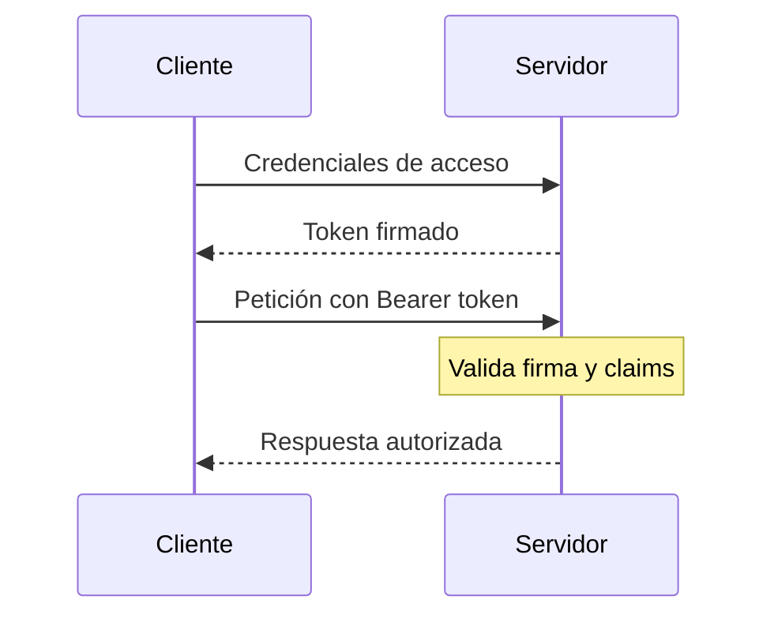

<div class="flex items-center gap-4 w-full">
  
  <span class="ud-pill">Desarrollo Web en Entorno Servidor · 2DAW · 2026-2027</span>
</div>

# Introducción al desarrollo<br>de software en servidor

### Parte 2: C# avanzado para desarrollo servidor

<div class="mt-10 flex items-end justify-between w-full">
  <div class="text-left">
    <b class="text-lg">José Luis González Sánchez</b><br/>
    <span class="opacity-70">IES Luis Vives · Leganés</span>
  </div>
  <PacMan :size="54" label="Preparando la aplicación..." />
</div>

---

## 📦 Materiales de la unidad

Todo el material de la UD01 está publicado en el repositorio de GitHub, organizado por carpetas:

<div class="grid grid-cols-2 gap-6 items-start">
<div>

- 📚 **14 puntos** — C# avanzado y ejemplos
- 📝 **Prácticas** — actividades en `practicas/`
- 💻 **Soluciones** — proyectos en `soluciones/`
- 🖼️ **Imágenes y recursos** — en `images/`
- 🎬 **Vídeos** — lista en YouTube

</div>
<div class="flex flex-col items-center justify-center gap-4 pt-4">
<div class="flex flex-col items-center gap-1 text-sm">
  <span class="text-xs opacity-70">Repositorio con materiales de la unidad</span>
  <RepoBadge />
</div>

<div class="text-sm opacity-75 text-center max-w-55">

Clónalo, forquéalo o descárgalo en zip: el material siempre está a un clic.

</div>
</div>
</div>

---

## 🎯 Resultado de aprendizaje: RA 1

<RaaCcee
  code="RA 1"
  title="Selecciona las arquitecturas y tecnologías de programación web en entorno servidor, analizando sus capacidades y características propias."
  :letters="['a', 'b', 'c', 'd', 'e', 'f', 'g']"
  :ccee="[
    'Se han caracterizado y diferenciado los modelos de ejecución de código en el servidor y en el cliente web.',
    'Se han reconocido las ventajas que proporciona la generación dinámica de páginas.',
    'Se han identificado los mecanismos de ejecución de código en los servidores web.',
    'Se han reconocido las funcionalidades que aportan los servidores de aplicaciones y su integración con los servidores web.',
    'Se han identificado y caracterizado los principales lenguajes y tecnologías relacionados con la programación web en entorno servidor.',
    'Se han verificado los mecanismos de integración de los lenguajes de marcas con los lenguajes de programación en entorno servidor.',
    'Se han reconocido y evaluado las herramientas y frameworks de programación en entorno servidor.',
  ]"
/>

---

## 📚 Parte 2: C# avanzado (1/2)

<div class="grid grid-cols-2 gap-3">

<TopicCard :num="11" title="Inyección de dependencias" desc="Abstracciones y ciclos de vida" />
<TopicCard :num="12" title="Patrones y arquitecturas" desc="Repository, Service y Factory" />
<TopicCard :num="13" title="LINQ y DataFrames" desc="Consultas y datos" />
<TopicCard :num="14" title="Ficheros y formatos" desc="Streams y serialización" />
<TopicCard :num="15" title="Result y excepciones" desc="Modelar los errores" />
<TopicCard :num="16" title="Concurrencia y asincronía" desc="Tareas y cancelación" />
<TopicCard :num="17" title="Programación reactiva" desc="Flujos de datos" />

</div>

---

## 📚 Parte 2: C# avanzado (2/2)

<div class="grid grid-cols-2 gap-3">

<TopicCard :num="18" title="Consumo de APIs con Refit" desc="Clientes y resiliencia" />
<TopicCard :num="19" title="Configuration y logging" desc="Opciones y registros" />
<TopicCard :num="20" title="Entity Framework Core" desc="Persistencia y migraciones" />
<TopicCard :num="21" title="SQL y NoSQL" desc="ACID, BASE y caché" />
<TopicCard :num="22" title="Testing avanzado" desc="Pruebas y depuración" />
<TopicCard :num="23" title="Docker" desc="Contenedores y Compose" />
<TopicCard :num="24" title="Seguridad" desc="Autenticación y protección" />

</div>

---
layout: section
---

<div class="ud-section-number">11</div>

# Inyección de dependencias

<div class="opacity-70">Solicita lo que necesitas sin construirlo dentro de cada clase</div>

---

## 11 · Punto de partida

<div class="grid grid-cols-2 gap-5 items-start">
<div>

<TipBox type="consejo" title="Punto de partida">

¿Tendrías que construir una cafetera cada vez que quieres tomar café? ¿Y si cambias de proveedor?

</TipBox>

<TipBox type="analogia">

En una cafetería pides el café; otra persona decide cómo prepararlo y te lo entrega.

</TipBox>

</div>
<div>

<Objetivos :items="[
  'Identificar el acoplamiento y aplicar inversión de dependencias',
  'Registrar y resolver servicios en .NET',
  'Distinguir transient, scoped y singleton',
  'Configurar DI en consola y usar Scrutor',
]" />

</div>
</div>

---

## 🔗 El problema del acoplamiento duro

```csharp
public class PedidoService
{
    private readonly PedidoRepository _repository = new();
    private readonly EmailService _email = new();

    public void CrearPedido(Pedido pedido)
    {
        _repository.Guardar(pedido);
        _email.EnviarConfirmacion(pedido.Cliente.Email);
    }
}
```

La clase **crea y conoce** sus dependencias concretas: cambiarlas obliga a modificarla y probarla puede requerir la base de datos o el correo reales.

---

## 🔄 Inversión de dependencias e inyección

```csharp
public class PedidoService(
    IPedidoRepository repository,
    IEmailService email)
{
    public void CrearPedido(Pedido pedido)
    {
        repository.Guardar(pedido);
        email.EnviarConfirmacion(pedido.Cliente.Email);
    }
}
```

<TipBox type="nota">

El servicio recibe implementaciones desde fuera. **DIP** es el principio de depender de abstracciones; **DI** es una técnica para suministrarlas.

</TipBox>

---

## 🧩 El contenedor de .NET

```csharp
// Registro en la composición de la aplicación
builder.Services.AddScoped<IPedidoRepository, PedidoRepository>();
builder.Services.AddScoped<IPedidoService, PedidoService>();
builder.Services.AddSingleton<ICacheService, CacheService>();
```

- `IServiceCollection` reúne los registros: **qué contrato**, **qué implementación** y **con qué ciclo de vida**.
- El proveedor de servicios crea el grafo y resuelve las dependencias de sus constructores.
- En ASP&#46;NET Core el host prepara el contenedor y crea un ámbito para cada petición HTTP.

---

## 🔍 ¿Cómo se resuelve un servicio?



El contenedor construye las dependencias necesarias antes de entregar el servicio. Si falta un registro obligatorio, la resolución falla: no debe ocultarse el error.

---

## ⏱️ Ciclos de vida de los servicios

| Ciclo | Creación y reutilización | Ejemplo |
|---|---|---|
| **Transient** | Una instancia nueva por resolución | Validador ligero |
| **Scoped** | Una instancia por ámbito; en web, normalmente por petición | Repositorio y `DbContext` |
| **Singleton** | Una instancia compartida por el contenedor | Caché o servicio sin estado |

<TipBox type="advertencia">

Un singleton es compartido entre peticiones: su estado mutable debe ser seguro ante concurrencia. No inyectes directamente un servicio scoped en un singleton.

</TipBox>

---

## 🪤 Dependencias cautivas

Un servicio de vida larga puede **retener** una dependencia creada para una vida más corta:

- Un singleton no debe capturar un `DbContext` scoped: compartiría estado entre peticiones y rompería su ámbito.
- Un transient inyectado en singleton también queda retenido mientras viva el singleton; valora si su estado y liberación son adecuados.
- Si un proceso de larga duración necesita trabajo scoped, crea un **ámbito explícito** y libera ese ámbito al terminar.

<TipBox type="consejo">

Elige el ciclo de vida por el estado y los recursos que maneja el servicio, no solo por su nombre.

</TipBox>

---

## 🧭 Constructor frente a Service Locator

<div class="grid grid-cols-2 gap-5 items-start">
<div>

<ConceptCard icon="✅" title="Inyección por constructor" accent="green">

- Declara las dependencias necesarias.
- El objeto llega preparado para trabajar.
- Facilita sustituirlas en las pruebas.

</ConceptCard>

</div>
<div>

<ConceptCard icon="⚠️" title="Service Locator" accent="orange">

- La clase busca sus dependencias en un localizador.
- Oculta lo que necesita y acopla al mecanismo de resolución.
- Los fallos aparecen al ejecutar esa búsqueda.

</ConceptCard>

</div>
</div>

La inyección por propiedad o método puede ser útil en casos concretos, pero para dependencias obligatorias preferimos el constructor.

---

## 🖥️ DI también en aplicaciones de consola

```csharp
using Microsoft.Extensions.DependencyInjection;

var services = new ServiceCollection();
services.AddScoped<IAcademiaService, AcademiaService>();
services.AddSingleton<IPersonasRepository, PersonasMemoryRepository>();

using var provider = services.BuildServiceProvider();
using var scope = provider.CreateScope();
var service = scope.ServiceProvider
    .GetRequiredService<IAcademiaService>();

var personas = service.GetAll();
```

El ámbito explícito controla la vida de los servicios scoped; al liberarlo también se liberan los recursos que le pertenecen.

---

## 🗂️ Organizar las responsabilidades

| Carpeta | Responsabilidad |
|---|---|
| `Models/` | Conceptos del dominio |
| `Repositories/` | Acceso a datos e implementaciones |
| `Services/` y `Validators/` | Casos de uso y validación |
| `Entity/` | Contexto y entidades de persistencia |
| `Infrastructure/` | Configuración y composición de dependencias |

Centralizar los registros facilita encontrar dónde se conecta cada contrato con su implementación.

---

## 🔎 Scrutor: registro por escaneo

```csharp
services.Scan(scan => scan
    .FromAssemblyOf<Program>()
    .AddClasses(c => c.AssignableTo<IScopedService>())
        .AsImplementedInterfaces()
        .WithScopedLifetime()
    .AddClasses(c => c.AssignableTo<ISingletonService>())
        .AsImplementedInterfaces()
        .WithSingletonLifetime()
);
```

Scrutor encuentra clases de un ensamblado y las registra siguiendo los filtros indicados. En esta estrategia, las interfaces marcadoras identifican el ciclo de vida.

---

## 🏷️ Marcadores y registros explícitos

```csharp
public interface IScopedService { }
public interface ISingletonService { }

public class PedidoRepository : IPedidoRepository, IScopedService
{
    // Implementación del contrato
}
```

Si una clase no cumple el filtro, **no se registra por ese escaneo**. Las factorías y dependencias que requieren parámetros pueden registrarse manualmente.

<TipBox type="advertencia">

Los marcadores son una convención de esta estrategia, no un requisito general de Scrutor.

</TipBox>

---

## 🎛️ Elegir implementación por configuración

```csharp
var tipo = builder.Configuration["Pedidos:RepositoryType"];

switch (tipo)
{
    case "MongoDbNative":
        builder.Services.AddScoped<IPedidosRepository, PedidosNativeRepository>();
        break;
    case "EfCore":
        builder.Services.AddScoped<IPedidosRepository, PedidosEfCoreRepository>();
        break;
    default:
        throw new InvalidOperationException("Repositorio de pedidos no válido");
}
```

Tras el escaneo, registra explícitamente la implementación elegida. Una configuración desconocida debe fallar de forma clara, no seleccionar otra base de datos por sorpresa.

---

## ✅ Resumen del punto 11

<div class="grid grid-cols-2 gap-5 items-start">
<div>

| Idea | Clave |
|---|---|
| DIP y DI | Contratos y suministro de dependencias |
| Constructor | Dependencias explícitas |
| Ciclo de vida | Transient, scoped o singleton |
| Scrutor | Registro por convenciones |

</div>
<div>

<ConceptCard icon="✅" title="Buenas prácticas" accent="green">

- Mantén la composición en un lugar identificable.
- Evita servicios scoped capturados por singletons.
- Comprueba los filtros y registros automáticos.

</ConceptCard>

**⏭️ ¿Qué viene después?** Patrones y arquitectura.

</div>
</div>

---
layout: section
---

<div class="ud-section-number">12</div>

# Patrones y arquitecturas

<div class="opacity-70">Organizar responsabilidades sin mezclar negocio e infraestructura</div>

---

## 12 · Punto de partida

<div class="grid grid-cols-2 gap-5 items-start">
<div>

<TipBox type="consejo" title="Punto de partida">

En una casa, ¿pondrías las tuberías y el cableado sin distinguir qué función cumple cada instalación?

</TipBox>

<TipBox type="analogia">

Los patrones proponen formas conocidas de repartir responsabilidades; no son recetas que debamos aplicar sin necesidad.

</TipBox>

</div>
<div>

<Objetivos :items="[
  'Separar acceso a datos y lógica de negocio',
  'Aplicar Repository, Service, Factory y Decorator',
  'Entender las dependencias en Clean Architecture',
  'Organizar el proyecto de forma coherente',
]" />

</div>
</div>

---

## 📁 Repository: un contrato para acceder a datos



El servicio trabaja con el **contrato**, mientras cada implementación sabe cómo consultar o guardar. Cambiar la tecnología requiere adaptar la composición y respetar el comportamiento del contrato.

---

## 🧱 Un contrato, varias implementaciones

```csharp
public interface IPersonasRepository
{
    IEnumerable<Persona> GetAll();
    Persona? GetById(int id);
    Persona Add(Persona persona);
    void Delete(int id);
}

public class PersonasMemoryRepository : IPersonasRepository
{
    private readonly List<Persona> _personas = new();
    public Persona? GetById(int id) =>
        _personas.FirstOrDefault(p => p.Id == id);
    // Resto de operaciones omitidas
}
```

La implementación en memoria es útil para aprender o simular almacenamiento; no sustituye todas las pruebas contra una base de datos real.

---

## ⚙️ Service: lógica de negocio

```csharp
public class AcademiaService(
    IPersonasRepository repository,
    IValidador<Persona> validador)
{
    public Result<Persona> Save(Persona persona)
    {
        var error = validador.Validar(persona);
        if (error is not null) return Result.Failure<Persona>(error);
        if (repository.GetAll().Any(p => p.Dni == persona.Dni))
            return Result.Failure<Persona>("DNI ya existe");
        return Result.Success(repository.Add(persona));
    }
}
```

El servicio valida y coordina el caso de uso; el repositorio se ocupa del acceso a datos. Una restricción única en la base de datos también protege frente a escrituras concurrentes.

---

## 🏭 Factory: encapsular la creación

```csharp
public static IPersonasRepository Create(
    string tipo, AppDbContext context) => tipo switch
{
    "memory" => new PersonasMemoryRepository(),
    "json"   => new PersonasJsonRepository(),
    "efcore" => new PersonasEfRepository(context),
    _ => throw new ArgumentException("Tipo de repositorio desconocido")
};
```

La factoría concentra la decisión de **qué objeto crear**. Puede ser útil si la elección depende de datos disponibles en ejecución; si la elección es fija al arrancar, el registro de DI puede bastar.

---

## 🎁 Decorator: añadir comportamiento

```csharp
public class PedidoServiceConLog(
    IPedidoService inner,
    ILogger<PedidoServiceConLog> logger) : IPedidoService
{
    public void CrearPedido(Pedido pedido)
    {
        logger.LogInformation("Creando pedido {Id}", pedido.Id);
        inner.CrearPedido(pedido);
        logger.LogInformation("Pedido {Id} creado", pedido.Id);
    }
}
```

El decorador conserva el contrato y **envuelve** otra implementación: añade registro, caché u otro comportamiento sin modificar la clase original.

---

## 🧅 Clean Architecture: dependencias hacia dentro



El dominio define conceptos y reglas centrales; las capas exteriores se adaptan a ellos. Una interfaz interna permite que infraestructura implemente un detalle sin que el dominio dependa de la base de datos.

---

## 🗂️ Capas y organización

| Capa | Contenido habitual |
|---|---|
| **Dominio** | Modelos, reglas y contratos |
| **Aplicación** | Casos de uso, servicios y validadores |
| **Infraestructura** | Persistencia, configuración y clientes externos |
| **Presentación** | Controladores, rutas y entrada HTTP |

Las carpetas como `Models/`, `Repositories/`, `Services/`, `Dto/` e `Infrastructure/` ayudan a localizar responsabilidades. Una organización coherente importa más que crear carpetas por inercia.

---

## ✅ Resumen del punto 12

<div class="grid grid-cols-2 gap-5 items-start">
<div>

| Patrón | Función |
|---|---|
| Repository | Abstraer el acceso a datos |
| Service | Coordinar reglas de negocio |
| Factory | Encapsular la creación |
| Decorator | Añadir comportamiento |

</div>
<div>

<ConceptCard icon="✅" title="Buenas prácticas" accent="green">

- Mantén las dependencias hacia el dominio.
- Separa persistencia y reglas de negocio.
- Introduce abstracciones cuando aporten valor.

</ConceptCard>

**⏭️ ¿Qué viene después?** Consultas con LINQ y DataFrames.

</div>
</div>

---
layout: section
---

<div class="ud-section-number">13</div>

# LINQ y DataFrames

<div class="opacity-70">Consultar y transformar datos con intención</div>

---

## 13 · Punto de partida

<div class="grid grid-cols-2 gap-5 items-start">
<div>

<TipBox type="consejo" title="Punto de partida">

¿Cómo obtendrías los productos caros ordenados por nombre sin escribir un bucle y una lista auxiliar?

</TipBox>

<TipBox type="analogia">

Con LINQ describes la compra que necesitas; no detallas cada paso por los pasillos.

</TipBox>

</div>
<div>

<Objetivos :items="[
  'Filtrar, proyectar, ordenar y agregar datos',
  'Agrupar y relacionar colecciones',
  'Distinguir consultas en memoria y en base de datos',
  'Elegir entre LINQ, PLINQ y DataFrame',
]" />

</div>
</div>

---

## 🔎 Consultas declarativas con LINQ

```csharp
var resultados = clientes
    .Where(c => c.Ciudad == "Madrid" && c.Activo)
    .OrderBy(c => c.Nombre)
    .ToList();
```

- `Where` **filtra**: conserva los clientes que cumplen la condición.
- `OrderBy` **ordena** los resultados por nombre.
- `ToList` **ejecuta y materializa** la consulta en una lista.

<TipBox type="nota">

Muchas operaciones LINQ se evalúan al enumerarlas. Si necesitas una instantánea, materialízala; si vuelves a enumerar una consulta diferida, puede volver a ejecutarse.

</TipBox>

---

## 🧺 Filtrar, proyectar y ordenar

```csharp
var resumen = productos
    .Where(p => p.Precio > 100)
    .OrderByDescending(p => p.Precio)
    .ThenBy(p => p.Nombre)
    .Select(p => new { p.Nombre, p.Precio })
    .ToList();
```

`Select` transforma cada elemento; no es un filtro. `ThenBy` añade un criterio de desempate sin sustituir el primero.

<TipBox type="consejo">

Proyecta solo los datos que necesitas, especialmente cuando una consulta se traduce a SQL.

</TipBox>

---

## 🔢 Agregar y paginar

```csharp
int total = productos.Count();
decimal suma = productos.Sum(p => p.Precio);
decimal media = productos.Average(p => p.Precio);

var pagina = productos
    .OrderBy(p => p.Id)
    .Skip((numeroPagina - 1) * tamanoPagina)
    .Take(tamanoPagina)
    .ToList();
```

`Count`, `Sum`, `Average`, `Min` y `Max` reducen una secuencia a un valor. Al paginar, usa un orden estable y valida número y tamaño de página.

---

## 🎯 ¿Uno, el primero o alguno?

| Operación | Resultado | Secuencia vacía |
|---|---|---|
| `First` | Primer elemento | Excepción |
| `FirstOrDefault` | Primero o valor predeterminado | `default` |
| `Single` | Exige exactamente uno | Excepción |
| `SingleOrDefault` | Cero o uno; falla si hay varios | `default` |
| `Any` / `All` | Comprueban condiciones | `false` / `true` |

El valor predeterminado depende del tipo: no siempre es `null`. `All` devuelve `true` para una secuencia vacía.

---

## 🗃️ Agrupar por categoría

```csharp
var porCategoria = productos
    .GroupBy(p => p.Categoria)
    .ToDictionary(g => g.Key, g => g.ToList());

if (porCategoria.TryGetValue("Electrónica", out var grupo))
    Console.WriteLine(grupo.Count);
```

`GroupBy` crea grupos por clave. Un diccionario es útil cuando necesitas **consultar repetidamente por clave**; una lista de grupos puede ser suficiente para recorrerlos todos.

---

## 🔗 Relacionar colecciones con Join

```csharp
var resultado = clientes.Join(
    ciudades,
    cliente => cliente.CiudadId,
    ciudad => ciudad.Id,
    (cliente, ciudad) => new
    {
        cliente.Nombre,
        Ciudad = ciudad.Nombre
    });
```

Un **inner join** devuelve coincidencias. Para conservar los elementos de la izquierda sin pareja, combina `GroupJoin`, `SelectMany` y `DefaultIfEmpty` para construir un left join.

---

## 🗄️ LINQ en memoria y en base de datos

```csharp
var resumen = await context.Productos
    .Where(p => p.Precio > 100)
    .OrderBy(p => p.Nombre)
    .Select(p => new { p.Nombre, p.Precio })
    .ToListAsync();
```

Con `IQueryable`, EF Core construye una consulta que el proveedor intenta traducir a SQL; `ToListAsync` la ejecuta. No todos los métodos de C# se traducen: revisa la consulta y evita cargar datos de más para filtrarlos después.

---

## 🧵 PLINQ: paralelismo para trabajo de CPU

```csharp
var resultado = productos
    .AsParallel()
    .Where(p => p.Precio > 100)
    .Select(p => ProcesarProducto(p))
    .ToList();
```

- Aprovecha varios núcleos si el trabajo por elemento compensa la coordinación.
- El orden no se conserva por defecto; `AsOrdered` permite solicitarlo.
- Evita efectos secundarios compartidos sin sincronización y **mide** antes de decidir.

Para E/S asíncrona, utiliza tareas asíncronas y límites de concurrencia en lugar de bloquear hilos con PLINQ.

---

## 🧰 Más operaciones de LINQ

```csharp
var productos = pedidos.SelectMany(p => p.Productos);
var parejas = nombres.Zip(edades, (nombre, edad) => new { nombre, edad });
var comunes = lista1.Intersect(lista2);
var soloEnPrimera = lista1.Except(lista2);
var lotes = Enumerable.Range(1, 100).Chunk(10);
```

`SelectMany` aplana secuencias; `Zip` combina posiciones; `Distinct`, `Union`, `Intersect` y `Except` operan como conjuntos; `Chunk` divide en lotes.

---

## 📊 DataFrame: datos por columnas

```csharp
using Microsoft.Data.Analysis;

var datos = DataFrame.LoadCsv("accidentes.csv");
var alcohol = datos.Filter(
    datos.Columns["PositivoAlcohol"].ElementwiseEquals(true));
var media = alcohol.Columns["Edad"].Mean();
```

Un DataFrame representa filas y **columnas tipadas**: resulta cómodo para filtrar, agrupar y calcular estadísticas sobre datos tabulares.

---

## 📊 DataFrame: agrupar y seleccionar

```csharp
var people = DataFrame.LoadCsv("personas.csv");
var selected = new DataFrame(
    people.Columns["Nombre"], people.Columns["Ciudad"]);
var byCity = people.GroupBy<string>("Ciudad");

foreach (var group in byCity.Groupings)
    Console.WriteLine($"{group.Key}: {group.Count()}");
```

La selección trabaja con columnas; `GroupBy` reúne las filas por clave. Comprueba los tipos y los valores nulos al cargar el CSV, especialmente antes de filtrar o agregar.

---

## 🧭 LINQ, PLINQ o DataFrame

| Herramienta | Encaja especialmente con |
|---|---|
| LINQ | Objetos de dominio y consultas legibles |
| PLINQ | Colecciones en memoria con cálculos de CPU costosos |
| DataFrame | Análisis de columnas, CSV y estadísticas |
| EF Core | Consultas que deben ejecutarse en la base de datos |

<TipBox type="consejo">

No hay un número universal de filas que determine la herramienta: importan el coste por registro, la memoria, el origen de datos y las mediciones.

</TipBox>

---

## ✅ Resumen del punto 13

<div class="grid grid-cols-2 gap-5 items-start">
<div>

| Operación | Función |
|---|---|
| `Where` / `Select` | Filtrar / transformar |
| `GroupBy` / `Join` | Agrupar / relacionar |
| `Skip` / `Take` | Paginar |
| `ToList` | Materializar |

</div>
<div>

<ConceptCard icon="✅" title="Buenas prácticas" accent="green">

- Distingue la consulta de su ejecución.
- Ordena de forma estable al paginar.
- Mide antes de paralelizar.

</ConceptCard>

**⏭️ ¿Qué viene después?** Ficheros y formatos de intercambio.

</div>
</div>

---
layout: section
---

<div class="ud-section-number">14</div>

# Ficheros y formatos

<div class="opacity-70">Gestionar recursos y mover datos de forma segura</div>

---

## 14 · Punto de partida

<div class="grid grid-cols-2 gap-5 items-start">
<div>

<TipBox type="consejo" title="Punto de partida">

Al cerrar una aplicación desaparecen los datos en memoria. ¿Cómo los guardamos sin dejar ficheros abiertos?

</TipBox>

<TipBox type="analogia">

Un stream es una tubería; `using` garantiza que cerremos el recurso al acabar de utilizarlo.

</TipBox>

</div>
<div>

<Objetivos :items="[
  'Liberar recursos con IDisposable y using',
  'Leer y escribir con System.IO y streams',
  'Trabajar con CSV y JSON',
  'Elegir el formato adecuado para cada intercambio',
]" />

</div>
</div>

---

## 🔐 IDisposable y using

```csharp
using var writer = new StreamWriter("datos.txt");
writer.WriteLine("Hola mundo");
```

`using` llama a `Dispose` al salir del ámbito, también cuando se produce una excepción. Esto permite cerrar recursos como ficheros o conexiones.

<TipBox type="advertencia">

Liberar el recurso no garantiza que una operación de escritura incompleta sea atómica ni que se hayan conservado los datos ante un fallo.

</TipBox>

---

## 📂 Operaciones de System&#46;IO

```csharp
string texto = File.ReadAllText("datos.txt");
File.WriteAllText("salida.txt", texto);
File.AppendAllText("log.txt", "Nuevo evento\n");

string ruta = Path.Combine("datos", "personas.csv");
string extension = Path.GetExtension(ruta);
```

`File` ofrece operaciones sencillas; `Directory` gestiona directorios y `Path` compone o examina rutas. Leer todo el fichero a memoria es apropiado solo cuando su tamaño lo permite.

---

## 🚰 Lectura y escritura progresivas

```csharp
using var reader = new StreamReader("personas.txt");
using var writer = new StreamWriter("copia.txt");

string? linea;
while ((linea = reader.ReadLine()) is not null)
{
    writer.WriteLine(linea);
}
```

Procesar línea a línea evita cargar necesariamente el fichero completo. Para operaciones de E/S prolongadas también existen alternativas asíncronas.

---

## 🧱 Streams: bytes que fluyen

| Tipo | Origen o destino |
|---|---|
| `FileStream` | Fichero |
| `MemoryStream` | Memoria |
| `NetworkStream` | Red |
| `CryptoStream` | Transformación criptográfica |

`StreamReader` y `StreamWriter` **envuelven** un stream para trabajar con texto y codificación: no son subclases de `Stream`. Se pueden componer capas de lectura, transformación y escritura.

---

## 🧠 Un stream en memoria

```csharp
using var memoria = new MemoryStream();
using var writer = new StreamWriter(memoria, Encoding.UTF8, 1024, leaveOpen: true);
writer.WriteLine("Datos en memoria");
writer.Flush();

memoria.Position = 0;
using var reader = new StreamReader(memoria);
string contenido = reader.ReadToEnd();
```

`Flush` envía el contenido del búfer; volver a la posición cero permite leer desde el principio. `leaveOpen` mantiene abierto el stream subyacente al liberar el escritor.

---

## 📑 CSV con CsvHelper

```csharp
using CsvHelper;
using System.Globalization;

using var reader = new StreamReader("personas.csv");
using var csv = new CsvReader(reader, CultureInfo.InvariantCulture);
var personas = csv.GetRecords<PersonaCsv>().ToList();
```

Un CSV representa datos tabulares como texto. CsvHelper interpreta cabeceras, delimitadores y campos entrecomillados; separar manualmente por comas no maneja correctamente comas o saltos de línea dentro de un campo.

---

## ✍️ Escribir CSV y elegir delimitador

```csharp
var config = new CsvConfiguration(CultureInfo.InvariantCulture)
{
    Delimiter = ";",
    HasHeaderRecord = true
};

using var writer = new StreamWriter("personas.csv");
using var csv = new CsvWriter(writer, config);
csv.WriteRecords(personas);
```

Acuerda con el receptor el separador, la cultura para números y fechas y la codificación. Mantén activas las validaciones de cabeceras y campos salvo que tengas una razón concreta para cambiarlas.

---

## 📦 JSON: serializar y deserializar

```csharp
using System.Text.Json;

var opciones = new JsonSerializerOptions
{
    WriteIndented = true,
    PropertyNamingPolicy = JsonNamingPolicy.CamelCase
};

string json = JsonSerializer.Serialize(personas, opciones);
var recuperadas = JsonSerializer.Deserialize<List<Persona>>(json);
```

Serializar transforma objetos en JSON; deserializar reconstruye objetos. El resultado puede ser `null` y el JSON mal formado puede producir una excepción.

---

## 🔬 Leer solo una parte del JSON

```csharp
using var documento = JsonDocument.Parse(json);
var raiz = documento.RootElement;

if (raiz.TryGetProperty("nombre", out var nombre))
    Console.WriteLine(nombre.GetString());
```

`JsonDocument` permite explorar datos sin definir un modelo completo. Libera el documento y comprueba la presencia y el tipo de las propiedades antes de usarlas.

---

## ⚖️ CSV, JSON y XML

| Formato | Uso habitual | Característica |
|---|---|---|
| CSV | Exportación tabular | Filas y columnas, sin estructura anidada nativa |
| JSON | APIs y configuración | Objetos, listas y tipos básicos |
| XML | Documentos y sistemas empresariales | Jerarquía y esquemas |

Para convertir CSV a JSON: lee los registros, valida los datos, serialízalos y escribe el resultado. Para ficheros grandes, considera procesamiento progresivo.

---

## ✅ Resumen del punto 14

<div class="grid grid-cols-2 gap-5 items-start">
<div>

| Concepto | Función |
|---|---|
| `using` | Liberación determinista |
| `Stream` | Flujo de bytes |
| CsvHelper | Lectura y escritura CSV |
| `System.Text.Json` | Procesamiento JSON |

</div>
<div>

<ConceptCard icon="✅" title="Buenas prácticas" accent="green">

- Libera recursos y controla los errores de E/S.
- Usa bibliotecas para formatos estructurados.
- Define codificación, cultura y delimitador.

</ConceptCard>

**⏭️ ¿Qué viene después?** Resultados y errores de dominio.

</div>
</div>

---
layout: section
---

<div class="ud-section-number">15</div>

# Result y excepciones

<div class="opacity-70">Modelar los fallos esperados como parte del contrato</div>

---

## 15 · Punto de partida

<div class="grid grid-cols-2 gap-5 items-start">
<div>

<TipBox type="consejo" title="Punto de partida">

Una persona no aparece en la búsqueda. ¿Es un fallo inesperado del sistema o un resultado que debemos comunicar?

</TipBox>

<TipBox type="analogia">

En Railway Oriented Programming una operación continúa por la vía de éxito o pasa a la vía de error.

</TipBox>

</div>
<div>

<Objetivos :items="[
  'Distinguir fallos esperados y excepciones',
  'Modelar errores de dominio y resultados',
  'Encadenar operaciones con Bind y Map',
  'Usar Maybe, validación y operaciones asíncronas',
]" />

</div>
</div>

---

## 🚦 Dos vías para una operación



Un fallo conocido se devuelve como resultado y puede propagarse sin usar excepciones como control de flujo. Las excepciones siguen siendo necesarias para situaciones inesperadas.

---

## 🎭 Resultado, ausencia y excepción

| Situación | Representación habitual |
|---|---|
| Una búsqueda puede no encontrar nada | `T?` o `Maybe<T>` |
| La operación puede fallar con contexto | `Result<T, TError>` |
| Base de datos inaccesible o configuración inválida | Excepción tratada en el límite adecuado |

El contrato debe explicar qué significa cada caso. Un fallo de infraestructura no debe convertirse silenciosamente en «no encontrado».

---

## 🧩 Union types y alternativas actuales

Una unión representa **uno de varios casos posibles**: por ejemplo, producto creado, nombre inválido o producto duplicado.

- Un tipo de resultado puede expresar éxito o error sin utilizar `null` como señal ambigua.
- La propuesta de uniones nativas de C# 15 depende de la versión y del estado del compilador.
- Aquí usamos `CSharpFunctionalExtensions` y errores modelados con `record`; no dependemos de sintaxis experimental.

---

## 🏷️ Errores de dominio

```csharp
public abstract record DomainError(string Message)
{
    public sealed record NotFound(int Id)
        : DomainError($"Persona {Id} no encontrada");

    public sealed record AlreadyExists(string Email)
        : DomainError($"El email {Email} ya existe");

    public sealed record Validation(string Detail)
        : DomainError(Detail);
}
```

Los casos identifican el motivo del fallo y permiten reaccionar de forma distinta. Evita mostrar al cliente detalles técnicos sensibles de excepciones o infraestructura.

---

## 🚂 Crear y consumir un Result

```csharp
Result<Persona, DomainError> resultado =
    persona is not null
        ? Result.Success<Persona, DomainError>(persona)
        : Result.Failure<Persona, DomainError>(
            new DomainError.NotFound(id));

resultado.Match(
    onSuccess: p => Console.WriteLine(p.Nombre),
    onFailure: error => Console.WriteLine(error.Message));
```

`Match` obliga a decidir qué hacer en ambos caminos. Consulta `Value` solo en éxito y `Error` solo en fallo.

---

## 🔗 Bind frente a Map

```csharp
var resultado = Result.Success<Persona, DomainError>(persona)
    .Bind(validador.Validar)
    .Bind(ComprobarEmailUnico)
    .Map(p => p.Nombre);
```

- **Bind** encadena una función que puede devolver otro `Result`.
- **Map** transforma el valor de éxito sin añadir otro resultado.
- Si una operación falla, las siguientes del camino de éxito no se ejecutan y el error se propaga.

---

## ✅ Ensure, Tap y MapError

```csharp
var resultado = ObtenerPersona(id)
    .Ensure(p => p.Activa, errorInactiva)
    .Tap(p => logger.LogInformation("Persona {Id}", p.Id))
    .TapError(e => logger.LogWarning("Error: {Mensaje}", e.Message))
    .MapError(AdaptarError);
```

`Ensure` comprueba una condición; `Tap` y `TapError` permiten efectos secundarios; `MapError` adapta el error. Un efecto secundario que lanza una excepción sigue pudiendo interrumpir el flujo.

---

## 🔍 Maybe: existe o no existe

```csharp
Maybe<Persona> persona = repository.GetById(id);

if (persona.HasValue)
    Console.WriteLine(persona.Value.Nombre);
```

`Maybe<T>` representa presencia o ausencia, pero no explica el motivo de un fallo. Al convertirlo en `Result`, proporcionamos el error que corresponde al caso de ausencia.

<TipBox type="nota">

Para errores personalizados puede utilizarse una extensión `ToResult` que devuelva `Result<T, TError>`, según la API disponible de la biblioteca.

</TipBox>

---

## 🧾 Validar varios campos

```csharp
var errores = new List<string>();
if (string.IsNullOrWhiteSpace(persona.Nombre))
    errores.Add("Nombre requerido");
if (!persona.Email.Contains('@'))
    errores.Add("Email inválido");
if (persona.Edad < 0)
    errores.Add("Edad no puede ser negativa");
```

Cuando las validaciones son independientes, reunir sus errores permite corregir varios campos a la vez. `Result.Combine` puede combinar resultados; asegúrate de definir cómo se agregan los errores.

---

## ⏳ Result con operaciones asíncronas

```csharp
public async Task<Result<Persona, DomainError>> GetByIdAsync(int id)
{
    var persona = await repository.GetByIdAsync(id);
    return persona is not null
        ? Result.Success<Persona, DomainError>(persona)
        : Result.Failure<Persona, DomainError>(
            new DomainError.NotFound(id));
}
```

`Task<Result<T, TError>>` representa una operación que termina más tarde y cuyo resultado puede ser éxito o fallo de dominio. No uses `async void` para métodos ordinarios.

---

## 🛟 Recuperación sin ocultar errores

Una búsqueda puede intentar primero la caché y después el repositorio:

1. Si la caché contiene el valor, devuélvelo.
2. Si no está, consulta la fuente de datos.
3. Si la fuente tampoco lo encuentra, devuelve `NotFound`.
4. Si ocurre un fallo de infraestructura, regístralo y trátalo como tal.

`OnFailureCompensate` puede implementar recuperación, pero debe distinguir **qué fallos** son recuperables. No conviertas cualquier error en una ausencia.

---

## 🚂 Del dato de entrada al resultado

```csharp
var result = Validate(request)
    .Bind(CheckEmailIsAvailable)
    .Bind(CreatePerson)
    .Tap(person => logger.LogInformation("Alta {Id}", person.Id));

return result.Match(
    person => Results.Created($"/personas/{person.Id}", person),
    error => Results.BadRequest(error.Message));
```

La validación, la comprobación y el alta forman una cadena: ante un fallo no se ejecutan los siguientes pasos. En una aplicación real, traduce cada tipo de error al estado HTTP que corresponda.

---

## ✅ Resumen del punto 15

<div class="grid grid-cols-2 gap-5 items-start">
<div>

| Concepto | Uso |
|---|---|
| `Result<T, E>` | Éxito o error con contexto |
| `Maybe<T>` | Valor presente o ausente |
| `Bind` / `Map` | Encadenar / transformar |
| `Match` | Consumir ambos caminos |

</div>
<div>

<ConceptCard icon="✅" title="Buenas prácticas" accent="green">

- Modela fallos de negocio esperados.
- No ocultes errores de infraestructura.
- Gestiona explícitamente el resultado final.

</ConceptCard>

**⏭️ ¿Qué viene después?** Concurrencia y asincronía.

</div>
</div>

---
layout: section
---

<div class="ud-section-number">16</div>

# Concurrencia y asincronía

<div class="opacity-70">Esperar sin bloquear y coordinar trabajo independiente</div>

---

## 16 · Punto de partida

<div class="grid grid-cols-2 gap-5 items-start">
<div>

<TipBox type="consejo" title="Punto de partida">

Una petición a una API tarda tres segundos. ¿Debe quedar un hilo del servidor parado durante toda la espera?

</TipBox>

<TipBox type="analogia">

Mientras esperas que te respondan a un mensaje, puedes continuar con otra tarea.

</TipBox>

</div>
<div>

<Objetivos :items="[
  'Distinguir sincronía, asincronía y paralelismo',
  'Utilizar Task, await y CancellationToken',
  'Coordinar operaciones independientes y gestionar sus errores',
  'Aplicar límites de concurrencia y canales',
]" />

</div>
</div>

---

## ⏳ Sincronía y operaciones de E/S

Una operación **síncrona bloqueante** mantiene ocupado el hilo hasta terminar. En una petición HTTP, una lectura de disco o una consulta a base de datos puede haber largos periodos de espera.

- Una operación **CPU-bound** dedica tiempo a calcular: compresión, cifrado o análisis.
- Una operación **I/O-bound** pasa tiempo esperando red, disco o un servicio externo.
- La E/S asíncrona permite aprovechar el hilo para otro trabajo mientras el recurso responde.

---

## 🧵 Hilos, núcleos y ThreadPool

El sistema operativo planifica los hilos disponibles sobre los núcleos y cambia entre ellos. Crear, mantener y cambiar hilos tiene un coste; el **ThreadPool** reutiliza hilos para ejecutar trabajo.

<TipBox type="advertencia">

Si muchas peticiones bloquean hilos esperando E/S, puede aparecer *starvation*: el trabajo nuevo queda esperando a que haya hilos disponibles.

</TipBox>

El número de hilos, el coste y la respuesta del pool dependen del entorno y de la carga: no son constantes universales.

---

## 📬 ¿Qué ocurre al hacer await?

```csharp
public async Task<string> LeerAsync(string ruta)
{
    using var reader = new StreamReader(ruta);
    string contenido = await reader.ReadToEndAsync();
    return contenido;
}
```

El método ejecuta código hasta que encuentra una operación incompleta. Entonces puede suspenderse sin bloquear el hilo; al completarse, se programa la continuación. Si la operación ya estaba completada, puede continuar inmediatamente.

---

## 🧠 Cuatro conceptos diferentes

| Concepto | Qué significa |
|---|---|
| **Sincronía** | El llamador espera a que la operación termine |
| **Asincronía** | Puede continuar sin bloquear el hilo durante la espera |
| **Concurrencia** | Varias operaciones progresan durante un mismo periodo |
| **Paralelismo** | Varias operaciones se ejecutan simultáneamente |

Una operación asíncrona no implica automáticamente un hilo nuevo ni paralelismo de CPU.

---

## 🎟️ Task y Task&lt;T&gt;

```csharp
Task guardado = GuardarAsync(persona);
Task<Persona?> busqueda = ObtenerAsync(id);

await guardado;
Persona? resultado = await busqueda;
```

Una `Task` representa el estado de una operación; `Task<T>` también transporta un valor. Puede completarse, fallar o cancelarse. `await` recupera el resultado y propaga el fallo o la cancelación.

---

## 🚫 No bloquees una operación asíncrona

```csharp
// Evita bloquear el hilo:
// var datos = client.GetStringAsync(url).Result;

// Espera de forma asíncrona:
var datos = await client.GetStringAsync(url);
```

`.Result` y `.Wait()` bloquean si la tarea no ha terminado. En interfaces gráficas pueden producir interbloqueos; en servidores, contribuyen al agotamiento del ThreadPool. Prefiere propagar `async` y `await`.

---

## 🕰️ ¿Secuencial o concurrente?

```csharp
// Secuencial: cada operación comienza después de la anterior
var csv = await LeerCsvAsync();
var json = await LeerJsonAsync();
var sqlite = await LeerSqliteAsync();
```

Si una operación necesita el resultado de la anterior, este orden es correcto. Si son **independientes** y los recursos lo permiten, pueden iniciarse antes de esperar.

---

## 🚀 Operaciones independientes con WhenAll

```csharp
var tareaCsv = LeerCsvAsync();
var tareaJson = LeerJsonAsync();
var tareaSqlite = LeerSqliteAsync();

await Task.WhenAll(tareaCsv, tareaJson, tareaSqlite);

var csv = await tareaCsv;
var json = await tareaJson;
var sqlite = await tareaSqlite;
```

Las tres operaciones se inician antes de esperar. Tras `WhenAll`, los `await` individuales recuperan sus resultados; no vuelven a ejecutar las operaciones.

---

## 🏁 WhenAll y WhenAny

| Método | Qué espera | Atención |
|---|---|---|
| `WhenAll` | Que terminen todas las tareas | Puede completar con error o cancelación |
| `WhenAny` | Que termine una tarea | Hay que esperar también la tarea ganadora |

```csharp
Task<string> primera = await Task.WhenAny(tareas);
string resultado = await primera;
```

`WhenAny` no cancela automáticamente las demás operaciones. Decide explícitamente si deben continuar o recibir una solicitud de cancelación.

---

## 🎛️ Limitar la concurrencia

```csharp
using var limite = new SemaphoreSlim(3);
var tareas = urls.Select(async url =>
{
    await limite.WaitAsync(token);
    try { return await DescargarAsync(url, token); }
    finally { limite.Release(); }
});

var resultados = await Task.WhenAll(tareas);
```

El semáforo limita las descargas simultáneas. Liberar el permiso en `finally` evita dejar el límite ocupado si la operación falla.

---

## 🛑 CancellationToken

```csharp
using var cts = new CancellationTokenSource();
cts.CancelAfter(TimeSpan.FromSeconds(5));

try
{
    var datos = await client.GetStringAsync(url, cts.Token);
}
catch (OperationCanceledException) when (cts.IsCancellationRequested)
{
    Console.WriteLine("Operación cancelada o tiempo agotado");
}
```

La cancelación es **cooperativa**: pasa el token a las operaciones que lo acepten y compruébalo en trabajos propios prolongados. Puedes enlazar tokens de distintas fuentes.

---

## ⚠️ async void y tareas olvidadas

- Usa `async Task` o `async Task<T>` para que el llamador pueda esperar y observar los errores.
- `async void` se reserva principalmente para manejadores de eventos que exigen ese retorno.
- Lanzar una tarea y olvidarla puede perder errores y terminar antes de completar el trabajo.
- Para trabajo en segundo plano, usa un mecanismo supervisado con ciclo de vida y registro de errores.

---

## 🚧 Errores con WhenAll

```csharp
var todas = Task.WhenAll(tareas);
try
{
    await todas;
}
catch (Exception ex)
{
    logger.LogError(ex, "Falló al menos una operación");
    // todas.Exception permite examinar los fallos agregados
    throw;
}
```

Al esperar `WhenAll` se propaga una excepción; la tarea agregada conserva las excepciones de las operaciones fallidas. La cancelación debe distinguirse del fallo.

---

## ⚙️ CPU, E/S y el coste del paralelismo

| Trabajo | Enfoque habitual |
|---|---|
| E/S asíncrona independiente | `await` y `Task.WhenAll`, con límites |
| Cálculo intensivo en CPU | `Parallel.ForEach` u otra estrategia medida |
| Cálculo pequeño | A menudo basta el código secuencial |

`Task.Run` programa trabajo en el ThreadPool; no transforma una E/S bloqueante en E/S asíncrona real. Repartir trabajo también cuesta tiempo y memoria: **mide** con datos reales.

---

## 🏭 Productor-consumidor con Channel

```csharp
var cola = Channel.CreateBounded<string>(
    new BoundedChannelOptions(100) { FullMode = BoundedChannelMode.Wait });

await cola.Writer.WriteAsync("pedido", token);
cola.Writer.Complete();

await foreach (var item in cola.Reader.ReadAllAsync(token))
    await ProcesarAsync(item, token);
```

El productor escribe y el consumidor lee; normalmente se ejecutan concurrentemente. Una cola acotada aplica presión cuando se llena. Si el productor termina o falla, debe completar el canal adecuadamente.

---

## 🏭 Canal: coordinar productor y consumidor

```csharp
async Task ProduceAsync(ChannelWriter<string> writer, CancellationToken token)
{
    try {
        await writer.WriteAsync("pedido", token);
        writer.Complete();
    } catch (Exception error) {
        writer.TryComplete(error);
        throw;
    }
}

await Task.WhenAll(ProduceAsync(cola.Writer, token),
    ConsumeAsync(cola.Reader, token));
```

Completar con error permite que el consumidor observe el fallo. Si una tarea falla, coordina también la cancelación de la otra para no dejarla esperando.

---

## 🌊 Task, ValueTask y flujos asíncronos

| Tipo | Para qué sirve |
|---|---|
| `Task<T>` | Una operación con resultado; opción habitual |
| `ValueTask<T>` | Optimización para casos medidos con finalización síncrona frecuente |
| `IAsyncEnumerable<T>` | Secuencia de elementos obtenidos asíncronamente |

```csharp
await foreach (var linea in LeerLineasAsync(ruta))
    Console.WriteLine(linea);
```

Un `ValueTask` puede tener restricciones de consumo; no lo esperes varias veces sin conocer el contrato. Un flujo permite procesar elementos sin esperar a reunirlos todos.

---

## ✅ Resumen del punto 16

<div class="grid grid-cols-2 gap-5 items-start">
<div>

| Concepto | Clave |
|---|---|
| `await` | Espera sin bloquear innecesariamente |
| `WhenAll` | Coordina tareas ya iniciadas |
| `CancellationToken` | Solicita cancelación cooperativa |
| `Channel<T>` | Comunica productor y consumidor |

</div>
<div>

<ConceptCard icon="✅" title="Buenas prácticas" accent="green">

- Distingue CPU de E/S.
- Observa errores y cancelación.
- Limita la concurrencia y mide.

</ConceptCard>

**⏭️ ¿Qué viene después?** Flujos reactivos con Rx&#46;NET.

</div>
</div>

---
layout: section
---

<div class="ud-section-number">17</div>

# Programación reactiva

<div class="opacity-70">Trabajar con valores que llegan a lo largo del tiempo</div>

---

## 17 · Punto de partida

<div class="grid grid-cols-2 gap-5 items-start">
<div>

<TipBox type="consejo" title="Punto de partida">

Un sensor envía temperaturas continuamente. ¿Cómo procesamos las lecturas sin tratarlas como una única respuesta?

</TipBox>

<TipBox type="analogia">

Un vídeo bajo demanda empieza cuando lo pides; una emisión en directo continúa aunque te conectes tarde.

</TipBox>

</div>
<div>

<Objetivos :items="[
  'Distinguir flujos fríos y calientes',
  'Consumir IAsyncEnumerable y observables',
  'Aplicar operadores y gestionar suscripciones',
  'Elegir el modelo adecuado para cada flujo',
]" />

</div>
</div>

---

## 🌊 Flujos: pull y push

| Modelo | Quién marca el ritmo | Ejemplo |
|---|---|---|
| **Pull asíncrono** | El consumidor pide el siguiente elemento | `IAsyncEnumerable<T>` |
| **Push** | El productor notifica a los suscriptores | `IObservable<T>` |

Un flujo **frío** suele iniciar la producción por cada consumidor; uno **caliente** comparte emisiones que pueden ocurrir antes de la suscripción. Un observable puede ser frío o caliente: no depende solo de su interfaz.

---

## 📄 IAsyncEnumerable y await foreach

```csharp
public async IAsyncEnumerable<string> LeerLineasAsync(string ruta)
{
    using var reader = new StreamReader(ruta);
    while (await reader.ReadLineAsync() is { } linea)
        yield return linea;
}

await foreach (var linea in LeerLineasAsync("datos.csv"))
    Console.WriteLine(linea);
```

El consumidor solicita cada elemento de forma asíncrona. Es útil para ficheros, páginas de una API o resultados grandes que pueden procesarse progresivamente.

---

## 🔔 IObservable y suscripciones

```csharp
using var subject = new Subject<string>();
using var suscripcion = subject.Subscribe(
    onNext: dato => Console.WriteLine(dato),
    onError: error => Console.WriteLine(error.Message),
    onCompleted: () => Console.WriteLine("Terminado"));

subject.OnNext("Hola");
subject.OnNext("Mundo");
subject.OnCompleted();
```

El observador recibe valores con `OnNext`; `OnError` o `OnCompleted` terminan el flujo. Liberar la suscripción deja de observar y evita retener recursos innecesariamente.

---

## 🏷️ Subject y sus variantes

| Tipo | Qué recibe un nuevo suscriptor |
|---|---|
| `Subject<T>` | Emisiones posteriores a la suscripción |
| `BehaviorSubject<T>` | Valor actual y emisiones posteriores |
| `ReplaySubject<T>` | Historial conservado y emisiones posteriores |
| `AsyncSubject<T>` | Último valor al completarse, si lo hay |

Controla la retención de `ReplaySubject`: un historial sin límite puede crecer en memoria. Encapsula el emisor para que no cualquiera pueda publicar eventos.

---

## 🧰 Operadores reactivos

```csharp
using var suscripcion = eventos
    .Where(e => e.Activo)
    .Select(e => e.Mensaje)
    .DistinctUntilChanged()
    .Subscribe(Console.WriteLine);
```

`Where` filtra, `Select` transforma y `DistinctUntilChanged` evita repeticiones consecutivas. Los operadores describen el flujo; la suscripción inicia su consumo según el comportamiento de la fuente.

---

## ⏱️ Tiempo y combinación

| Operador | Función |
|---|---|
| `Throttle` | Emite el último valor tras un periodo sin cambios |
| `Buffer` | Agrupa elementos por tiempo o cantidad |
| `Merge` / `Concat` | Combina flujos concurrentes / secuenciales |
| `CombineLatest` / `Zip` | Combina últimos valores / pares por posición |
| `Timeout` | Falla si no llega una señal a tiempo |

El comportamiento ante errores, finalización y suscripción importa tanto como los valores emitidos.

---

## 🔎 Búsqueda reactiva

```csharp
var busquedas = input
    .Throttle(TimeSpan.FromMilliseconds(300))
    .DistinctUntilChanged()
    .Where(texto => texto.Length >= 2)
    .Select(texto => Observable.FromAsync(
        ct => BuscarAsync(texto, ct)))
    .Switch();

using var suscripcion = busquedas.Subscribe(
    MostrarResultados, RegistrarError);
```

`Switch` deja de observar la búsqueda anterior cuando llega otra. La cancelación efectiva del trabajo depende de que la fuente y `BuscarAsync` respeten el token.

---

## 🛟 Errores y ciclo de vida

- `OnError` termina esa suscripción: registra y comunica el fallo.
- `Catch` puede cambiar a otro flujo cuando existe una recuperación justificada.
- `Retry` vuelve a suscribirse; úsalo con límites y solo para fallos recuperables.
- Libera suscripciones con `Dispose` y evita que vivan más que su consumidor.

---

## ✅ Resumen del punto 17

<div class="grid grid-cols-2 gap-5 items-start">
<div>

| Concepto | Clave |
|---|---|
| `IAsyncEnumerable<T>` | Consumo pull asíncrono |
| `IObservable<T>` | Notificaciones push |
| `Subject` | Observador y observable |
| `Switch` | Observa el flujo más reciente |

</div>
<div>

<ConceptCard icon="✅" title="Buenas prácticas" accent="green">

- Distingue fuente fría y caliente.
- Libera suscripciones.
- Gestiona errores y cancelación.

</ConceptCard>

**⏭️ ¿Qué viene después?** Consumir APIs externas.

</div>
</div>

---
layout: section
---

<div class="ud-section-number">18</div>

# Consumo de APIs

<div class="opacity-70">HttpClient, Refit y resiliencia ante fallos</div>

---

## 18 · Punto de partida

<div class="grid grid-cols-2 gap-5 items-start">
<div>

<TipBox type="consejo" title="Punto de partida">

Tu aplicación necesita consultar otra API. ¿Qué ocurre si la red falla o el servicio tarda demasiado?

</TipBox>

<TipBox type="analogia">

Un cortacircuitos detiene temporalmente los intentos cuando el servicio falla repetidamente.

</TipBox>

</div>
<div>

<Objetivos :items="[
  'Enviar peticiones HTTP con HttpClient',
  'Configurar clientes con IHttpClientFactory',
  'Definir una interfaz de API con Refit',
  'Aplicar reintentos, timeout y circuit breaker',
]" />

</div>
</div>

---

## 🌐 HttpClient: petición y respuesta

```csharp
using var respuesta = await client.GetAsync("usuarios/42", token);
respuesta.EnsureSuccessStatusCode();

var usuario = await respuesta.Content
    .ReadFromJsonAsync<Usuario>(cancellationToken: token);
```

`HttpClient` envía peticiones; `HttpResponseMessage` contiene estado, cabeceras y cuerpo. `EnsureSuccessStatusCode` lanza una excepción si la respuesta no es de éxito; cuando necesites tratar un `404` de forma particular, inspecciona el estado antes.

---

## ♻️ Gestionar conexiones HTTP

Crear y destruir constantemente clientes y sus manejadores puede agotar conexiones. Un cliente de larga duración también necesita una estrategia adecuada de renovación de conexiones para reflejar cambios de DNS.

`IHttpClientFactory` centraliza la configuración y reutiliza manejadores:

```csharp
builder.Services.AddHttpClient("usuarios", client =>
{
    client.BaseAddress = new Uri("https://api.ejemplo.com/");
    client.Timeout = TimeSpan.FromSeconds(30);
});
```

---

## 🧩 Clientes con nombre y tipados

```csharp
builder.Services.AddHttpClient<IUsuarioService, UsuarioService>(
    client => client.BaseAddress = new Uri("https://api.ejemplo.com/"));

public class UsuarioService(HttpClient client) : IUsuarioService
{
    public Task<Usuario?> ObtenerAsync(int id, CancellationToken token) =>
        client.GetFromJsonAsync<Usuario>($"usuarios/{id}", token);
}
```

Un cliente **con nombre** se obtiene de la factoría; un cliente **tipado** recibe el `HttpClient` en su constructor y encapsula la comunicación con una API.

---

## 📜 Refit: describir la API con una interfaz

```csharp
public interface IUsuarioApi
{
    [Get("/usuarios/{id}")]
    Task<Usuario> ObtenerAsync(int id, CancellationToken token);

    [Post("/usuarios")]
    Task<Usuario> CrearAsync([Body] Usuario usuario);
}
```

Refit genera el cliente a partir de atributos y tipos. Reduce código repetitivo, pero no elimina la necesidad de gestionar estados HTTP, errores, autenticación y cancelación.

---

## 🔌 Registrar y usar Refit

```csharp
builder.Services.AddRefitClient<IUsuarioApi>()
    .ConfigureHttpClient(client =>
    {
        client.BaseAddress = new Uri("https://api.ejemplo.com/");
        client.Timeout = TimeSpan.FromSeconds(10);
    });

public class UsuarioService(IUsuarioApi api)
{
    public Task<Usuario> ObtenerAsync(int id, CancellationToken token) =>
        api.ObtenerAsync(id, token);
}
```

La implementación se inyecta como cualquier otra dependencia. Según el tipo de retorno, Refit puede lanzar una excepción para respuestas HTTP no satisfactorias.

---

## 🔁 Retry: reintentar con criterio

Un fallo de red temporal o una respuesta `5xx` pueden justificar un reintento limitado:

1. Identifica qué fallos son transitorios.
2. Limita intentos y usa espera creciente con variación.
3. Registra los intentos y respeta cancelación y tiempo máximo.
4. Comprueba que repetir la operación sea seguro.

<TipBox type="advertencia">

Un `POST` que crea un pago no debe repetirse a ciegas: usa una clave de idempotencia si la API la admite.

</TipBox>

---

## 🔁 Configurar reintentos con Polly

```csharp
builder.Services.AddHttpClient("lectura", client =>
    client.BaseAddress = new Uri("https://api.ejemplo.com/"))
    .AddPolicyHandler(Policy
        .Handle<HttpRequestException>()
        .OrResult<HttpResponseMessage>(r => (int)r.StatusCode >= 500)
        .WaitAndRetryAsync(3, attempt =>
            TimeSpan.FromSeconds(Math.Pow(2, attempt))));
```

Con `Microsoft.Extensions.Http.Polly`, este cliente de lectura reintenta fallos de conexión y respuestas `5xx` con espera creciente. Limita la espera total y añade registro y variación entre intentos.

---

## 🔌 Circuit breaker y timeout

| Estrategia | Función |
|---|---|
| **Timeout** | Limita cuánto se espera |
| **Retry** | Reintenta fallos seleccionados |
| **Circuit breaker** | Deja de llamar temporalmente tras fallos repetidos |
| **Límite de concurrencia** | Protege recursos ante demasiadas llamadas |

El circuito pasa de cerrado a abierto; tras un intervalo permite probar la recuperación. Polly ofrece estas estrategias, pero sus API y paquetes dependen de la versión.

---

## 🧭 Diseñar una integración robusta


Separa el contrato de la API de la lógica de negocio. Define qué hacer con errores HTTP, respuestas inválidas, cancelaciones y credenciales; no devuelvas datos inventados para aparentar éxito.

---

## ✅ Resumen del punto 18

<div class="grid grid-cols-2 gap-5 items-start">
<div>

| Herramienta | Función |
|---|---|
| `HttpClient` | Comunicación HTTP |
| `IHttpClientFactory` | Configuración y gestión de manejadores |
| Refit | Cliente a partir de una interfaz |
| Polly | Estrategias de resiliencia |

</div>
<div>

<ConceptCard icon="✅" title="Buenas prácticas" accent="green">

- Respeta cancelación y tiempos máximos.
- Reintenta solo fallos adecuados.
- Considera la idempotencia.

</ConceptCard>

**⏭️ ¿Qué viene después?** Configuración y registros.

</div>
</div>

---
layout: section
---

<div class="ud-section-number">19</div>

# Configuración y logging

<div class="opacity-70">Separar los ajustes del código y observar lo que sucede</div>

---

## 19 · Punto de partida

<div class="grid grid-cols-2 gap-5 items-start">
<div>

<TipBox type="consejo" title="Punto de partida">

La URL de una API cambia al pasar a producción. ¿Debemos modificar y recompilar el código?

</TipBox>

<TipBox type="analogia">

La configuración es el panel de mandos; los registros son el diario de lo que ocurre durante el viaje.

</TipBox>

</div>
<div>

<Objetivos :items="[
  'Combinar configuración y secretos por entorno',
  'Usar IConfiguration e IOptions',
  'Registrar eventos estructurados con ILogger y Serilog',
  'Añadir contexto sin exponer datos sensibles',
]" />

</div>
</div>

---

## ⚙️ Configuración por entorno

```json
{
  "ApiSettings": {
    "BaseUrl": "https://api.ejemplo.com/",
    "TimeoutSeconds": 30
  }
}
```

`appsettings.json` contiene valores base; `appsettings.Development.json` o `appsettings.Production.json` pueden sustituirlos. Los proveedores posteriores prevalecen según el orden de configuración.

---

## 🔑 Secretos fuera del repositorio

- **Desarrollo:** User Secrets permite guardar secretos fuera del proyecto; no es una solución de cifrado.
- **Producción:** usa el gestor de secretos de la plataforma o variables de entorno protegidas.
- Las claves anidadas usan `:` en configuración y `__` en variables de entorno: `ApiSettings__BaseUrl`.
- Valida los valores obligatorios al arrancar: una clave ausente debe producir un error claro.

---

## 🧭 IConfiguration

```csharp
public class MiServicio(IConfiguration config)
{
    public void Mostrar()
    {
        string? url = config["ApiSettings:BaseUrl"];
        int timeout = config.GetValue<int>("ApiSettings:TimeoutSeconds");
        Console.WriteLine($"{url}: {timeout}s");
    }
}
```

`IConfiguration` unifica fuentes como JSON, variables de entorno y argumentos. Para secciones usadas por varios servicios, la configuración tipada evita repetir claves literales.

---

## 🧩 IOptions: ajustes tipados

```csharp
public class ApiSettings
{
    public string BaseUrl { get; set; } = "";
    public int TimeoutSeconds { get; set; }
}

builder.Services.Configure<ApiSettings>(
    builder.Configuration.GetSection("ApiSettings"));
```

Después, un servicio recibe `IOptions<ApiSettings>` por constructor y consulta `options.Value`. Añade validación para impedir que una URL ausente o un timeout inválido lleguen a producción.

---

## 🔄 Opciones y recarga

| Interfaz | Comportamiento |
|---|---|
| `IOptions<T>` | Opciones habituales sin recarga |
| `IOptionsSnapshot<T>` | Scoped; calcula una instantánea por ámbito |
| `IOptionsMonitor<T>` | Puede observar cambios desde un singleton |

La recarga requiere que el proveedor de configuración admita cambios. Un snapshot ya obtenido no cambia dentro del mismo ámbito.

---

## 🪵 Logging estructurado con ILogger

```csharp
public class PedidoService(ILogger<PedidoService> logger)
{
    public void Procesar(int pedidoId)
    {
        logger.LogInformation("Procesando pedido {PedidoId}", pedidoId);
    }
}
```

El mensaje conserva `PedidoId` como propiedad consultable. Esto facilita filtrar eventos por pedido, nivel o contexto sin depender de buscar texto libre.

---

## 🚥 Elegir el nivel del evento

| Nivel | Para qué |
|---|---|
| Trace / Debug | Detalles de diagnóstico |
| Information | Eventos relevantes del flujo normal |
| Warning | Situación anómala pero gestionable |
| Error | Operación fallida que necesita atención |
| Critical | Fallo grave de la aplicación |

El nivel mínimo y los destinos deben ajustarse al entorno para mantener señales útiles sin generar ruido excesivo.

---

## 📝 Serilog y destinos

```csharp
builder.Host.UseSerilog((context, config) => config
    .ReadFrom.Configuration(context.Configuration));
```

Serilog puede dirigir eventos a consola, ficheros u otros destinos y enriquecerlos con contexto. Para usar la sección `Serilog` del JSON hay que **configurar su lectura**; el bloque por sí solo no activa la biblioteca.

Los ficheros necesitan rotación y una política de retención acorde con la operación.

---

## 📝 Configurar destinos de Serilog

```json
{
  "Serilog": {
    "MinimumLevel": "Information",
    "WriteTo": [
      { "Name": "Console" },
      { "Name": "File", "Args": {
        "path": "logs/app-.log", "rollingInterval": "Day"
      }}
    ]
  }
}
```

La lectura de configuración y cada destino requieren sus paquetes correspondientes. Limita la retención del fichero y adapta los niveles al entorno.

---

## 🏷️ Contexto sin secretos

Los *enrichers* pueden añadir aplicación, entorno o identificador de correlación. El registro de peticiones HTTP ayuda a relacionar método, ruta, estado y duración.

<TipBox type="advertencia">

No registres contraseñas, tokens, claves ni datos personales innecesarios. Elige propiedades concretas en vez de volcar objetos completos sin revisar.

</TipBox>

En una aplicación de consola también puedes registrar `ILogger` mediante DI y vaciar correctamente el proveedor al finalizar.

---

## ✅ Resumen del punto 19

<div class="grid grid-cols-2 gap-5 items-start">
<div>

| Concepto | Uso |
|---|---|
| `IConfiguration` | Acceso a proveedores de ajustes |
| `IOptions<T>` | Opciones tipadas |
| `ILogger<T>` | Interfaz de logging |
| Serilog | Eventos estructurados y destinos |

</div>
<div>

<ConceptCard icon="✅" title="Buenas prácticas" accent="green">

- Protege secretos y valida opciones.
- Registra propiedades útiles.
- Evita exponer datos sensibles.

</ConceptCard>

**⏭️ ¿Qué viene después?** Persistencia con EF Core.

</div>
</div>

---
layout: section
---

<div class="ud-section-number">20</div>

# Entity Framework Core

<div class="opacity-70">Mapear objetos y consultar una base de datos relacional</div>

---

## 20 · Punto de partida

<div class="grid grid-cols-2 gap-5 items-start">
<div>

<TipBox type="consejo" title="Punto de partida">

¿Cómo trabajamos con personas y pedidos desde C# sin escribir a mano cada consulta de persistencia?

</TipBox>

<TipBox type="analogia">

Un ORM traduce entre el modelo de objetos y el modelo relacional; no sustituye conocer la base de datos.

</TipBox>

</div>
<div>

<Objetivos :items="[
  'Configurar DbContext, entidades y relaciones',
  'Aplicar CRUD y consultas LINQ',
  'Cargar relaciones y utilizar SQL parametrizado',
  'Gestionar migraciones y datos iniciales',
]" />

</div>
</div>

---

## 🗺️ ¿Qué hace un ORM?

EF Core relaciona entidades y propiedades de C# con estructuras de una base de datos. El proveedor traduce consultas compatibles y ejecuta comandos sobre el SGBD.

<TipBox type="nota">

La consulta sigue llegando a la base de datos: índices, transacciones, planes SQL y concurrencia siguen siendo importantes.

</TipBox>

PostgreSQL utiliza el proveedor Npgsql; para ejecutar migraciones se necesitan además el paquete de diseño y la herramienta `dotnet-ef`.

---

## 🧱 DbContext y DbSet

```csharp
public class AppDbContext(DbContextOptions<AppDbContext> options)
    : DbContext(options)
{
    public DbSet<Persona> Personas => Set<Persona>();
    public DbSet<Pedido> Pedidos => Set<Pedido>();
}

builder.Services.AddDbContext<AppDbContext>(options =>
    options.UseNpgsql(connectionString));
```

El contexto representa una unidad de trabajo y realiza seguimiento de entidades. Se registra normalmente como scoped y no debe compartirse entre operaciones concurrentes.

---

## 🔗 Entidades y relaciones

```csharp
public class Persona
{
    public int Id { get; set; }
    public string Nombre { get; set; } = "";
    public ICollection<Pedido> Pedidos { get; set; } = [];
}

public class Pedido
{
    public int Id { get; set; }
    public int PersonaId { get; set; }
    public Persona Persona { get; set; } = null!;
}
```

La clave ajena `PersonaId` y las propiedades de navegación permiten modelar una relación uno a muchos.

---

## 🛠️ Data Annotations y Fluent API

```csharp
protected override void OnModelCreating(ModelBuilder modelBuilder)
{
    modelBuilder.Entity<Persona>(entity =>
    {
        entity.HasKey(p => p.Id);
        entity.Property(p => p.Nombre).IsRequired().HasMaxLength(100);
        entity.HasMany(p => p.Pedidos)
            .WithOne(p => p.Persona)
            .HasForeignKey(p => p.PersonaId);
    });
}
```

Los atributos permiten configuración básica en la entidad; Fluent API separa la configuración y permite expresar relaciones, índices y opciones más complejas.

---

## ✍️ Crear y modificar

```csharp
var persona = new Persona { Nombre = "Ana" };
context.Personas.Add(persona);
await context.SaveChangesAsync(token);

var existente = await context.Personas.FindAsync([id], token);
if (existente is not null)
{
    existente.Nombre = "Ana María";
    await context.SaveChangesAsync(token);
}
```

`Add` prepara la inserción; `SaveChangesAsync` persiste. Si el contexto sigue una entidad, detecta los cambios de sus propiedades.

---

## 🗑️ Consultar y eliminar

```csharp
var activas = await context.Personas
    .AsNoTracking()
    .Where(p => p.Activa)
    .OrderBy(p => p.Nombre)
    .ToListAsync(token);

var persona = await context.Personas.FindAsync([id], token);
if (persona is not null)
{
    context.Personas.Remove(persona);
    await context.SaveChangesAsync(token);
}
```

Para consultas de solo lectura, `AsNoTracking` evita el seguimiento cuando no se necesita. Los ejemplos son fragmentos y requieren un modelo que incluya `Activa`.

---

## 🔍 Consultar y proyectar

```csharp
var resumen = await context.Personas
    .Where(p => p.Activa)
    .Select(p => new
    {
        p.Id,
        p.Nombre,
        TotalPedidos = p.Pedidos.Count
    })
    .ToListAsync(token);
```

EF Core intenta traducir el filtro y la proyección a SQL. Proyectar solo lo necesario puede reducir datos transferidos; revisa las consultas y el plan cuando haya problemas de rendimiento.

---

## 📦 Cargar relaciones

```csharp
var persona = await context.Personas
    .Include(p => p.Pedidos)
    .FirstOrDefaultAsync(p => p.Id == id, token);
```

La carga **eager** solicita relaciones junto con la consulta; la **explícita** las carga después; la **lazy** requiere configuración y carga al acceder. Sin lazy loading no debes asumir que una navegación se ha cargado.

<TipBox type="advertencia">

Acceder repetidamente a relaciones con lazy loading puede causar el problema N+1. Revisa las consultas generadas.

</TipBox>

---

## 🛡️ SQL directo y parámetros

```csharp
var personas = await context.Personas
    .FromSqlInterpolated(
        $"SELECT * FROM personas WHERE edad > {edadMinima}")
    .ToListAsync(token);
```

EF Core parametriza el valor interpolado en esta API. No construyas SQL concatenando entradas de usuario: los parámetros protegen **valores**, no nombres dinámicos de tablas o columnas.

Las operaciones SQL directas pueden dejar entidades ya seguidas desactualizadas; recárgalas o usa un contexto nuevo cuando corresponda.

---

## 🧬 Migraciones y datos iniciales

```bash
dotnet ef migrations add Inicial
dotnet ef database update
dotnet ef migrations script
```

1. Modifica el modelo y genera una migración.
2. Revisa los cambios y el SQL antes de aplicarlos.
3. Aplica la migración según el proceso de despliegue.
4. Usa `HasData` para datos del modelo o una inicialización controlada para casos más complejos.

---

## ✅ Resumen del punto 20

<div class="grid grid-cols-2 gap-5 items-start">
<div>

| Concepto | Función |
|---|---|
| `DbContext` | Unidad de trabajo y seguimiento |
| `DbSet<T>` | Acceso a entidades |
| LINQ | Consultas traducibles |
| Migraciones | Evolución del esquema |

</div>
<div>

<ConceptCard icon="✅" title="Buenas prácticas" accent="green">

- Revisa SQL y relaciones cargadas.
- Parametriza entradas.
- Comprueba las migraciones antes de aplicarlas.

</ConceptCard>

**⏭️ ¿Qué viene después?** SQL, NoSQL y caché.

</div>
</div>

---
layout: section
---

<div class="ud-section-number">21</div>

# SQL, NoSQL y caché

<div class="opacity-70">Elegir el almacenamiento según los datos y las garantías necesarias</div>

---

## 21 · Punto de partida

<div class="grid grid-cols-2 gap-5 items-start">
<div>

<TipBox type="consejo" title="Punto de partida">

¿Guardarías pedidos, perfiles flexibles y datos de caché en la misma estructura?

</TipBox>

<TipBox type="analogia">

Una tabla relacional organiza relaciones; un documento reúne datos relacionados; una caché acerca resultados frecuentes.

</TipBox>

</div>
<div>

<Objetivos :items="[
  'Comprender ACID y consistencia eventual',
  'Comparar PostgreSQL, MongoDB y Redis',
  'Aplicar caché y expiración',
  'Distinguir replicación, particionado y escalabilidad',
]" />

</div>
</div>

---

## 🧱 ACID: garantías de una transacción

| Propiedad | Significado |
|---|---|
| **Atomicidad** | Se aplica toda la transacción o ninguna parte |
| **Consistencia** | Preserva las reglas e invariantes definidas |
| **Aislamiento** | Controla la interacción entre transacciones |
| **Durabilidad** | Un commit confirmado persiste ante fallos previstos |

Una transferencia debe restar y sumar como una unidad. La garantía concreta depende del sistema, el nivel de aislamiento y su configuración.

---

## 🌍 BASE y consistencia eventual

**BASE** describe sistemas orientados a disponibilidad, estado que puede cambiar y convergencia eventual. Durante la propagación, dos réplicas pueden devolver versiones diferentes.

<TipBox type="advertencia">

SQL no significa siempre consistencia fuerte ni NoSQL significa ausencia de transacciones. Evalúa las garantías reales de cada sistema y operación.

</TipBox>

Una cifra de visualizaciones puede tolerar cierto retraso; un cambio de saldo o una reserva de stock exige garantías más estrictas.

---

## 🐘 PostgreSQL y Dapper

```csharp
using var connection = new NpgsqlConnection(connectionString);
var persona = await connection.QueryFirstOrDefaultAsync<Persona>(
    "SELECT * FROM personas WHERE id = @Id",
    new { Id = id });
```

PostgreSQL ofrece tablas, restricciones, relaciones y transacciones. Dapper ejecuta SQL y facilita el mapeo de resultados; los valores se pasan como parámetros.

---

## 💳 Transacciones: todo o nada

```csharp
await using var transaction = await connection.BeginTransactionAsync();
try
{
    await connection.ExecuteAsync(sqlDebito, debito, transaction);
    await connection.ExecuteAsync(sqlCredito, credito, transaction);
    await transaction.CommitAsync();
}
catch
{
    await transaction.RollbackAsync();
    throw;
}
```

Las operaciones se confirman juntas o se revierten. Las comprobaciones de saldo, el aislamiento y las restricciones también deben diseñarse para evitar carreras.

---

## 🧰 ADO&#46;NET, Dapper y EF Core

| Herramienta | Nivel de abstracción |
|---|---|
| ADO&#46;NET | Conexiones, comandos y lectores explícitos |
| Dapper | SQL escrito por ti y mapeo ligero |
| EF Core | Entidades, LINQ, seguimiento y migraciones |

Elige según el control necesario, la complejidad y las mediciones. Las tres opciones necesitan consultas seguras y pruebas contra el proveedor real.

---

## 🍃 MongoDB: documentos BSON

```csharp
var productos = client.GetDatabase("Tienda")
    .GetCollection<ProductoMongo>("productos");

await productos.InsertOneAsync(producto);
var encontrado = await productos
    .Find(p => p.Id == id)
    .FirstOrDefaultAsync();
```

MongoDB almacena documentos en colecciones. El esquema flexible no elimina la necesidad de validar datos, diseñar índices y planificar cambios de estructura.

---

## 📄 Embebido o referencia

| Embebido | Referencia |
|---|---|
| Datos relacionados dentro del documento | Identificador que apunta a otro documento |
| Útil si se leen y cambian juntos | Útil si cambian de manera independiente |
| Evita consultas adicionales | Evita duplicar conjuntos grandes |

Un documento tiene límites de tamaño. Una colección que crece sin control puede ser mejor como referencia; embebido y referencias pueden combinarse.

---

## 🔄 Operaciones y transacciones en MongoDB

```csharp
var cambio = Builders<ProductoMongo>.Update.Set(p => p.Precio, precio);
var actualizado = await productos.UpdateOneAsync(p => p.Id == id, cambio);
var eliminado = await productos.DeleteOneAsync(p => p.Id == id);
```

Comprueba los recuentos de coincidencias y eliminaciones. MongoDB admite transacciones multidocumento en configuraciones compatibles, como un *replica set*; no debes asumir que funcionan en un servidor standalone.

---

## 🍃 MongoDB: insertar y consultar

```csharp
var client = new MongoClient(connectionString);
var collection = client.GetDatabase("tienda")
    .GetCollection<ProductoMongo>("productos");

await collection.InsertOneAsync(product);
var found = await collection
    .Find(p => p.Id == product.Id)
    .FirstOrDefaultAsync();
```

El driver nativo permite consultas y agregaciones específicas. También existe un proveedor de EF Core para MongoDB: revisa sus capacidades y limitaciones antes de elegirlo.

---

## ⚡ Redis: claves y valores

```csharp
string clave = $"persona:{persona.Id}";
string json = JsonSerializer.Serialize(persona);

await cache.SetStringAsync(clave, json,
    new DistributedCacheEntryOptions
    {
        AbsoluteExpirationRelativeToNow = TimeSpan.FromMinutes(30)
    });
```

Redis puede emplearse para caché, sesiones, contadores y otras estructuras. `IDistributedCache` proporciona una interfaz para operaciones de caché; el proveedor determina dónde se almacenan los datos.

---

## 🎯 Cache-Aside



Al escribir en la fuente de datos, invalida o actualiza la entrada de caché. Diseña qué ocurre si la caché falla y qué antigüedad es aceptable.

---

## ⏲️ Expiración y desalojo

| Mecanismo | Decisión |
|---|---|
| Expiración absoluta | Caduca tras un plazo máximo |
| Expiración deslizante | Caduca tras un periodo sin uso |
| FIFO | Se desaloja lo más antiguo |
| LRU / LFU | Se prioriza lo menos reciente / frecuente |

TTL y desalojo resuelven problemas distintos. La política real depende de la implementación y de su configuración: no presupongas que todas usan LRU.

---

## 🏠 Caché local o distribuida

`IMemoryCache` vive en el proceso: es sencillo y rápido, pero cada instancia de la aplicación tiene su propia caché. Redis permite compartir datos entre instancias, a costa de infraestructura y comunicación de red.

```csharp
builder.Services.AddMemoryCache();
// O registrar un proveedor distribuido:
builder.Services.AddStackExchangeRedisCache(options =>
    options.Configuration = redisConnection);
```

Si configuras un límite de tamaño en `MemoryCache`, indica el tamaño de las entradas según la convención elegida.

---

## 🏠 Caché local: guardar y recuperar

```csharp
if (!cache.TryGetValue(key, out Producto? product))
{
    product = await repository.GetByIdAsync(id);
    if (product is not null)
        cache.Set(key, product, TimeSpan.FromMinutes(5));
}
```

Una entrada local evita lecturas repetidas en la misma instancia. Si varias instancias modifican el dato, cada caché puede quedar desactualizada: define una estrategia de invalidación o usa una caché compartida.

---

## 🧩 Particionado y replicación

- **Sharding:** reparte datos entre nodos según una clave de partición.
- **Replicación:** mantiene copias para disponibilidad o distribución de lecturas.
- Una réplica puede ir retrasada; leer inmediatamente después de escribir no siempre devuelve el dato nuevo.
- La replicación no sustituye a las copias de seguridad.

---

## 📈 Escalabilidad y elección

| Enfoque | Ejemplo | Contrapartida |
|---|---|---|
| Vertical | Más CPU o memoria en un servidor | Límite físico y coste |
| Horizontal | Añadir nodos | Coordinación y distribución |

Una arquitectura puede combinar PostgreSQL para pedidos, MongoDB para documentos y Redis para caché. Elige por consultas, integridad, volumen y operación, no por una clasificación rígida.

---

## ✅ Resumen del punto 21

<div class="grid grid-cols-2 gap-5 items-start">
<div>

| Concepto | Uso |
|---|---|
| PostgreSQL | Relaciones y transacciones |
| MongoDB | Documentos y estructura flexible |
| Redis | Caché y estructuras en memoria |
| Cache-aside | Caché junto a la fuente de datos |

</div>
<div>

<ConceptCard icon="✅" title="Buenas prácticas" accent="green">

- Protege la integridad y parametriza.
- Define expiración e invalidación.
- Diseña para las garantías necesarias.

</ConceptCard>

**⏭️ ¿Qué viene después?** Pruebas y depuración.

</div>
</div>

---
layout: section
---

<div class="ud-section-number">22</div>

# Testing avanzado

<div class="opacity-70">Comprobar comportamientos, aislar fallos y medir lo que se prueba</div>

---

## 22 · Punto de partida

<div class="grid grid-cols-2 gap-5 items-start">
<div>

<TipBox type="consejo" title="Punto de partida">

Tu aplicación funciona hoy. ¿Cómo sabrás si un cambio de mañana rompe una regla de negocio?

</TipBox>

<TipBox type="analogia">

Los tests son una red de seguridad: ayudan a detectar regresiones, pero su eficacia depende de lo que comprueban.

</TipBox>

</div>
<div>

<Objetivos :items="[
  'Diseñar tests independientes con NUnit y AAA',
  'Aislar dependencias con Moq',
  'Probar infraestructura real con Testcontainers',
  'Interpretar cobertura y depurar fallos',
]" />

</div>
</div>

---

## 🧪 Tipos de pruebas

| Tipo | Qué comprueba | Dependencias |
|---|---|---|
| Unitaria | Una unidad de comportamiento | Aisladas o sustituidas |
| Integración | Componentes trabajando juntos | Base de datos o servicio real |
| Extremo a extremo | Un recorrido completo | Aplicación desplegada |

No son intercambiables: una prueba con un mock no comprueba que la consulta SQL funcione en PostgreSQL.

---

## 🧱 AAA: Arrange, Act, Assert

```csharp
[Test]
public void Sumar_DosNumeros_DevuelveLaSuma()
{
    var calculadora = new Calculadora();  // Arrange

    int resultado = calculadora.Sumar(2, 3);  // Act

    Assert.That(resultado, Is.EqualTo(5));  // Assert
}
```

Prepara el escenario, ejecuta el comportamiento y verifica el resultado. Nombra cada prueba de forma que describa el caso y lo esperado.

---

## 📋 NUnit: ciclo de vida y casos

```csharp
[TestCase(2, 3, 5)]
[TestCase(0, 0, 0)]
[TestCase(-1, 1, 0)]
public void Sumar_DevuelveElResultado(int a, int b, int esperado)
{
    Assert.That(calculadora.Sumar(a, b), Is.EqualTo(esperado));
}
```

`[SetUp]` y `[TearDown]` se ejecutan por prueba; `[OneTimeSetUp]` y `[OneTimeTearDown]` por fixture. Los casos parametrizados comparten la intención, no el estado mutable.

---

## ✅ Aserciones expresivas

```csharp
resultado.Should().Be(5);
personas.Should().HaveCount(2);
personas.Should().Contain(p => p.Nombre == "Ana");
persona.Should().BeEquivalentTo(esperada);
```

FluentAssertions permite expresar expectativas sobre valores, colecciones y objetos. Elige aserciones que comprueben el comportamiento relevante, no solo que el código se haya ejecutado.

---

## 🎭 Moq: aislar una dependencia

```csharp
var repositorio = new Mock<IPersonaRepository>();
repositorio.Setup(r => r.GetByIdAsync(1))
    .ReturnsAsync(new Persona("Ana"));

var servicio = new PersonaService(repositorio.Object);
var resultado = await servicio.ObtenerPorIdAsync(1);

resultado.Should().NotBeNull();
resultado!.Nombre.Should().Be("Ana");
repositorio.Verify(r => r.GetByIdAsync(1), Times.Once);
```

`Setup` define la respuesta del doble; `Verify` comprueba una interacción cuando esta forma parte del comportamiento que importa.

---

## 🧭 Casos que no deben faltar

- **Éxito:** una entrada válida produce el resultado esperado.
- **Bordes:** colección vacía, límite permitido o valor ausente.
- **Errores:** validación rechazada o dependencia que falla.
- **Aislamiento:** cada prueba prepara y limpia sus propios datos.

No conviertas el mock en una copia de la implementación: las pruebas demasiado acopladas dificultan la refactorización.

---

## 🐳 Testcontainers: integración real

```csharp
var postgres = new PostgreSqlBuilder()
    .WithImage("postgres:17-alpine")
    .WithDatabase("testdb")
    .WithUsername("test")
    .WithPassword("test")
    .Build();

await postgres.StartAsync();
var connectionString = postgres.GetConnectionString();
```

El contenedor proporciona una base de datos real y efímera. Prepara el esquema, limpia o aísla los datos entre pruebas y libera el contenedor al terminar. Las credenciales mostradas son exclusivamente de prueba.

---

## 🔒 Contenedores durante las pruebas

Testcontainers necesita acceso a un motor compatible. Ejecutar pruebas dentro de otro contenedor exige diseñar ese acceso con cuidado:

- No expongas una API de administración sin autenticar ni cifrar.
- Un socket del motor puede conceder privilegios importantes sobre el host.
- Podman puede ejecutarse sin demonio y sin root, pero su integración también requiere configurar acceso y permisos.
- Ejecutar los tests de integración en una etapa de CI con acceso controlado suele ser más sencillo que anidarlos.

---

## 📊 Cobertura con Coverlet

```bash
dotnet test --collect:"XPlat Code Coverage"
```

El informe Cobertura muestra líneas y ramas ejecutadas. Sirve para localizar código no ejercitado, pero **una línea ejecutada no garantiza una comprobación útil**.

En este módulo: entrega tests que pasen e informe de cobertura; el mínimo indicado para código de negocio es **80 %**. Los servicios tienen un objetivo de **90 % o más**.

---

## 🧭 Leer un error y su stack trace

Un error de resolución de DI puede indicar el contrato que falta y la cadena de llamadas que llevó a resolverlo.

1. Lee el tipo y el mensaje completo de la excepción.
2. Busca las líneas de tu código y su contexto.
3. Comprueba la causa interna si existe.
4. Reproduce el fallo con una prueba y verifica la corrección.

No todas las excepciones del mismo tipo tienen la misma causa: el mensaje y el contexto importan.

---

## 🐞 Depurar en Rider

Coloca un **breakpoint**, inicia la prueba con *Debug* e inspecciona variables, pila y condiciones. Usa *Step Over* para avanzar y *Step Into* para entrar en una llamada.

<TipBox type="consejo">

Una prueba pequeña y reproducible facilita identificar el fallo. Las trazas temporales pueden ayudar, pero no sustituyen las aserciones.

</TipBox>

---

## ✅ Resumen del punto 22

<div class="grid grid-cols-2 gap-5 items-start">
<div>

| Herramienta | Función |
|---|---|
| NUnit | Ejecutar pruebas |
| FluentAssertions | Expresar expectativas |
| Moq | Crear dobles |
| Testcontainers | Integrar servicios reales efímeros |

</div>
<div>

<ConceptCard icon="✅" title="Buenas prácticas" accent="green">

- Cubre éxito, bordes y errores.
- Aísla datos entre pruebas.
- Revisa cobertura sin confundirla con calidad.

</ConceptCard>

**⏭️ ¿Qué viene después?** Contenedores y despliegue.

</div>
</div>

---
layout: section
---

<div class="ud-section-number">23</div>

# Docker y Podman

<div class="opacity-70">Empaquetar la aplicación y coordinar sus servicios</div>

---

## 23 · Punto de partida

<div class="grid grid-cols-2 gap-5 items-start">
<div>

<TipBox type="consejo" title="Punto de partida">

La aplicación funciona en tu equipo, pero en otro faltan dependencias. ¿Cómo reproducimos su entorno?

</TipBox>

<TipBox type="analogia">

Una imagen es la receta; un contenedor es una instancia creada a partir de ella.

</TipBox>

</div>
<div>

<Objetivos :items="[
  'Distinguir imágenes, contenedores y máquinas virtuales',
  'Construir una imagen .NET multi-etapa',
  'Configurar servicios, redes y volúmenes con Compose',
  'Aplicar buenas prácticas con Docker o Podman',
]" />

</div>
</div>

---

## 📦 Imagen, contenedor y máquina virtual

| Concepto | Qué representa |
|---|---|
| Imagen | Plantilla inmutable con aplicación y dependencias |
| Contenedor | Instancia aislada creada a partir de una imagen |
| Dockerfile | Instrucciones para construir una imagen |
| Compose | Definición de servicios que colaboran |

Los contenedores comparten el kernel del sistema anfitrión; una máquina virtual incluye su propio sistema invitado. En Windows o macOS puede intervenir una máquina virtual Linux.

---

## 📝 Dockerfile: la receta

```dockerfile
FROM mcr.microsoft.com/dotnet/sdk:10.0 AS build
WORKDIR /src
COPY *.csproj .
RUN dotnet restore
COPY . .
RUN dotnet publish -c Release -o /app/publish --no-restore
```

`FROM` elige la imagen base, `WORKDIR` fija el directorio, `COPY` incorpora archivos y `RUN` ejecuta instrucciones durante la construcción. Este fragmento presupone un solo proyecto en el contexto.

---

## 🏗️ Segunda etapa: solo runtime

```dockerfile
FROM mcr.microsoft.com/dotnet/aspnet:10.0 AS runtime
WORKDIR /app
COPY --from=build /app/publish .
ENV ASPNETCORE_URLS=http://+:5000
EXPOSE 5000
ENTRYPOINT ["dotnet", "MiAplicacion.dll"]
```

La etapa final copia la publicación, no todo el SDK. `EXPOSE` documenta el puerto; para acceder desde el host también hay que **publicarlo**.

---

## ♻️ Caché de construcción y .dockerignore

- Copiar primero los archivos de proyecto y restaurar dependencias permite reutilizar esa capa cuando el código cambia sin modificar dependencias.
- `.dockerignore` excluye `bin`, `obj`, `.git`, dependencias y archivos que no deban entrar en el contexto.
- Una solución con varios proyectos necesita copiar sus archivos de proyecto y solución antes de restaurar.
- Evita copiar secretos a las capas de una imagen.

---

## ⌨️ Comandos esenciales

```bash
docker build -t miapp:v1 .
docker run -d -p 5000:5000 --name miapp miapp:v1
docker ps
docker logs -f miapp
docker exec -it miapp /bin/sh
docker stop miapp
```

`build` crea la imagen; `run` crea y arranca un contenedor; `ps`, `logs` y `exec` ayudan a inspeccionarlo. Podman ofrece comandos equivalentes para estos casos.

---

## 🧩 Compose: aplicación y servicios

```yaml
services:
  app:
    build: .
    ports:
      - "5000:5000"
    environment:
      ASPNETCORE_ENVIRONMENT: Development
      ConnectionStrings__DefaultConnection: ${DB_CONNECTION}
    depends_on:
      db:
        condition: service_healthy
```

Compose reúne la configuración de varios servicios. La aplicación accede a la base de datos por su **nombre de servicio** en la red compartida, no por `localhost`.

---

## 🐘 Base de datos y comprobación de salud

```yaml
  db:
    image: postgres:17-alpine
    environment:
      POSTGRES_DB: miapp
      POSTGRES_USER: app
      POSTGRES_PASSWORD: ${POSTGRES_PASSWORD}
    volumes:
      - pgdata:/var/lib/postgresql/data
    healthcheck:
      test: ["CMD-SHELL", "pg_isready -U app -d miapp"]
      interval: 10s
      timeout: 5s
      retries: 5
```

`service_healthy` espera a la comprobación de salud inicial; la aplicación debe seguir gestionando caídas posteriores y reconexiones.

---

## 💾 Volúmenes y persistencia

| Tipo | Característica |
|---|---|
| Volumen con nombre | Gestionado por el motor; persiste fuera del contenedor |
| Bind mount | Comparte una ruta concreta del host |
| `tmpfs` | Almacenamiento temporal en memoria |

Un contenedor es reemplazable; los datos importantes necesitan persistencia **y copias de seguridad**. Eliminar volúmenes también elimina sus datos.

---

## 🔐 Buenas prácticas de imagen

- Usa multi-etapa y una imagen de runtime apropiada.
- Ejecuta como usuario sin privilegios cuando sea posible.
- Mantén imágenes base actualizadas y revisa vulnerabilidades.
- No incluyas contraseñas ni claves en el Dockerfile o la imagen.
- Expón solo los puertos necesarios; no publiques la base de datos o la caché sin motivo.

---

## 🧰 Docker, Podman y Rider

Docker y Podman trabajan con imágenes OCI y comparten muchos comandos y Dockerfiles. Podman puede funcionar sin demonio y en modo rootless; existen diferencias de configuración e integración.

En **Rider**, configura la conexión en *Build, Execution, Deployment → Docker* y utiliza la ventana *Services* para inspeccionar imágenes, contenedores y registros.

---

## ✅ Resumen del punto 23

<div class="grid grid-cols-2 gap-5 items-start">
<div>

| Concepto | Función |
|---|---|
| Dockerfile | Construcción de imagen |
| Multi-etapa | Separar SDK y runtime |
| Compose | Coordinar servicios |
| Volumen | Persistir datos fuera del contenedor |

</div>
<div>

<ConceptCard icon="✅" title="Buenas prácticas" accent="green">

- Excluye secretos del contexto.
- Protege redes y puertos.
- Gestiona persistencia y backups.

</ConceptCard>

**⏭️ ¿Qué viene después?** Seguridad en aplicaciones web.

</div>
</div>

---
layout: section
---

<div class="ud-section-number">24</div>

# Seguridad en aplicaciones web

<div class="opacity-70">Proteger identidad, datos y operaciones de extremo a extremo</div>

---

## 24 · Punto de partida

<div class="grid grid-cols-2 gap-5 items-start">
<div>

<TipBox type="consejo" title="Punto de partida">

La aplicación funciona. ¿Qué ocurre si alguien roba una sesión, manipula una petición o intenta acceder a datos ajenos?

</TipBox>

<TipBox type="analogia">

La autenticación comprueba quién entra; la autorización decide a qué habitaciones puede acceder.

</TipBox>

</div>
<div>

<Objetivos :items="[
  'Distinguir autenticación y autorización',
  'Entender JWT, refresh tokens y contraseñas',
  'Aplicar CORS, HTTPS y cabeceras de seguridad',
  'Reconocer CSRF, XSS, inyección y otras amenazas',
]" />

</div>
</div>

---

## 🔑 Autenticación y autorización

| Pregunta | Concepto | Ejemplo |
|---|---|---|
| ¿Quién eres? | Autenticación | Verificar credenciales |
| ¿Qué puedes hacer? | Autorización | Comprobar rol y acceso al recurso |

Un usuario autenticado no tiene permiso automáticamente para ver todos los pedidos. Comprueba permisos y propiedad de los recursos **en el servidor**.

---

## 🚦 El pipeline de seguridad

```csharp
builder.Services.AddAuthentication("Bearer")
    .AddJwtBearer(options =>
    {
        options.TokenValidationParameters = validationParameters;
    });
builder.Services.AddAuthorization();

var app = builder.Build();
app.UseAuthentication();
app.UseAuthorization();
app.MapGet("/privado", () => Results.Ok())
    .RequireAuthorization();
```

La autenticación establece la identidad; la autorización evalúa la política. La configuración de validación debe comprobar firma, emisor, audiencia y vigencia.

---

## 🛂 Roles, claims y políticas

```csharp
builder.Services.AddAuthorization(options =>
    options.AddPolicy("AdminOnly",
        policy => policy.RequireRole("Admin")));

app.MapGet("/admin/usuarios", ObtenerUsuarios)
    .RequireAuthorization("AdminOnly");
```

Una política puede requerir roles o claims. Además de comprobar un rol, muchas operaciones necesitan comprobar si esa persona puede acceder a **ese recurso concreto**.

---

## 🎫 JWT: tres partes

```text
header.payload.signature
```

| Parte | Contenido |
|---|---|
| Header | Tipo de token y algoritmo |
| Payload | Claims, emisor, audiencia y expiración |
| Signature | Verificación de integridad y autenticidad |

Un JWT firmado **no está cifrado por defecto**: su payload puede leerse. No incluyas contraseñas ni información sensible.

---

## 🎫 Crear un token firmado

```csharp
var token = new JwtSecurityToken(
    issuer: issuer,
    audience: audience,
    claims: claims,
    expires: DateTime.UtcNow.AddMinutes(15),
    signingCredentials: credentials);
string encoded = new JwtSecurityTokenHandler().WriteToken(token);
```

La clave de firma debe proceder de un almacén seguro. Al recibir el token, valida firma, algoritmo permitido, emisor, audiencia y expiración antes de confiar en sus claims.

---

## 🔄 Flujo de un token de acceso



Usa HTTPS para proteger el token en tránsito. La firma válida no sustituye la comprobación de permisos ni asegura que los claims sigan siendo adecuados indefinidamente.

---

## ♻️ Refresh token y rotación

Un **access token** de vida limitada se usa para acceder a recursos; un **refresh token** permite solicitar otro sin introducir de nuevo las credenciales.

1. Verifica que el refresh token sea válido y no esté revocado o caducado.
2. Revoca el anterior y emite uno nuevo de forma coordinada.
3. Protege su almacenamiento, limita su duración y permite revocar la sesión.

La rotación ayuda a detectar reutilizaciones; no elimina por sí sola el riesgo de robo.

---

## 🍪 Sesiones frente a JWT

| Sesión con cookie | JWT firmado |
|---|---|
| Identificador vinculado a estado del servidor | Claims transportados en el token |
| Revocación mediante la sesión | Revocación inmediata requiere estrategia adicional |
| Cookie con `HttpOnly`, `Secure` y `SameSite` | Almacenamiento y transporte requieren protección |

La elección depende del cliente y del modelo de sesión. Las cookies enviadas automáticamente requieren considerar CSRF.

---

## 🔒 Contraseñas: hash, no texto plano

```csharp
string hash = BCrypt.Net.BCrypt.HashPassword(password);
bool correcta = BCrypt.Net.BCrypt.Verify(password, hash);
```

BCrypt aplica un salt y un coste configurado para dificultar ataques por fuerza bruta. Usa bibliotecas mantenidas y políticas apropiadas; no registres contraseñas ni hashes en los logs.

Para un login fallido, comunica un mensaje genérico y aplica límites frente a intentos repetidos.

---

## 🌍 CORS: control del navegador

```csharp
builder.Services.AddCors(options =>
    options.AddPolicy("Frontend", policy =>
        policy.WithOrigins("https://miapp.com")
            .AllowAnyHeader()
            .AllowAnyMethod()));

app.UseCors("Frontend");
```

CORS determina qué respuestas puede leer un navegador desde otro origen. **No autentica ni autoriza** a clientes y no sustituye la protección de la API. Configura credenciales y orígenes según el caso.

---

## 🔐 HTTPS y TLS

HTTPS protege HTTP en tránsito mediante TLS. El cliente valida el certificado y el nombre del servidor; después la conexión protege la confidencialidad e integridad de los datos intercambiados.

```csharp
builder.Services.AddHttpsRedirection();
var app = builder.Build();
app.UseHttpsRedirection();
```

En producción, gestiona certificados válidos y su renovación. Si TLS termina en un proxy, configura correctamente el esquema y las cabeceras reenviadas de fuentes confiables.

---

## 🛡️ Cabeceras de seguridad

| Cabecera | Propósito |
|---|---|
| `Strict-Transport-Security` | Indicar a navegadores que utilicen HTTPS |
| `Content-Security-Policy` | Restringir recursos y scripts permitidos |
| `X-Content-Type-Options: nosniff` | Evitar interpretación inesperada del tipo |
| `X-Frame-Options` | Restringir inclusión en marcos |
| `Referrer-Policy` | Limitar información del referente |

Adapta la política a la aplicación. `X-XSS-Protection` está obsoleta; no sustituye la codificación de salida y una CSP adecuada.

---

## 🎭 CSRF: peticiones con credenciales ajenas

Si un navegador envía cookies automáticamente, una página maliciosa puede intentar provocar una acción en una aplicación donde el usuario ya tiene sesión.

- Protege operaciones que cambian estado con mecanismos **anti-forgery** adecuados.
- Configura `SameSite`, `Secure` y `HttpOnly` según el flujo.
- Verifica autorización e intención en el servidor.
- CORS no es una defensa completa contra CSRF: algunas peticiones pueden enviarse aunque no se pueda leer la respuesta.

---

## 💉 Inyección y XSS

| Amenaza | Prevención principal |
|---|---|
| SQL injection | Consultas parametrizadas y mínimos privilegios |
| XSS | Codificar la salida según su contexto y controlar HTML no confiable |
| CSRF | Tokens anti-forgery y protección de cookies |

Una CSP bien diseñada añade una capa de defensa frente a XSS, pero no sustituye una salida codificada ni una validación adecuada.

---

## 🚨 Amenazas y defensa en profundidad

El OWASP Top 10 organiza riesgos como control de acceso roto, fallos criptográficos, inyección, diseño inseguro, componentes vulnerables y registros insuficientes.

<TipBox type="consejo">

Valida cada entrada, autoriza cada operación, actualiza dependencias, limita peticiones y registra eventos relevantes sin almacenar secretos.

</TipBox>

La lista evoluciona con el tiempo: comprueba la edición aplicable al proyecto y no la trates como una lista exhaustiva.

---

## ✅ Resumen del punto 24

<div class="grid grid-cols-2 gap-5 items-start">
<div>

| Concepto | Clave |
|---|---|
| Autenticación / autorización | Identidad / permisos |
| JWT | Token firmado, no cifrado por defecto |
| BCrypt | Hash de contraseña con salt |
| CORS / CSRF | Mecanismos y amenazas diferentes |

</div>
<div>

<ConceptCard icon="✅" title="Buenas prácticas" accent="green">

- Protege credenciales y tokens.
- Valida y autoriza en servidor.
- Aplica HTTPS y defensas por capas.

</ConceptCard>

**⏭️ ¿Qué viene después?** Resumen de la parte 2.

</div>
</div>

---
layout: section
---

# Resumen de la parte 2

<div class="opacity-70">De las dependencias a una aplicación segura y desplegable</div>

---

## 🧭 Mapa conceptual de C# avanzado


<TipBox type="nota">

Cada técnica resuelve una parte del problema: combinarlas permite construir servicios mantenibles, observables y seguros.

</TipBox>

---

## 🧩 Conceptos clave: construir el servicio

<div class="grid grid-cols-2 gap-5 items-start">
<div>

<ConceptCard icon="🧱" title="Organización y datos" accent="blue">

- DI suministra dependencias con un ciclo de vida adecuado.
- Repository y Service separan datos y negocio.
- LINQ consulta; CSV, JSON y streams intercambian datos.

</ConceptCard>

</div>
<div>

<ConceptCard icon="🚦" title="Flujo y comunicación" accent="green">

- Result expresa fallos esperados.
- `async` y `await` evitan bloquear durante E/S asíncrona.
- Flujos, Refit y resiliencia coordinan datos y APIs.

</ConceptCard>

</div>
</div>

---

## 🧩 Conceptos clave: preparar producción

<div class="grid grid-cols-2 gap-5 items-start">
<div>

<ConceptCard icon="🗄️" title="Persistencia y observación" accent="purple">

- Opciones y logs separan configuración y diagnóstico.
- EF Core permite consultar y evolucionar el esquema.
- PostgreSQL, MongoDB y Redis tienen distintos usos.

</ConceptCard>

</div>
<div>

<ConceptCard icon="🚀" title="Calidad y operación" accent="green">

- Las pruebas comprueban comportamientos e integración.
- Contenedores empaquetan la aplicación y sus servicios.
- Identidad, permisos y HTTPS protegen el acceso.

</ConceptCard>

</div>
</div>

---

## ⚠️ Errores comunes a evitar

<div class="grid grid-cols-2 gap-5 items-start">
<div>

| Error | Cómo evitarlo |
|---|---|
| Bloquear con `.Result` | Usa `await` |
| Capturar scoped en singleton | Respeta el ámbito |
| Ocultar un fallo como ausencia | Distingue error y `null` |
| Concatenar SQL | Parametriza valores |

</div>
<div>

| Error | Cómo evitarlo |
|---|---|
| Guardar secretos en código | Usa un almacén protegido |
| Olvidar recursos o suscripciones | Libera con `using` / `Dispose` |
| Reintentar una operación insegura | Comprueba idempotencia |
| Confiar solo en el cliente | Autoriza en servidor |

</div>
</div>

---

## ✅ Checklist de supervivencia

<div class="grid grid-cols-2 gap-5 items-start">
<div>

<ConceptCard icon="🧠" title="¿Lo tienes claro?" accent="blue">

- [ ] ¿Distingo los ciclos de vida de DI?
- [ ] ¿Separo repository y service?
- [ ] ¿Diferencio `Result`, `Maybe` y excepción?
- [ ] ¿Distingo asincronía y paralelismo?
- [ ] ¿Conozco las garantías de mis datos?

</ConceptCard>

</div>
<div>

<ConceptCard icon="🧰" title="¿Lo sabes aplicar?" accent="green">

- [ ] ¿Consulto con LINQ y libero recursos?
- [ ] ¿Consumo APIs con cancelación y resiliencia?
- [ ] ¿Configuro EF Core y sus migraciones?
- [ ] ¿Pruebo y despliego con contenedores?
- [ ] ¿Protejo credenciales y permisos?

</ConceptCard>

</div>
</div>

---

## 🚀 ¿Qué viene después?

<div class="grid grid-cols-2 gap-5 items-start">
<div>


Las herramientas de esta parte preparan el desarrollo de aplicaciones reales en servidor.

</div>
<div>

<ConceptCard icon="🚀" title="UD02: Desarrollo de servicios web en .NET" accent="purple">

Aplicaremos estos conceptos al construir APIs REST con ASP&#46;NET Core.

</ConceptCard>

</div>
</div>

---
layout: center
---

<div class="flex flex-col items-center gap-3 w-full text-center">

<PacMan :size="64" />

# ¡Hasta el próximo deploy! <span class="ud-emoji">👋</span>

<b class="text-lg">UD01 · Introducción al desarrollo de software en servidor · Parte 2</b>

<span class="ud-pill">Desarrollo Web en Entorno Servidor · 2DAW · Curso 2026-2027</span>

<div class="flex flex-col items-center gap-1">
  <span class="text-xs opacity-70">📚 Materiales, prácticas y recursos</span>
  <RepoBadge />
</div>

<div class="flex flex-wrap items-center justify-center gap-x-6 gap-y-3 text-sm">

<a class="ud-pill ud-pill-link" href="https://joseluisgs.dev" target="_blank">🌐 joseluisgs.dev</a>
<a class="ud-pill ud-pill-link" href="https://github.com/joseluisgs" target="_blank">🐙 GitHub</a>
<a class="ud-pill ud-pill-link" href="https://www.linkedin.com/in/JoseLuisGSDev" target="_blank">💼 LinkedIn</a>
<a class="ud-pill ud-pill-link" href="https://www.youtube.com/@joseluisgs/" target="_blank">🎬 YouTube</a>
<a class="ud-pill ud-pill-link" href="https://x.com/JoseLuisGSDev" target="_blank">🐦 X</a>
<a class="ud-pill ud-pill-link" href="https://www.instagram.com/joseluisgs.dev/" target="_blank">📸 Instagram</a>

</div>
</div>
